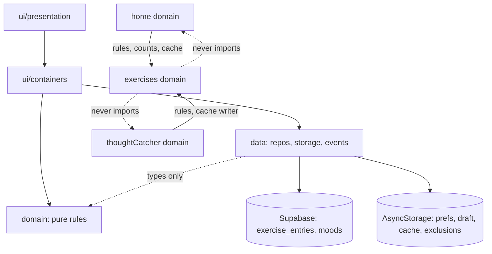
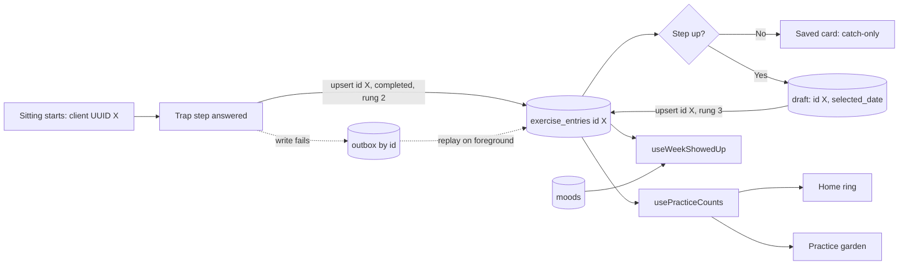

# Architecture Spine — Happy Engagement & Logging

## Design Paradigm

The initiative's domain-oriented layered architecture, in the shape `src/domains/exercises`, `home` and `thoughtCatcher` already use.

| Layer | Directory | Holds |
| --- | --- | --- |
| Presentation | `src/domains/*/ui/presentation` | JSX only; props in, callbacks out |
| Containers | `src/domains/*/ui/containers` | Hooks that gather inputs, call domain rules, call data |
| Domain | `src/domains/*/domain` | Pure functions and types; no React, no I/O, no clock read |
| Data | `src/domains/*/data` | `*.repo.ts` Supabase calls, AsyncStorage adapters, event emitters |



Every time-dependent rule takes `now` as an argument. Domain functions never call `new Date()` or `Math.random()`.

## Inherited Invariants

| Inherited | From parent | Binds here |
| --- | --- | --- |
| AD-2 | `architecture-happy-product-direction` | For standalone exercises an `exercise_entries` row with `status=completed` is the only qualifying practice source. Insights never write back |
| AD-3 | `architecture-happy-product-direction` | One domain-owned write path per durable entity, idempotent on retry; caches invalidated after an acknowledged write |
| AD-7 | `architecture-happy-product-direction` | No reflection text, thought text or free text in analytics or ordinary logs |
| AD-8 | `architecture-happy-product-direction` | A saved state is shown only after the durable write is acknowledged; unsynced work never counts as practice |
| AD-9 | `architecture-happy-product-direction` | Presentation → orchestration → data; no domain imports another domain's UI or persistence |
| Platform | `architecture-onboarding-and-day-0` | iOS only; NativeWind for static styles; tactile button system; haptics convention |

**Conflicts surfaced, not overridden.** Three decisions in `architecture-onboarding-and-day-0` contradict later UX spines or the code as it stands, and need amending at that altitude: AD-8 (XP award on the micro-win), AD-9 (streak flame capsule in `HomeHeader`), and AD-11 (Home preserved as `JournalCalendarScreen`; Home now renders from `src/domains/home`). This spine adds no XP and no streak, and builds on the `src/domains/home` Home.

## Invariants & Rules

### AD-12 — One Thought Catcher runtime [ADOPTED]

- **Binds:** `src/domains/thoughtCatcher`, `src/exercises/thoughtCatcher/config.ts`, `buildExerciseRoute`, Lessons, resume row, assistant, starter path
- **Prevents:** the ladder being built twice, with the Home wizard and the generic exercise flow saving different step ids and completion rules for one `exercise_type`
- **Rule:** `src/domains/thoughtCatcher` is the only runtime that creates or edits a `thought_catcher` entry. `buildExerciseRoute('thought_catcher')` is the single redirect point: it returns `/tabs/screens/thought-catcher` unless `readOnly` is set, in which case the generic flow renders the past entry. Hardcoded generic-flow routes for this type (assistant constants, starter path) are replaced by that call. The generic-flow config for `thought_catcher` never writes. When a sitting was launched with starter-path parameters, the runtime calls the same practice-completion adapter the generic flow calls (`src/domains/practice/data/practiceCompletion.repo.ts`) on its first completed write; a Home-launched sitting writes the entry only, as the generic flow does today. Thought Reframing (rung 4) stays on the generic flow, unchanged.

### AD-13 — A rung is derived, never stored [ADOPTED]

- **Binds:** ladder, saved-card variants, insight readers, analytics
- **Prevents:** a stored rung column drifting from the response it describes, and readers treating a catch as a full record
- **Rule:** `entryRung(entry)` in `src/domains/exercises/domain` is total and is the single definition: completed `thought_catcher` with a trimmed non-empty `balancedThought` → 3; completed `thought_catcher` without one → 2; completed `thought_reframing` → 4; anything else → `null`. A mood log is rung 1 and is not an entry. A catch-only entry is written as `status: 'completed'` with `balancedThought`, `isTrue` and `postIntensity` absent. No column, status value or `schema_version` changes. Readers that compare before and after (`useBeliefDecay`, `useExerciseRecommendation`, `useExerciseTimeline` and its rating extractors) skip entries where `entryRung` is below 3.

### AD-14 — One sitting, one row id, generated on the client

- **Binds:** Thought Catcher save, step-up row, draft, Home paused state, why-sheet Edit
- **Prevents:** a sitting producing two or three completed rows (retry after a lost acknowledgement, upgrade without the id, re-answering after Back), or an `in_progress` row that Practice shows as paused while Home shows it as done
- **Rule:** The runtime generates the entry UUID when a sitting starts and passes it on every write of that sitting; a `thought_catcher` write without an id is forbidden. The first durable write happens when the trap step is answered, as a completed rung-2 row with the existing caught step list. Saving a fair thought upserts the same id with the existing checked step list. `trap` is not a step id. The runtime never writes `in_progress`. A draft (new: AsyncStorage) exists only from the rung-2 write onward and holds the entry id, `selected_date` and unfinished rung-3 input; before the trap step, leaving discards as today. The draft is cleared on rung-3 save, on "That's enough for today", and when a new sitting starts. It does not expire at day end. Editing an old entry reuses its id and its original `selected_date`.

### AD-15 — The trap choice is one additive optional field [ADOPTED]

- **Binds:** `ThoughtCatcherResponse`, trap chips, recall, pattern line, Home card, analytics
- **Prevents:** trap data stored under different keys or enums, or the escape answers being indistinguishable from "not asked"
- **Rule:** `ThoughtCatcherResponse` gains `trap?: TrapChoice`, where `TrapChoice = CognitiveDistortionKey | 'not_sure' | 'none'` is exported with its one label table from `src/domains/exercises/domain`. Absent means the entry predates the trap step. `schema_version` stays 4. The older `TrapType` used by `ReflectionData` maps into `TrapChoice` through one named function in the same folder; no new code switches on `TrapType`. "Most-picked traps" is computed from completed `thought_catcher` rows' `trap` only, excluding the two escapes. No other response field is added, renamed or removed.

### AD-16 — Practice has one predicate and counts have one source [ADOPTED]

- **Binds:** Home weekly ring, lifetime count, Practice stats, garden, week leaf, tone-card trigger, milestone triggers
- **Prevents:** Home and Practice showing different numbers, or ring and garden using different filters
- **Rule:** `countsAsPractice(entry)` in `src/domains/exercises/domain` is the only filter: any `exercise_entries` row of any `exercise_type` whose status is `completed`, or the legacy read-only values `summary` and `checker_completed`. A mood log is never practice. `usePracticeCounts` (key `["practice_counts", userId]`) returns lifetime, this-week and per-topic counts from those rows and is the only source for the ring, the lifetime count, the garden, Practice stats and every "Nth entry" trigger; Home reads it through the hook, never through local state. `useWeekShowedUp` (key `["week_showed_up", userId]`) replaces `useWeekPracticeDays`: a Monday–Sunday local week in which a day is filled by a row that `countsAsPractice` or by a `moods` row. `in_progress` rows fill nothing. `happy.reflections` is never a count source.

### AD-17 — One resolver owns Home's bubble, button and tone card

- **Binds:** Home hero bubble (including the mood reply and return greeting), Home button label and target, tone-card visibility
- **Prevents:** bubble, button and card each deciding "what state is today" separately; two bubbles on one screen; two night windows
- **Rule:** `resolveHomeAsk(inputs, now)` in `src/domains/home/domain` returns `{ bubble, button, toneCard, modifier }` and is the only encoder of the base precedence table, modifiers M1–M6 and the time windows in the UX spine. Its inputs are a typed object assembled by one container hook: install day, gap days, practice counts, today's band, entries saved today, paused draft, session bubble count, step-up declined, help opened this session, Show Happi, tone-card seen. A paused draft wins over "saved today" when the draft's entry id is today's newest saved entry; otherwise "saved today" applies. The bubble lines and the night window in `useHomeScene`, and the mood-reply bubble set from `HomeContainer` local state, are removed in favour of the resolver's output; `useHomeScene` keeps scene and pose only. At most one bubble is returned.

### AD-18 — Mood is stored 1–5; the day's band is derived [ADOPTED]

- **Binds:** check-in, Low-day routing, hard-entry rule, recall eligibility
- **Prevents:** a second mood scale beside `moods.mood_score`, each feature choosing its own "Low" threshold, or disagreeing on which of several logs in a day counts
- **Rule:** The check-in keeps the five chips and keeps writing `moods` through `useEmotionLogger`. `moodBand(score)`: 4–5 good, 3 okay, 2 low, 1 not okay. `bandForDay(moods, localDay)` is the band of the latest row that day with `input_method = 'emotion_logger'`, where a mood's local day is the device-local date of its `selected_date`; no such row means no band. Both live in `src/domains/exercises/domain` and every rule that says Low or Not okay calls `bandForDay`.

### AD-19 — "Hard entry" is computed at save, not stored

- **Binds:** saved-card variant, Happi expression, haptic, analytics case
- **Prevents:** a persisted label on a person's entry, and builders using different triggers
- **Rule:** `isHardEntry({ trap, intensity, post, bandToday })` is true when the band is low or not okay, or `trap === 'none'`, or `post` is set and `post >= intensity`. `post` is the draft's raw after-rating and may be null; the payload omits `postIntensity` when it was not set. The result goes to the saved card and the event and is never written to any store.

### AD-20 — Recall reads saved entries; exclusions stay on the device

- **Binds:** recall chip, why sheet, Forget
- **Prevents:** recalled text reaching analytics or a new table, a Low-day sentence resurfacing, or Forget deleting an entry
- **Rule:** One repo function in `src/domains/exercises/data` returns the recall candidate: the newest entry with `entryRung` 3 and the same `trap`, skipping ids in the local exclusion set and skipping entries whose `selected_date` has a low or not-okay `bandForDay`. That function owns the moods lookup for the candidates it checks. Forget adds the entry id to the exclusion set and changes nothing in Supabase. Recall never reads `coping_cards`. Recalled text is never an event property.

### AD-21 — Rotation is a pure function with named inputs

- **Binds:** ask lines, stems, examples
- **Prevents:** stored rotation history, lines changing on re-render, and builders choosing different ordinals
- **Rule:** `pickAskLine(localDate, firstOpenDate, window)` and `pickStems(entryOrdinal)` index their pools arithmetically so the no-repeat rules hold by construction; the monthly pool swap is derived from `localDate`. `entryOrdinal` is the count of rung-3 entries before this sitting. `firstOpenDate` comes from one preference key written on first launch. Days 1–5 return the fixed line. The only other stored rotation state is the local date the ask bubble was last shown.

### AD-22 — Client-only preferences are namespaced, versioned and unsynced

- **Binds:** tone, ask-shown date, first-open date, tone-card-seen, recall exclusions, Thought Catcher draft, reflection cache
- **Prevents:** more ad-hoc key styles, and one builder syncing a preference another reads locally
- **Rule:** New keys use `@happy/<name>_v1` and are read and written through one adapter file per domain in `data/`. They are device-local. Clearing storage leaves a valid default: Gentle tone, no exclusions, no draft. The existing `happy.reflections` cache keeps its key but each record gains the entry id and is written by replace-by-id through one function in `src/domains/home/data`, called once per write; it is the source for the Home reflection card, "saved today" and recent-thought chips.

### AD-23 — Logging copy uses i18n keys, with tone as i18next context

- **Binds:** ask lines, button labels, step-up row, trap definitions, saved-card lines, empty-state lines
- **Prevents:** more hardcoded English in domain files, Plain implemented as scattered conditionals, and a wrong-language fallback
- **Rule:** Every new user-facing string is a key in the `exercises` or `home` namespace of `src/locales`, added to `en` at least. Tone is passed as i18next context: `t(key, { context: tone })` with `plain` the only context value, so a Plain variant is the key `<key>_plain` and i18next's own fallback returns the base key in the user's language. No helper concatenates suffixes. A line that Plain drops is decided in the domain rule that picks the line, not by an empty string.

### AD-24 — One saved event per sitting, from one module

- **Binds:** all new analytics in the ask, ladder, save, recall and tone paths
- **Prevents:** event names drifting between call sites, rung-2 saves double-counted for people who step up, and free text reaching PostHog
- **Rule:** New events are functions in `src/domains/exercises/data/loggingEvents.ts`; call sites do not call `posthog.capture` for them. One `entry_saved` event is emitted per sitting, when the saved card is shown, carrying the entry id, final rung, trap choice, hard-entry flag and sync state; the intermediate rung-2 write emits nothing. Property types admit only enums, numbers, booleans and ids. `rung` uses this spine's numbering (1–4).

### AD-25 — An entry's day is `selected_date`, written once

- **Binds:** ring, lifetime and weekly counts, week leaf, garden, "saved today", Low-day exclusion, look-backs
- **Prevents:** one entry landing in different days or weeks for different features, and an edit or upgrade moving an old entry into this week
- **Rule:** `selected_date` (local `YYYY-MM-DD`) is set at a row's first write and never changed by an upgrade or edit. Every day or week rule buckets on it. `created_at`, `updated_at` and `completed_at` are never used for day or week membership.

### AD-26 — A failed save is queued, shown as unsynced, and never counted

- **Binds:** Thought Catcher save, saved card, ring, garden
- **Prevents:** a swallowed failure shown as saved, a ring that moves for work that never reached the server, or a queued entry lost at day end
- **Rule:** When a `thought_catcher` write fails, its payload stays in an outbox (new: AsyncStorage, in `src/domains/thoughtCatcher/data`) keyed by entry id; a later payload for the same id replaces it. The outbox is replayed through `useExerciseMutation` when the app next comes to the foreground with a signed-in user, and is never cleared by time. The saved card receives `sync: 'synced' | 'queued'`; when queued it shows the unsynced line and does not animate the ring or count. Counts move only after `usePracticeCounts` refetches an acknowledged row. With no user id the write is queued, not thrown away.

## Consistency Conventions

| Concern | Convention |
| --- | --- |
| Naming | Rule functions are verbs on nouns (`entryRung`, `countsAsPractice`, `bandForDay`, `isHardEntry`, `resolveHomeAsk`). Repos end in `.repo.ts`. Event names lower_snake_case |
| Query keys | Inline array literals, first element lower_snake_case, second the user id |
| Invalidation | `useExerciseMutation` and `useEmotionLogger` both invalidate `["practice_counts"]` and `["week_showed_up"]` in addition to their existing lists |
| Belief values | Stored as `intensity` and `postIntensity`, 0–10. Any bucketed display is derived |
| Time | Local day is the device timezone at write time; rules receive `now` |
| Tests | Each new domain rule ships one co-located Jest test with a table of cases. No domain tests exist yet; the first ticket adds the setup |

## Stack

Resolved from the lockfile on 2026-11-15, not re-verified on the web. The repo has two modified lockfiles and a deleted `bun.lock`; settling on one is outside this spine.

| Name | Version |
| --- | --- |
| Expo | 58.0.24 |
| React Native | 0.88.1 |
| React | 19.3.0 |
| Expo Router | 58.0.31 |
| TanStack Query | 5.107.1 |
| Supabase JS | 2.119.0 |
| React Native Reanimated | 4.7.1 |
| AsyncStorage | 2.2.0 |
| i18next / react-i18next | 26.7.2 / 17.1.13 |
| PostHog React Native | 4.86.0 |
| NativeWind | 4.2.7 |
| TypeScript | 6.0.3 |
| Jest | 30.5.2 |

No new dependency is added.

## Structural Seed

Names marked new do not exist yet.

```text
src/domains/
  exercises/
    domain/          # new: entryRung, countsAsPractice, moodBand, bandForDay, isHardEntry, TrapChoice, pickStems
    data/            # new: practiceCounts.repo, recall.repo, loggingEvents, prefs adapter
    ui/containers/   # new: usePracticeCounts, useWeekShowedUp
  home/
    domain/          # new: resolveHomeAsk, pickAskLine (folder is empty today)
    data/            # reflectionsStorage (replace-by-id), new prefs adapter
  thoughtCatcher/
    domain/          # steps: adds trap step and step-up
    data/            # buildEntryPayload (adds trap, omits unset postIntensity), new draft and outbox adapters
```



## Capability → Architecture Map

| Capability / Area | Lives in | Governed by |
| --- | --- | --- |
| Daily ask, Home modifiers, tone card | `src/domains/home/domain`, `HomeContainer` | AD-17, AD-21, AD-23 |
| Effort ladder, rungs 2–3 | `src/domains/thoughtCatcher` | AD-12, AD-13, AD-14, AD-15, AD-26 |
| Rung 1 check-in | `useEmotionLogger`, `moods` | AD-18 |
| Rung 4 reframe | generic exercise flow | AD-13 |
| Saved-card variants | `SavedReflectionCard` (onboarding domain UI, reused) | AD-13, AD-19, AD-26 |
| Recall chip and why sheet | `src/domains/exercises/data`, `thoughtCatcher` UI | AD-20, AD-22 |
| Week leaf, ring, garden | `src/domains/exercises/ui/containers` | AD-16, AD-25 |
| Happi tone | prefs adapter, i18n context | AD-22, AD-23 |
| Measurement | `loggingEvents.ts` | AD-24, inherited AD-7 |

## Deferred

- **Distressed variant and "I'm struggling" route.** Not built in code (`crisisActive` is hardwired false). Owned by the onboarding and Day-0 scope. Until it ships, a not-okay band opens the existing help sheet and `resolveHomeAsk` returns no bubble.
- **Onboarding's first reflection.** It is saved only to AsyncStorage, so it is not practice under AD-16 and the count reads 0 after onboarding. Owned by onboarding: either write one completed row through the AD-12 runtime's data function, or keep first-visit copy free of a count. Reopen before the ring ships on Home.
- **Guest write access.** No RLS policy for `exercise_entries` is visible in the repo's migrations, so whether an anonymous user can write these rows is unverified. Verify against the hosted project before release.
- **Check-in chip labels.** The five chips stay (decided 2026-11-15); the UX spines still describe four and need that wording corrected.
- **Where the shared saved card lives.** `SavedReflectionCard` sits in the onboarding domain and is reused as is; move it only when a second domain needs to change it.
- **Outbox for other exercises.** AD-26 covers `thought_catcher` only; the generic flow keeps its current failure behaviour.
- **Syncing preferences and recall exclusions across devices.** Device-local until multi-device use is scoped.
- **Removing the generic-flow Thought Catcher config.** Kept for read-only history.
- **Feature flags and staged rollout.** No flag system exists; the experiment backlog needs one. Reopen before the first experiment.
- **Low-day follow-up row.** Parked by the product owner (2026-11-15); `resolveHomeAsk` returns no bubble after a low band.
- **Editing a past entry in the wizard.** Not built; the why sheet opens the entry read-only.
- **Server-side reflection engine.** `daily.service.ts` reads today's entries with no status filter. Unchanged; reopen if it starts counting practice.
- **Environments, promotion, secrets, rollback.** Inherited from the initiative spine's Operational Envelope. This feature adds no migration, function or secret.
