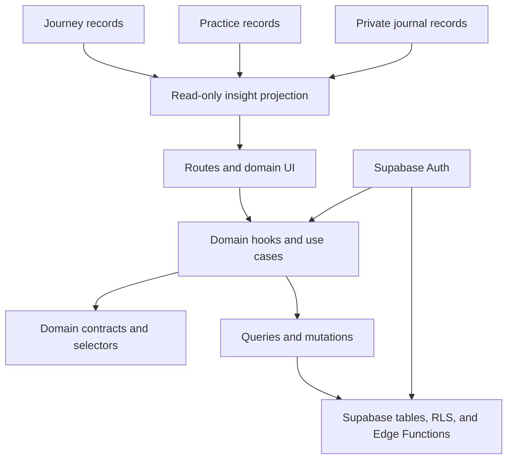
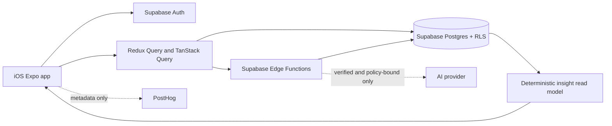

# Architecture Spine — Happy Product Direction

## Design Paradigm

Happy uses a domain-oriented layered architecture with client orchestration and server-owned durable data.

- Presentation: Expo Router routes, screens, and domain UI under `app/` and `src/domains/*/ui`.
- Domain orchestration: domain hooks, use cases, selectors, and contracts under `src/domains/*`, `hooks/`, and `src/hooks/`.
- Data access: typed query and mutation boundaries using the existing Redux Toolkit Query, TanStack Query, and Supabase clients.
- Persistence and privileged work: Supabase Auth, Postgres tables with RLS, and Edge Functions.
- Cross-cutting concerns: auth context, store providers, localization, analytics, error handling, and observability.

The client coordinates the user journey. Supabase owns durable records and privileged transitions. No new central workflow backend is introduced for this initiative.

## Invariants & Rules

### AD-1 — Preserve one identity from anonymous start to sign-up

- **Binds:** CAP-1 through CAP-6; auth, progress, practice, journal, and insight records
- **Prevents:** anonymous work being stranded, duplicated, or silently moved to a second account when a user signs up
- **Rule:** Every new session begins as a Supabase anonymous user when anonymous auth is available. Durable rows use that user's `auth.users.id`. The auth boundary exposes `auth_ready`, `profile_ready`, and `identity_ready` separately; domain reads and local replay wait for `identity_ready`. The provider-owned state machine is monotonic within a session: `cold -> auth_ready -> profile_ready -> identity_ready`, or `recovery_required`/`failed`; it emits `identity_ready` only after the current session user and profile row are hydrated. Claiming an account links the provider identity to the current anonymous user and returns `IdentityLinkResultV1` with the exact status union `linked | recovery_required | cancelled | retryable_failure | failed`, the anonymous/effective user ids, an operation id, and a retryable flag. `retryable` is true only for `retryable_failure`; normal `linked` requires `effective_user_id == anonymous_user_id`. A provider/session id mismatch blocks replay and reads. If the provider already belongs to another account, stop with `recovery_required` and present an explicit existing-account recovery path; never silently merge, replace, or delete data.

### AD-2 — Each domain owns one canonical durable model

- **Binds:** journey, practice, journal, and insights domains
- **Prevents:** multiple features writing incompatible versions of the same progress, practice, or reflection data
- **Rule:** The initiative uses the v5 course hierarchy `courses -> sections -> units -> nodes` as the canonical journey model. Journey progress is `user_course_progress` plus the v5 node-progress/attempt/response model (`user_node_progress`, `node_attempts`, and `user_node_responses`) after the schema/function mismatch is reconciled. The legacy `journey_templates` model is read-only compatibility input; new work must not write it, and its retirement follows the v5 migration gate. Practice owns a persisted normalized `PracticeCompletionV1`: `{ practice_session_id, user_id, path_id?, path_version?, practice_ref, source_kind, source_id, completion_kind, completed_at, evidence_key, schema_version }`. For v5, the only qualifying completion evidence is a submitted `user_node_responses` record that satisfies the node's required-response resolution; `user_node_progress` is a derived summary and `node_attempts` is not completion evidence. For standalone exercises, a stable `exercise_entries` row with `status=completed` is the qualifying source. One acknowledged Practice completion transaction upserts one normalized projection and one versioned completion event; the projection is deduplicated by `practice_session_id`, while source ids remain traceability fields. Journal owns private reflections in `journal_records`, with `journal_reflection_lineage` as the required one-to-one guided-context store keyed by `journal_record_id`; `journal_ai` and `moods` are related by the canonical journal id. `journal_entries` is legacy compatibility input only: reads are limited to pre-cutover rows through an adapter, new writes are forbidden, and the adapter is removed after backfill verification. Insights are read-only projections over these canonical outputs and never write back to them.

### AD-3 — Durable mutations have one domain-owned write path

- **Binds:** all user-created or user-progress data
- **Prevents:** optimistic client state becoming a second source of truth or two mutation paths disagreeing about completion
- **Rule:** A durable mutation crosses the owner and boundary named in the entity matrix below, includes the authenticated user context, carries an idempotency key for retryable completion, returns an explicit saved/completed result, and invalidates or refreshes the named client cache. Redux and TanStack Query may render optimistic state but cannot authoritatively persist records independently. Practice creates one stable `practice_session_id` when a practice starts; retries and attempt rows may change, but the normalized completion keeps that session id. For an acknowledged completion, the owner transaction commits the normalized projection and its versioned completion event together; the Insights projector consumes that event idempotently and reports `projection_pending` until its cursor includes the completion. Immediate post-practice feedback is source-confirmed and does not imply that the Insights read model is current. Existing direct Supabase calls are legacy exceptions; new initiative code uses the owner boundary and migrates a legacy caller before reusing its entity.

### AD-4 — Cross-domain progress uses an explicit StarterPath contract

- **Binds:** CAP-1, CAP-2, CAP-3, and CAP-5
- **Prevents:** lesson-to-practice-to-reflection routing drifting because builders infer relationships from translated labels, screen paths, or catalog order
- **Rule:** The first loop uses `StarterPathV1`: `{ path_id, path_version, goal_id, course_id, lesson_node_id, practice_ref, reflection_prompt_id, next_action }`. `lesson_node_id` always identifies a v5 node whose type is `lesson`; `practice_ref` is `{ source: "course_node" | "exercise_catalog", id }`; `next_action` is the closed union `{ kind: "lesson" | "practice" | "reflection" | "insight", target_id, path_id, reason_code }`. Journey is the path/version authority. `StarterPathProgressV1` is physically persisted in Journey-owned `user_starter_path_progress`, keyed by `(user_id, path_id, path_version)`, with `status`, `last_completed_step`, `next_action`, `revision`, and `updated_at`; `user_preferences.active_path_id` is the only active-path pointer. Switching and completion use a Journey-owned serialized mutation with compare-and-swap on `revision`, so completion cannot overwrite a concurrent path switch. Downstream domains emit `PathStepCompletedV1` events; only Journey updates the shared next action. Each event contains `{ event_id, user_id, path_id, path_version, step_kind, step_id, source_kind, source_id, practice_session_id, occurred_at, idempotency_key, causation_id, schema_version }`; duplicate event ids or idempotency keys are no-ops, and events for an unselected immutable path version update only that path's preserved progress.

### AD-5 — Insights use an evidence ladder, not premature pattern claims

- **Binds:** CAP-4, insight screens, post-practice feedback, and insight analytics
- **Prevents:** generic or overconfident mental-health conclusions from sparse data, and a blank product that gives users no immediate reward
- **Rule:** Every insight type declares a readiness state and its source data through `InsightObservationV1`: `{ observation_id, user_id, source_type, source_id, practice_session_id, insight_family, evidence_key, observed_at, local_date, timezone_epoch, schema_version, metrics }`. `insight_family` comes from a versioned registry whose entry defines the required metric keys, allowed nulls, validation, and readiness eligibility; invalid or incomplete metrics are excluded from threshold counts. `observation_id` is the deterministic hash of `(source_id, insight_family)` and is protected by a unique constraint on `(source_id, insight_family)`; projection retries upsert the same observation and schema-version recalculation updates it in place rather than appending a duplicate. `schema_version` identifies the projection schema and does not create a second observation. One completed practice can create at most one observation per insight family; duplicate retries use the same `practice_session_id` and are deduplicated. `evidence_key` has the grammar `<insight_family>:<path_id>:<path_version>` and is derived from the immutable StarterPath contract, so switching paths does not combine unrelated evidence. Immediate feedback describes only the current completed session. An activity summary unlocks after 3 distinct completed practice sessions in a rolling 7-day window. A pattern insight unlocks after at least 5 relevant observations across at least 3 distinct user-local calendar days in a rolling 30-day window. Insight time uses a per-user `InsightTimeContextV1`: the first structured observation pins a valid IANA timezone and increments a timezone epoch; an explicit timezone reset starts a new epoch without rewriting old observations. Windows are half-open `[start, end)`, calculated from UTC instants using that epoch's IANA timezone; DST is delegated to the timezone library, and invalid timezone input falls back to UTC while keeping the pattern ineligible until a valid context exists. Pattern output includes the observation count, active-day count, time window, and an emerging-pattern explanation; it makes no diagnosis, causal claim, or treatment recommendation. If a threshold is not met, show insufficient data rather than an invented insight.

### AD-6 — First insights are deterministic and source-transparent

- **Binds:** CAP-4 and the first pattern insight implementation
- **Prevents:** opaque AI interpretation becoming the product's required source of truth or exposing free-text reflections before privacy behavior is verified
- **Rule:** The first pattern insight is calculated by the Insights read-model owner from `InsightObservationV1` using deterministic rules. Existing AI narratives and timeline summaries are compatibility surfaces, not evidence sources for the new contract. Free-text AI narratives are optional deferred work, require verified processing and safety behavior, and cannot gate the core insight surface.

### AD-7 — Sensitive reflections stay private and out of ordinary telemetry

- **Binds:** CAP-3, CAP-4, journal records, voice/photo inputs, AI processing, and analytics
- **Prevents:** accidental disclosure of health-adjacent content through logs, analytics, public features, or unverified processing
- **Rule:** Reflection content is private by default and scoped by `auth.uid()` through database access policies. Analytics and ordinary logs contain event metadata only, never reflection text, audio, photos, or raw AI prompts. The first CAP-3 slice supports verified text reflection only; voice and photo inputs remain unavailable or visibly gated until their deferred privacy and retention gates pass. A guided reflection must carry `ReflectionContextV1`: `{ path_id, path_version, practice_session_id, practice_ref, reflection_prompt_id, journal_record_id, source: "guided", schema_version }`, persisted in the Journal-owned one-to-one `journal_reflection_lineage` store with a required non-null guided context. Standalone journaling uses `source: "standalone"` and cannot satisfy the guided path step. Journal writes acknowledge the canonical `journal_records` row and required lineage atomically; `journal_ai` and `moods` are optional asynchronous children, and a `journal_records` row without its required lineage is not eligible as guided evidence. Deleting a journal aggregate deletes its lineage and child rows within the same ownership boundary. The only approved sensitive-processing boundary is a server-side, policy-gated reflection service; new initiative code must not call a model directly from the client. Before any AI or transcription capability is enabled, the release must verify consent/disclosure, redaction, retention, deletion, high-risk handling, and log redaction. Existing client AI and server content-preview logging are legacy paths that cannot be used by the new core loop until that gate passes.

### AD-8 — Saved and unsynced states are distinct

- **Binds:** anonymous sessions, journal drafts, practice completion, and progress recovery
- **Prevents:** users believing work is safe when it exists only in memory, or unsynced drafts being counted as completed data or insight evidence
- **Rule:** The UI shows a saved or completed state only after the durable write is acknowledged. Local drafts use `UnsyncedOperationV1` with `{ operation_id, entity_type, local_user_id, payload_version, created_at, attempt_count, state, depends_on }`; `local_user_id` is always the current Supabase UUID, never a device or guest id. The auth boundary owns replay after `identity_ready`, ordered by `(created_at, operation_id)` within a user and constrained by explicit `depends_on` edges. A failed operation stalls only its dependents; unrelated operations may continue. A replay batch acknowledges an operation only when its owner-defined aggregate boundary is complete, and returns `projection_pending` when a downstream read model is not yet current. Replay either acknowledges, retries with backoff, or moves to a visible recovery state. A provider identity conflict pauses replay and keeps the data attached to the anonymous user until the user chooses recovery. Unsynced content cannot feed insights or count as completed practice/reflection.

### AD-9 — Dependency direction stays one-way

- **Binds:** all independently built units in this initiative
- **Prevents:** screens reaching into another domain's persistence, insights becoming a mutation layer, or data providers importing presentation concerns
- **Rule:** Presentation depends on domain orchestration; domain orchestration depends on domain contracts and data access; data access depends on auth and persistence adapters. Insights may read canonical domain outputs but no domain imports insight UI or insight mutation logic. This rule governs all new initiative code. Existing direct-Supabase screens and hooks are named legacy exceptions with an owning epic and retirement gate; they are not patterns for new work.



## Consistency Conventions

| Concern | Convention |
| --- | --- |
| Naming | Use stable domain identifiers such as `goal_id`, `course_id`, `node_id`, `practice_id`, `reflection_id`, and `insight_id`. Use lower-snake-case for persisted fields and analytics event names; display labels never act as identifiers. |
| Data and formats | Store timestamps as ISO 8601 UTC. Scope durable rows with `user_id` and enforce ownership with RLS. Version response payloads when their meaning changes. Every pattern insight carries `window_start`, `window_end`, `timezone_epoch`, `observation_count`, `active_day_count`, and `readiness_state`. |
| State and mutation | Use the existing Redux Toolkit Query or TanStack Query boundary for reads and domain mutations. Return explicit loading, saved, unsynced, insufficient-data, and error states. Invalidate related caches after acknowledged writes. |
| Auth and identity | Read the current Supabase user from the auth boundary. Anonymous and identified users use the same user-id contract. Never key durable product data by email, provider id, device id, or a local guest id. |
| Analytics and logs | Track funnel metadata such as goal, lesson, practice, reflection, readiness state, and counts. Redact reflection text, audio, photos, AI prompts, and health-adjacent free text from analytics and ordinary logs. |
| Health language | Use observed, time-bounded, non-diagnostic language. Never convert a streak, score, subscription, or insight into evidence of clinical benefit. |

### Entity ownership and mutation matrix

| Entity / projection | Canonical store | Owner and write boundary | Read/cache rule |
| --- | --- | --- | --- |
| Course and node progress | `user_course_progress`, `user_node_progress`, `node_attempts`, `user_node_responses` | Journey; v5 course/progress mutation boundary after schema reconciliation | Journey query cache owns refresh; legacy `journey_templates` is compatibility read-only |
| Practice completion | `PracticeCompletionV1` over v5 node responses or `exercise_entries` | Practice; one completion adapter with idempotent `practice_session_id` and source id | Practice and Insights consume the normalized projection; raw stores are not joined ad hoc |
| Guided path and next action | `user_starter_path_progress` keyed by `(user_id, path_id, path_version)` plus `user_preferences.active_path_id` | Journey; only Journey mutates `next_action`, path revision, and active-path state through the serialized path mutation | Home/journey read the same versioned projection |
| Private reflection | `journal_records` plus one-to-one guided lineage owned by Journal; `journal_ai`/`moods` by canonical journal id | Journal; one journal repository/server boundary | Journal reads `journal_records`; legacy `journal_entries` only through a bounded pre-cutover adapter |
| Insight evidence and readiness | `InsightObservationV1` read model | Insights; read-only projection from canonical sources | Insights owns readiness calculation and cache invalidation; it never writes source records |

## Stack

| Name | Version |
| --- | --- |
| Expo | 56.0.12 |
| React Native | 0.85.3 |
| Expo Router | 56.2.11 |
| React | 19.2.3 |
| Redux Toolkit | 2.11.2 |
| TanStack Query | 5.90.4 |
| Supabase JS | 2.75.0 |
| TypeScript | 6.0.3 |
| Supported platform | iOS 26+ initiative target; current native targets require reconciliation before release |

## Structural Seed

```text
app/
  tabs/                         # Expo Router entry points and navigation surfaces
src/domains/
  journey/                      # course catalog, path selection, progress, journey UI
  timeline/                     # timeline/read-model presentation and mutations
src/hooks/
  insights/                     # read-only insight projections and readiness logic
  ...                           # existing shared data and feature hooks
hooks/
  data/                         # existing authenticated data queries and mutations
  journals/                     # private journal queries and operations
supabase/
  migrations/                  # durable schema and RLS
  functions/                   # privileged transitions and server-side processing
src/network/
  auth/                         # Supabase auth and identity linking
  ...                           # external data adapters
```



## Operational Envelope

- **Environments:** Local development uses local Supabase configuration and synthetic data. Preview/TestFlight uses an isolated hosted Supabase project. Production App Store builds use the protected production project. Anonymous users and real journal content must not be used in local or preview fixtures without an explicit data policy.
- **Promotion:** Apply schema/RLS migrations before deploying compatible Edge Functions, then ship the client. Seeds are versioned and non-destructive. Every function change remains compatible with the currently released client until rollout completes.
- **Secrets:** Supabase secrets and EAS environment configuration hold provider keys. Sensitive AI and transcription keys are server-side only; no new sensitive-processing path uses a public client key. A production release is blocked if an Edge Function contains a hardcoded service-role or provider credential; secrets must be externalized, rotated when exposed, and verified in the deployed environment.
- **Release gates:** Verify applied hosted migrations, RLS isolation for two user identities, monotonic anonymous-to-identified linking and replay behavior, canonical practice completion projection/deduplication, guided reflection lineage, journal deletion behavior, insight readiness thresholds/timezone behavior, and redacted logs before CAP-3, CAP-4, or CAP-6 is released. Existing legacy Edge Functions with embedded or fallback service-role credentials are an explicit production blocker: revoke/rotate exposed credentials, externalize secrets, and pass a repository/configuration scan plus hosted verification before promotion. The first CAP-3 release must be text-only with verified boundary copy; voice/photo and automated high-risk interpretation stay disabled until the named safety/privacy gates are accepted. Reconcile the native iOS deployment target with the iOS 26+ initiative constraint before claiming the supported platform.
- **Observability:** Track metadata-only auth, completion, save, replay, readiness, and function-error events. The release/on-call owner monitors Edge Function failures and RLS/auth regressions; the privacy/safety owner reviews sensitive-processing incidents.
- **Retention and deletion:** The data/privacy owner must define and verify retention, deletion, backup, and restore behavior for `journal_records`, `journal_ai`, moods, practice evidence, and unsynced drafts before enabling AI, voice, photo, or pattern processing that uses those records.
- **Rollback:** App rollback cannot undo an applied migration. Use additive, forward-compatible schema changes, reversible feature gates, and function versions that tolerate the previous client during rollout.

The operational boundary is Supabase plus the iOS Expo client. AI processing remains an optional external boundary and is not required for the core Learn → Practise → Journal → Insight loop.

## Capability → Architecture Map

| Capability / Area | Lives in | Governed by |
| --- | --- | --- |
| CAP-1 — goal-led lesson | onboarding/personalization and `src/domains/journey` | AD-4, AD-5, AD-9 |
| CAP-2 — guided practice | journey handoff and exercise runtime | AD-3, AD-4, AD-8 |
| CAP-3 — private reflection | journal routes, journal hooks, and canonical `journal_records` | AD-1, AD-2, AD-3, AD-7, AD-8 |
| CAP-4 — personal insight | `src/hooks/insights`, insight components, and read models | AD-2, AD-5, AD-6, AD-7 |
| CAP-5 — resume and switch | journey state, course progress, and identity continuity | AD-1, AD-3, AD-4, AD-8 |
| CAP-6 — boundaries and safety | shared copy, auth/data boundaries, and insight/reflection surfaces | AD-1, AD-6, AD-7, AD-9 |

## Deferred

- Exact first goal, lesson, practice, and reflection prompt; Epic 1 chooses the first StarterPath bundle. Reopen when the bundle is selected; the bundle must conform to `StarterPathV1`.
- Legacy journey and journal reconciliation; Journey owns the v5 migration adapter and Journal owns the `journal_entries` read adapter. Reopen before the first dependent epic writes or reads a new source; exit when one canonical read/write path and a retirement or backfill marker are verified. Existing legacy Edge Functions with hardcoded or fallback service-role credentials remain blocked from production until rotation, externalization, and scan/host verification pass.
- Full offline conflict resolution and multi-device draft merging; the auth/data owner reopens this only when offline creation or multi-device support is explicitly scoped. `UnsyncedOperationV1` remains the minimum behavior.
- Voice and photo reflection processing; Journal/data privacy owner reopens after capability, retention, deletion, transcription, and user-facing disclosure are verified. The first CAP-3 slice is text-only; these modalities are unavailable or visibly gated before that evidence exists.
- Free-text AI narratives; Insights/data privacy owner reopens after server-only processing, redaction, consent, high-risk handling, and retention gates pass.
- High-risk content handling and professional-care signposting; safety owner reopens before any automated interpretation of sensitive text is enabled. Boundary copy and safety review are release-blocking for CAP-6 even when the deterministic core loop remains non-diagnostic.
- Numeric activation, retention, conversion, and insight-quality targets; product owner reopens after baselines exist.
- A new central workflow backend; architecture owner reopens only if Supabase domain boundaries cannot provide the required idempotent transitions.
- Native platform alignment; release owner reopens before the first iOS 26+ release because current Podfile/Xcode deployment targets are lower.
