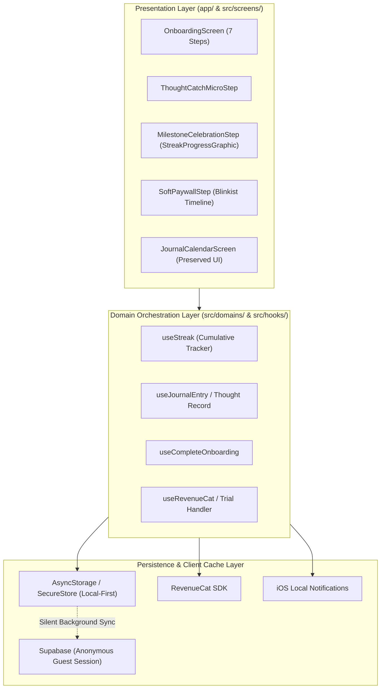

# Architecture Spine — Happy Onboarding & Day-0

## Design Paradigm

Happy Onboarding & Day-0 adheres to the initiative's domain-oriented layered architecture with client orchestration and local-first execution.

* **Presentation**: Expo Router routes under `app/tabs/screens/(onboarding)/premium-onboarding.tsx` and `app/tabs/(tabs)/home/index.tsx`. Reusable step components under `src/screens/OnboardingScreen/steps/`.
* **Domain Orchestration**: Local hooks (`useStreak`, `useCompleteOnboarding`, `useRevenueCat`) manage step state, haptics, and cached projections.
* **Data Access & Local Cache**: Local storage (`AsyncStorage`) acts as the immediate write substrate for Day-0; durable sync to Supabase occurs asynchronously.
* **Platform Invariant**: Exclusively iOS 26+ native app. Zero Android or web legacy branches.

## Inherited Invariants

| Inherited | From Parent Spine | Binds Here |
| :--- | :--- | :--- |
| **AD-1** | `architecture-happy-product-direction` | Preserve one identity from anonymous start to sign-up via Supabase anonymous user. Day-0 users enter as anonymous guests without blocking registration. |
| **AD-2** | `architecture-happy-product-direction` | Canonical durable models for progress, practice, and journal. Practice completion owns normalized `PracticeCompletionV1`. |
| **AD-3** | `architecture-happy-product-direction` | Single domain-owned write path with idempotency keys. Optimistic client mutations write local cache first with durable background sync. |
| **AD-4** | `architecture-happy-product-direction` | Cross-domain `StarterPathV1` contract for lesson/practice/reflection routing. Home tab anchors to Lesson 1 of `StarterPathV1`. |

## Invariants & Rules

### AD-7 — 7-Step Sequence State Machine & Hydration Contract [ADOPTED]

- **Binds:** `OnboardingScreen`, `OnboardingStepRenderer`, `constants.ts`, `types.ts`, `premium-onboarding.tsx`
- **Prevents:** Step state divergence, race conditions where steps load out of order, or premature network blockers before value delivery.
- **Rule:** The onboarding sequence is strictly fixed to 7 sequential steps:
  1. `welcome` (Path canvas hero)
  2. `quiz_motivation` (1-tap single select)
  3. `building_journey` (2.4s Harvard labor loader)
  4. `thought_catch_micro` (30s CBT micro-win)
  5. `milestone_celebration` (Day 1 streak flame + habit row)
  6. `notification_permission` (Finch preview + quiet schedule)
  7. `soft_paywall` (Blinkist 3-node timeline)
  
  State is coordinated via `currentStepIndex` (0 to 6) in `OnboardingScreen.tsx`. Supabase anonymous authentication must be initialized in the background on app launch; reaching Step 7 or dismissing the paywall immediately writes `has_completed_onboarding: true` to local storage and executes `router.replace('/tabs/(tabs)/home')`. Re-opening the app checks local storage and directly renders the Home tab. Zero forced account registration bottom sheets on Day 0.

### AD-8 — Thought Catch Micro-Win Local-First Mutation & XP Award [ADOPTED]

- **Binds:** `ThoughtCatchMicroStep.tsx`, `useJournalEntry`, `useUserProfile`
- **Prevents:** Network latency or dropped connections stalling the micro-win, and duplicate XP grants on step replay.
- **Rule:** Step 4 operates local-first. Selecting a distortion chip (`anxiety`, `mood`, `stress`, `sleep`) immediately transitions the UI, reveals the Reframed Reality card, and fires `Haptics.impactAsync(Medium)`. The reframed thought record and `+10 XP` award are committed to local cache with idempotency key `thought_micro_${anonymous_user_id}`. Network persistence to `journal_records` and `user_profiles` is dispatched as a non-blocking background queue. Failure to reach Supabase never blocks user progression to Step 5.

### AD-9 — Unbreakable Cumulative Streak Ignition & Component Reuse [ADOPTED]

- **Binds:** `MilestoneCelebrationStep.tsx`, `src/components/Streak/StreakCelebration.tsx`, `useStreak.ts`, `HomeHeader.tsx`
- **Prevents:** Abstinence Violation Effect (users churning when streaks reset to zero) and visual divergence between onboarding and production components.
- **Rule:** Step 5 MUST reuse the existing, clean, production-grade `<StreakProgressGraphic />` from `@/src/components/Streak/StreakCelebrationParts.tsx`. No diagonal layouts or custom UI reinventions. Tapping "LOCK IN DAY 1 STREAK" sets `currentStreak = 1` and updates `weeklyProgress.days[todayIndex] = true` in local storage. Streaks in Happy are cumulative counters of active habit days; missed days pause the counter and NEVER reset it to zero. The local cache is written synchronously before transitioning to Step 6, guaranteeing `HomeHeader` displays `🔥 1 Day` instantly upon landing on Home.

### AD-10 — Soft Paywall Bypass & Anonymous RevenueCat Attribution [ADOPTED]

- **Binds:** `SoftPaywallStep.tsx`, `useRevenueCat.ts`, iOS local notification scheduler
- **Prevents:** Users trapped behind a commercial paywall, lost subscription entitlements during anonymous-to-authenticated linking, and missed trial renewal reminders.
- **Rule:** Step 7 renders the Blinkist 3-node transparent timeline. The prominent 44x44pt top `✕` dismiss button and the secondary text button *"No thanks, explore free first"* immediately dismiss the paywall and route the guest to `/tabs/(tabs)/home`. When a user starts a trial:
  1. The RevenueCat SDK associates the purchase with the active anonymous Supabase user ID via `Purchases.logIn(anonymousUserId)`.
  2. Starting a trial immediately schedules a local iOS notification for `now + 5 days at 10:00 AM` (48 hours before billing) with body: *"Your Happy free trial wraps up in 2 days. Manage or cancel anytime in Settings."*
  3. Dismissing the paywall flags `updateTrialStarted(false)` and routes to Home with zero penalty or blocking dialogs.

### AD-11 — Home Screen UI Preservation & Hydration Invariant [ADOPTED]

- **Binds:** `app/tabs/(tabs)/home/index.tsx`, `src/screens/JournalCalendarScreen/JournalCalendarScreen.tsx`, `HomeHeader.tsx`, `FeaturedPromptCard.tsx`, `EmotionLogger.tsx`, `StarterPathNextActionCard.tsx`
- **Prevents:** Unprompted visual redesigns, regression of existing features, or jarring user surprises on first landing.
- **Rule:** The existing `JournalCalendarScreen` is preserved intact. Landing on `/tabs/(tabs)/home` displays the established production hierarchy:
  1. Header toolbar with capture (`+`) and settings gear.
  2. `HomeHeader` displaying greeting and the `🔥 1 Day` streak capsule (tappable to open `StreakDisplay`).
  3. Section 1 (Hero): `FeaturedPromptCard` for Today's Reflection.
  4. Section 2 (Check-in): `EmotionLogger` for 1-tap mood logging.
  5. Section 3 (Learning): `StarterPathNextActionCard` (Lesson 1 anchor) and `ContinueJourneyCard`.
  
  All Day-0 state (`streak`, `userProfile`, `activePath`) hydrates from local storage before falling back to remote queries, ensuring a sub-100ms render with zero content layout shift (CLS). No major UI redesigns may be applied to Home without explicit user review.

## Consistency Conventions

| Concern | Convention |
| :--- | :--- |
| **Component Structure** | Functional components $\le 300$ lines. Extract named sub-components if exceeded. |
| **Styling** | NativeWind / Tailwind CSS classes for static styles; inline `style` restricted to runtime Reanimated shared values. |
| **Buttons** | Use existing 3D tactile button system (`TactileButton` / `SvgAppButton`) with 56px face + 6px bottom rim and `selectionAsync` haptic tick. |
| **Haptics** | `selectionAsync` on touch down; `impactAsync(Medium)` on option selection; `notificationAsync(Success)` on completion milestones. |
| **Errors** | `HomeErrorBoundary` wraps the Home tab; errors render `HomeErrorFallback` with retry instead of crashing native runtime. |
| **Idempotency** | Local mutations prefix keys with entity and user id: `thought_micro_<uid>`, `onboard_complete_<uid>`. |

## Stack

| Component / Platform | Version / Specification |
| :--- | :--- |
| **Target OS** | iOS 26+ only (no Android, no web branches) |
| **Framework** | Expo SDK 52 / React Native 0.76+ |
| **Navigation** | Expo Router v4 |
| **Styling** | NativeWind v4 / Tailwind CSS |
| **Animation** | React Native Reanimated v3 |
| **Haptics** | `expo-haptics` |
| **Subscriptions** | RevenueCat (`react-native-purchases` v8+) |
| **Notifications** | `expo-notifications` (local scheduled triggers) |
| **Auth & Backend** | Supabase Auth (Anonymous Guest) & Postgres with RLS |

## Capability → Architecture Map

| Capability / Requirement | Lives in | Governed by |
| :--- | :--- | :--- |
| **7-Step Sequence** | `src/screens/OnboardingScreen/` | `AD-7` |
| **30s Thought Catch Micro-Win** | `src/screens/OnboardingScreen/steps/ThoughtCatchMicroStep.tsx` | `AD-8` |
| **Day 1 Streak Ignition** | `src/components/Streak/StreakCelebration.tsx` & `MilestoneCelebrationStep.tsx` | `AD-9` |
| **Soft Paywall & Trial Reminder** | `src/screens/OnboardingScreen/steps/SoftPaywallStep.tsx` | `AD-10` |
| **First 60s Home Landing** | `src/screens/JournalCalendarScreen/JournalCalendarScreen.tsx` | `AD-11` |

## Deferred

* **Social Account Linking**: Claiming anonymous account with Apple ID / Google deferred to post-Day 0 (triggered contextually on Day 3 or when user initiates backup).
* **AI Voice Journaling Onboarding**: Voice input remains an optional button in `FeaturedPromptCard` on Home; not forced during Day 0.
* **Complex Multi-node Journey Map**: Rendering the full tree inside onboarding is permanently replaced by the lean 7-step sequence and Home spotlight.
