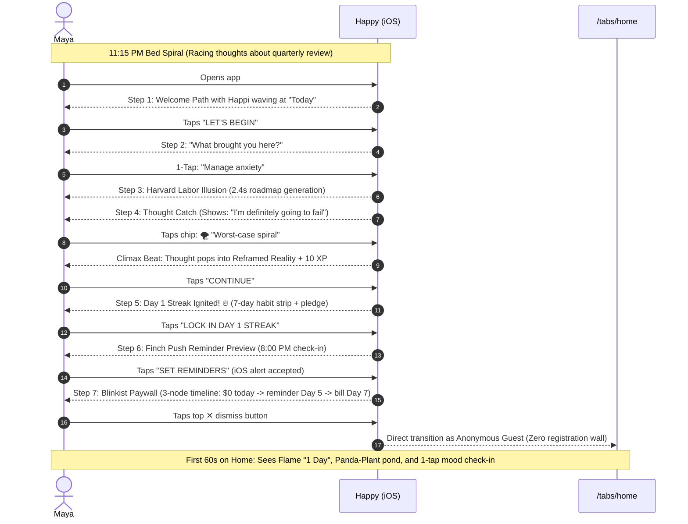

# Happy Onboarding & Day-0 — Experience Spine

`DESIGN.md` owns the visual identity, tokens, and styling specifications. This spine owns the information architecture, behavioral states, interaction primitives, accessibility, and user journeys. Visual references live under [mockups/](mockups/). On conflict, this spine wins.

## 1. Foundation

* **Platform**: Exclusively iOS 26+ mobile (iPhone, portrait orientation). Built with Expo Router and React Native NativeWind/Tailwind.
* **Core Product Loop**: **Learn $\rightarrow$ Practice $\rightarrow$ Journal $\rightarrow$ Insight**. Onboarding is the ignition of this loop, not an intake gate.
* **Anonymous Guest First**: Users launch into an anonymous Supabase guest session immediately. Zero forced sign-in or account registration blockers before reaching the Home tab.
* **Zero Blank-Slate Fatigue**: No open text fields in onboarding. All interactions are 1-tap chip selections or button presses.
* **Visual Identity Reference**: See `DESIGN.md` for tokens, typography ramp, and 3D button depth.

## 2. Information Architecture

| Screen / Step | Reached From | Primary Purpose | Exit / Advance Condition |
| :--- | :--- | :--- | :--- |
| **Step 1: Welcome** (`welcome`) | App launch (first install) | Visual proof of guided journey (curved path, Happi at "Today"). | Tap `"LET'S BEGIN"` (reveals after 520ms). Handoff delay 110ms. |
| **Step 2: Motivation** (`quiz_motivation`) | Step 1 | 1-tap intake selection (Anxiety, Mood, Stress, Self, Sleep). | 1-tap card selection. Auto-advances after 360ms. |
| **Step 3: Labor Loader** (`building_journey`) | Step 2 | Harvard Labor Illusion (operational transparency of AI personalization). | Exactly 2.4s timer across 4 tasks. Auto-advances. |
| **Step 4: Thought Catch** (`thought_catch_micro`) | Step 3 | Interactive 30s micro-win. Spot cognitive distortion and see reframed reality. | Tap distortion chip $\rightarrow$ pop reframe $\rightarrow$ tap 3D `"CONTINUE"`. |
| **Step 5: Milestone** (`milestone_celebration`) | Step 4 | Celebrate Lesson 1 completion using existing clean `StreakProgressGraphic` (Streak flame + 7-day row) with zero diagonal fluff. | Tap 3D `"LOCK IN DAY 1 STREAK"` (or `"CONTINUE"`). |
| **Step 6: Push Primer** (`notification_permission`) | Step 5 | Finch companion framing for quiet daily check-in reminder. | Tap `"SET REMINDERS"` (triggers iOS dialog) OR `"Maybe later"`. |
| **Step 7: Soft Paywall** (`soft_paywall`) | Step 6 | Blinkist 3-node transparent timeline trial offer (annual plan with 68% off). | Tap `"START 7-DAY FREE TRIAL"` OR tap 44x44pt `✕` dismiss button. |
| **Home: Landing** (`/tabs/(tabs)/home`) | Step 7 (or paywall dismiss) | Immediate value delivery preserving existing `JournalCalendarScreen` (HomeHeader, FeaturedPromptCard, EmotionLogger, StarterPathNextActionCard). Zero unexpected UI changes. | Tap mood bubble or tap next lesson card. |

## 3. Voice and Tone

* **Non-Clinical & De-stigmatizing**: Never use clinical DSM-5 jargon in customer copy. Replace *"cognitive distortion"* with *"thinking trap"* or *"mind trick"*. Replace *"catastrophizing"* with *"worst-case spiral"*.
* **Compassionate & Unhurried**: Speak like a warm, knowledgeable friend (Happi). Keep copy brief, empathetic, and anchored in agency.
* **Zero Guilt & Zero Shame**: Streaks are framed as cumulative momentum, never fragile glass chains. Missed days never trigger punishing copy or shameful resets.
* **Transparent Reassurance**: Monetization copy explicitly details trial dates and cancellation ease: *"Cancel anytime in Settings • No surprise charges"*.

## 4. Component Patterns

### 3D Tactile Action Button (`TactileButton`)
* **Behavior**:
  - Touch Down: Translates down by 6px with haptic tick (`selectionAsync`).
  - Touch Up / Release: Bounces back with spring physics (`damping: 20, stiffness: 100`).
  - Action Dispatched: On release inside bounding box.
* **Visual Reference**: [mockups/key-thought-catch.html](mockups/key-thought-catch.html)

### Single-Tap Chip Selector (`DistortionChips`)
* **Behavior**:
  - Tapping a chip immediately applies active border and background color.
  - Fires `Haptics.impactAsync(ImpactFeedbackStyle.Medium)`.
  - Disables sibling chips and triggers instant pop-in of the Reframed Reality card.

### Harvard Labor Illusion Loader (`BuildingJourneyStep`)
* **Timing & Progression**:
  - Total duration locked to 2,400ms (optimal Harvard perceived-value window).
  - 4 sub-tasks complete sequentially with checkmarks: Profile (500ms) $\rightarrow$ Personal Plan (600ms) $\rightarrow$ CBT Tools (600ms) $\rightarrow$ Gentle Schedule (500ms) $\rightarrow$ Buffer (200ms).
  - Fires `Haptics.notificationAsync(Success)` upon 100% completion.

### Transparent Timeline Paywall (`SoftPaywallStep`)
* **Behavior**:
  - Displays 3-node vertical roadmap: *Today ($0.00)* $\rightarrow$ *Day 5 (Reminder alert)* $\rightarrow$ *Day 7 (Annual bill starts)*.
  - Prominent 44x44pt `✕` button top-right and secondary text button *"No thanks, explore free first"*.
  - Dismissal triggers `DiscountInterceptModal` (30% off offer). Dismissing intercept drops guest immediately onto Home tab. Zero blocking sign-in.
* **Visual Reference**: [mockups/key-paywall.html](mockups/key-paywall.html)

## 5. State Patterns

### Onboarding State Machine
* **Current Step**: Tracked via `currentStepIndex` (0 to 6) in `OnboardingScreen.tsx`.
* **Step Back Navigation**: Users can navigate back across intake steps (Steps 1–2). Back button is hidden on Step 3 (Loader) and Step 5 (Celebration).
* **Completion Persistence**: On Step 7 completion or dismissal, `completeOnboarding()` writes:
  - `has_completed_onboarding: true` in local AsyncStorage.
  - `streak_count: 1` and `last_active_date: TODAY` in local storage.
  - `xp: 10` awarded to user profile.
  - Anonymous Supabase guest session created and linked.

### Offline & Low-Connectivity Resilience
* All 7 onboarding steps execute locally with zero network blocking.
* Local SQLite / AsyncStorage buffers profile mutations and syncs silently once connected.
* Paywall displays local cached SKU pricing if RevenueCat network request is delayed.

## 6. Interaction Primitives & Haptics

| Event / Trigger | Visual Motion | Haptic Feedback | Sound (if active) |
| :--- | :--- | :--- | :--- |
| **Tactile Button Down** | Translates down 6px (20ms) | `selectionAsync()` | Soft physical click |
| **Tactile Button Release** | Springs back (damping 20, stiffness 100) | None | None |
| **Motivation / Distortion Tap** | Scale pop 1.03x + border color shift | `impactAsync(Medium)` | Light tap |
| **Labor Loader Finish** | Green checkmark bounce + progress fill | `notificationAsync(Success)` | Gentle chime |
| **Reframe Card Reveal** | Slide-up + fade-in (250ms ease-out) | `impactAsync(Light)` | Soft whoosh |
| **Day 1 Streak Ignited** | Flame scale pulse (1.15x spring) + confetti | `notificationAsync(Success)` | Fanfare celebration |
| **Paywall Dismiss** | Fade out / slide down (200ms) | `selectionAsync()` | None |

## 7. Accessibility Floor

* **Touch Target Minimum**: All interactive elements (chips, buttons, dismiss icons) are $\ge 44\times 44$pt. Primary tactile buttons are 56pt height.
* **Dynamic Type & Scalability**: Text components honor iOS Dynamic Type scales while preserving layout stability.
* **VoiceOver Semantics**:
  - Steps are announced as *"Step 4 of 7: Notice the trap in your thinking"*.
  - Distortion chips have accessibility role `button` and state `selected` / `unselected`.
  - Mascot illustrations marked `accessible={false}` or given descriptive alt labels (*"Happi celebrating your Day 1 streak"*).
* **Color Contrast**: Text-to-background contrast exceeds WCAG AA standards (Sage-700/800 on Canvas $\ge 4.5:1$; white on Sage-500 $\ge 3.8:1$ for large text).

## 8. Key Flows

### Protagonist Journey: Maya (29, Marketing Lead)

### First 60 Seconds on Home: Existing Screen Preservation Blueprint
* **Rule**: Preserve existing `JournalCalendarScreen.tsx` intact. Zero unrequested layout refactors or visual surprises.
1. **0–5s**: Lands smoothly on `/tabs/home` (`JournalCalendarScreen`). `HomeHeader` displays user greeting and existing streak capsule.
2. **5–20s**: Existing `FeaturedPromptCard` ("Today's Reflection") and `EmotionLogger` allow immediate 1-tap engagement if user wants.
3. **20–60s**: Existing `StarterPathNextActionCard` spotlights the first guided learning step without cluttering the screen.
