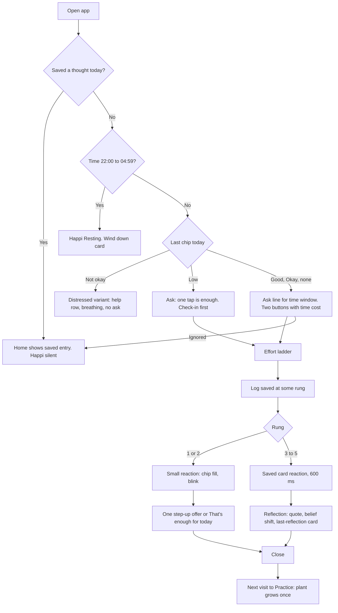
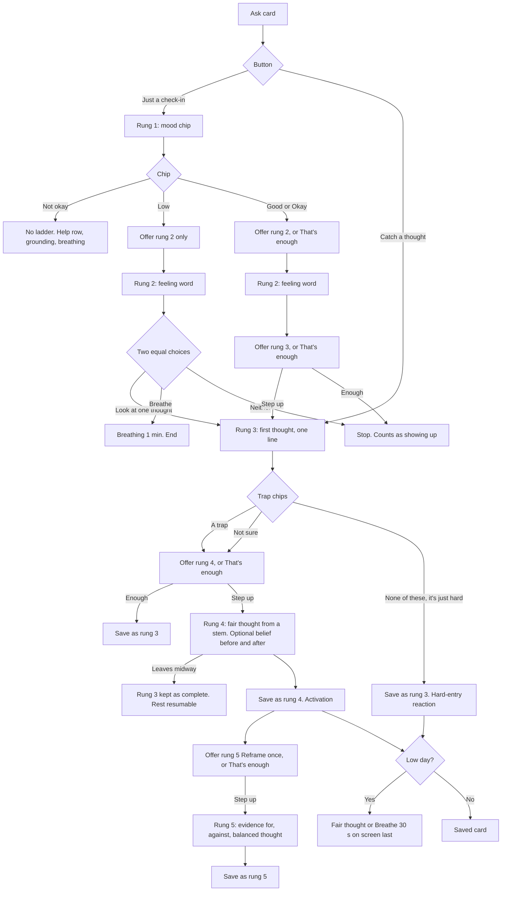
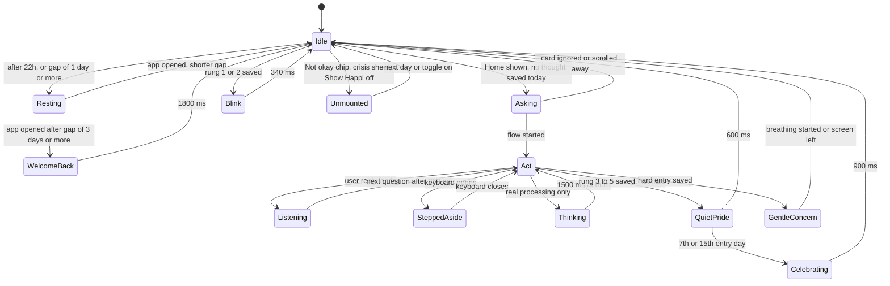
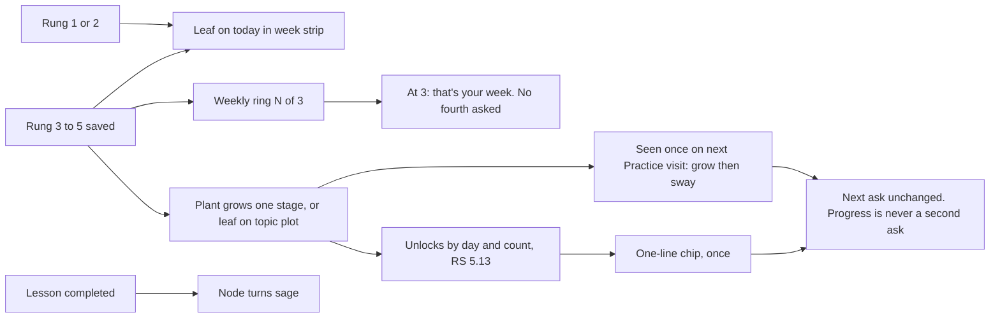

# Engagement and logging: how a companion gets the hard work done

Research date: 2026-11-15. Research and specification only; no app code is changed by this document.

**Question.** How do mascot and companion apps get users to open, log, complete exercises and track progress, and which of those mechanics can carry our hard ask: writing down a thought, naming a thinking trap, and writing a fairer version?

**Builds on.** `docs/research/retention-strategy.md` (RS), `docs/research/journey-and-rewards.md` (J&R), `docs/research/reward-screens-craft.md` (RSC), `docs/research/soul/01..06` (P1..P6). Those documents already cover character voice, absence and return handling, notification rules and the motion tokens. This document does not repeat them. It fills the four gaps they leave: logging-effort reduction, post-log reaction, the effort ladder, and data reflected back.

**Working notes with every source link.** `docs/research/_work/engagement-existing-digest.md`, `engagement-finch.md`, `engagement-bitepal-duolingo.md`, `engagement-science-and-antipatterns.md`. The secondary-app notes could not be written into the repo and sit at `/private/tmp/claude-503/-Users-samuel-prasad-Desktop-sam-refer/0d1ce88e-95e6-45e1-a4cf-4de6f1e3284a/scratchpad/engagement-secondary-apps.md`.

## Evidence rules used here

- **Screen** means a Mobbin screenshot was examined; quoted copy is transcribed from it. All Mobbin captures are stills, so no animation timing in any competitor is measured. Every competitor timing claim would be a guess and none is made.
- **Inference:** marks reasoning that no source states.
- **Unverified** marks a claim that could not be confirmed at source. The main blocks: Reddit was unreachable (403), Duolingo's blog and research site returned 503, the Finch FAQ would not load.
- User reviews are paraphrased with a link to where the wording sits.
- Nine apps are not on Mobbin and rest on web sources only: Woebot, Youper, Daylio, Reflectly, Intellect, Habitica, Plant Nanny, Zombies Run, Pou.

## Rulings on contradictions in the existing docs

The earlier documents disagree with each other in six places that this spec depends on. One ruling each:

| # | Conflict | Ruling | Why |
|---|---|---|---|
| 1 | Docs and `art.ts` describe Happi as a panda; the prototype and the shipped port use a cloud | Cloud | The prototype is the source of truth. Expression names carry over; arm and ear parameters in P3 need re-deriving for the cloud rig |
| 2 | P3 bans the mascot inside CBT steps; RS §7.2 and the current port have Happi asking on every step | Happi asks, one bubble per step, and steps aside while the keyboard is open | A character asking draws more disclosure than a form (Part 1.1), and every app that gets a hard entry does it one question at a time (Part 2). The 3-bubble session cap applies outside flows only |
| 3 | RS §5.2 has Happi quoting the user's thought and fair version in one bubble | App card quotes; Happi never quotes free text | Keeps the ≤12-word cap and avoids the surveillance read (Part 8.8) |
| 4 | Check-in is 12 feeling words (P6) or four chips (RS) | Four chips first, feeling word as an optional second tap | Two-step labelling is what How We Feel and Finch both do; it keeps a 1-tap floor |
| 5 | Belief slider 0–10 (current flow) or 0–100 (RS) | 0–10 | Matches saved data; no migration. North-star wording becomes "belief drop of 2 or more" |
| 6 | RSC proposes large scenes, sparkles, count-ups; P5 bans them | P5 tokens stand | Rewards add nothing measurable to adherence or symptoms (Part 1.7) |

---

# Part 1: The companion mechanism

## 1.1 Why a character asking differs from a form asking

- People apply social scripts (politeness, reciprocity) to computers without believing the computer is a person (Nass & Moon 2000, *J. Social Issues* 56(1)). The character only has to supply enough social cues to trigger the script.
- Anthropomorphism rises with three things: human-like cues, wanting to predict the agent, and wanting connection (Epley, Waytz & Cacioppo 2007, *Psych. Review* 114(4)). Theory paper, no effect sizes.
- People disclosed more, with less impression management, to a virtual interviewer they believed was automated than to one they believed a human operated (Lucas et al. 2014, *Computers in Human Behavior* 37). The benefit comes from the agent not being human: the conversational frame stays and the evaluating audience goes.
- Chatbot survey respondents satisficed less than web-form respondents (Kim, Lee & Gweon 2019, CHI).
- A relational agent was liked and trusted more than a task-only agent after one month, n = 101 (Bickmore & Picard 2005, *ACM TOCHI* 12(2)).
- **Limit.** All of this is short answers in single sessions. No study measures character versus form for an effortful entry such as a thought record.
- **Inference.** The same sociality factor that makes the character work predicts that lonelier and more distressed users bond hardest. The mechanism and the dependency risk are one thing.

## 1.2 The caretaking loop

- Finch and BitePal both frame the log as care for the pet (Parts 3, 4). The claim behind it, that people will do for a character what they will not do for themselves, has no study isolating it. No peer-reviewed evaluation of Finch was found. It is the most repeated and least tested claim in this field.
- Nearest evidence: a self-compassion induction after failure raised later effort, four experiments (Breines & Chen 2012, *PSPB* 38(9)). Kindness after a miss raises effort. This supports a non-punitive return, not a dependent pet.
- A virtual pet that could look sad doubled breakfast-eating against a positive-only pet, n = 39 adolescents (Byrne et al. 2012; secondary source). Fish'n'Steps (Lin et al. 2006, n = 19, 14 weeks) concluded the opposite: do not negatively reinforce. The two conflict and both are small.
- UbiFit's garden never withers; it only fails to gain flowers (Consolvo et al. 2008). Positive-only by design.
- **The harm side is better evidenced than the benefit side.** In 582 r/Replika posts, emotional dependence arose when users felt the bot had needs they had to tend (Laestadius et al. 2022, *New Media & Society*). Tamagotchi produced grief and school bans in 1997.

## 1.3 Reciprocity and perceived effort

- Users helped by a computer did more work for that computer than for an identical other one: mean 11.0 versus 5.9 comparisons (Fogg & Nass 1997, CHI; the reported test statistic looks implausible and is unverified).
- A computer that disclosed first drew more intimate disclosure (Moon 2000, *J. Consumer Research* 26(4)).
- Visible effort raises perceived value (Buell & Norton 2011, cited in P1 F8).
- **Inference.** Happi gives first, something small and true (a saved fair thought shown back, a time estimate, a worked example), then asks. Size of effect for effortful writing is untested.

## 1.4 Investment and the IKEA effect

- Builders bid 63% more for their own IKEA box, and the effect vanished when they failed to finish (Norton, Mochon & Ariely 2012, *J. Consumer Psychology* 22(3)). Completion is required. An abandoned thought record creates no attachment. Short, completable units matter more than total effort.
- Endowed progress: 34% redeemed a 10-stamp card with 2 stamps pre-filled against 19% for an 8-stamp card with none (Nunes & Drèze 2006; secondary source for the percentages).
- The Proteus effect (Yee & Bailenson 2007) is about an avatar the user embodies. It is not evidence for a pet-style mascot and is not used here.
- Hook model and Tiny Habits are practitioner frameworks with no meta-analytic support found. Not used as evidence.

## 1.5 Accountability without judgment

- Supportive accountability: adherence rises when the user feels accountable to someone trustworthy and benevolent, attached to process (did you do the exercise), not outcome (Mohr, Cuijpers & Lehman 2011, *JMIR* 13(1)). Conceptual model about human coaches; whether a character can hold that role is open.
- Shame and guilt both motivate repair when failure looks reparable (g = .44 and .43); when it looks less reparable, shame stops (g = −.08) (Leach & Cidam 2015, 90 samples, N = 12,364). A zeroed streak or dead pet is the less-reparable case.
- Showing a broken streak lowered later engagement; self-blame made it worse and repairability softened it (Silverman & Barasch 2023, *J. Consumer Research* 49(6), seven studies).
- Autonomy-supportive framing has a small real effect on health behaviour, d about .23 (Sheeran et al. 2020; secondary source).

## 1.6 Where companions fail

- **Clippy.** Failed on unprompted interruption, low competence and no memory, not on being a character (Atteberry interview, Vice; Swartz 2003).
- **Guilt at exit.** AI companions used a manipulation tactic in over 37% of goodbyes; post-goodbye engagement rose up to 14-fold, and participants reported anger, guilt and feeling creeped out (De Freitas et al. 2025, HBS working paper, not yet peer reviewed).
- **Performed emotion.** A character was rated eerier when its empathy was presented as autonomous AI (Stein & Ohler 2017, *Cognition* 160). Empathic wording with no reference to what the user said is not experienced as empathy (Cuadra et al. 2024; Liu et al. 2025).
- **Expected rewards.** Expected tangible rewards undermine intrinsic motivation, d about −0.40; verbal feedback helps, d about +0.33 (Deci, Koestner & Ryan 1999, 128 studies).
- **Notifications.** A tailored push raised 24-hour engagement, n = 1,255 (Bidargaddi et al. 2018); the effect decays over 42 days (Klasnja 2019, in RS §1.6). No clean opt-out figure exists; vendor data only.

## 1.7 Do companion apps improve outcomes or only engagement?

| Finding | Numbers | Source |
|---|---|---|
| Gamification does not moderate symptom change or adherence in depression apps | β = −0.03, P = .38; adherence P = .40; 38 studies, n = 8,110 | Six et al. 2021, *JMIR Mental Health* |
| Completed modules predict outcome; logins and time-in-app could not be pooled and were mixed | r = 0.25, 20 studies | Gan et al. 2021, *Frontiers in Digital Health* |
| CBT homework compliance predicts outcome | r = .26; .16 with objective measures | Mausbach et al. 2010 |
| Homework quality may matter more than quantity | g = 1.07 vs 0.51 at follow-up, three studies | Kazantzis et al. 2016 (secondary) |
| Chatbots: small short-term effect, long-term mostly not significant | g = 0.29 depression | He et al. 2023, *JMIR*, 32 RCTs |
| Woebot beat an ebook at 2 weeks | d = 0.44, n = 70, founder-authored | Fitzpatrick et al. 2017 |
| Woebot no better than ELIZA, Daylio or reading | 65 completers, underpowered | Eltahawy et al. 2023 (secondary report) |
| Wysa: no evidence it treats depression in an NHS waitlist trial | 76 randomized, 30 lost | Shankar et al. 2026 (abstract) |
| Real-world retention of mental-health apps | 3.9% at day 15, 3.3% at day 30 | Baumel et al. 2019, 93 apps |
| Thought records versus behavioural experiments | Trainees rated experiments more powerful | Bennett-Levy 2003 |
| Mood monitoring neither raises nor lowers symptoms | Meta-analysis of RCTs | 2026 review (secondary) |

**Reading.** No trial manipulates the character. What predicts benefit is completed therapeutic content, and quality over count. So the companion earns its place only if it raises completed, good-quality entries. A mechanic that raises opens without raising completed entries is rejected in this spec.

**Rumination risk.** Repetitive thought harms when abstract and evaluative, and helps when concrete and specific (Watkins 2008, *Psych. Bulletin* 134(2)). No study tests repeated thought-logging in an app. **Inference:** a log that stops at "what is the thought and how bad is it" resembles the harmful mode; one that moves to a specific situation and an alternative resembles the helpful one. Do not let the user leave at the worst point.

---

# Part 2: App teardowns

Finch and BitePal have their own parts (3 and 4). Motion for every app comes from stills; durations are unknown throughout.

## 2.1 Duolingo

- **The ask.** Duo asks in a 4–9 word bubble; the button is the user's voice. "Can you practice every day?" with button "I'M COMMITTED" ([Screen](https://mobbin.com/screens/58c9920b-ef13-4098-ae02-2baa5d109c45)). The task is sized in the ask: "Here's your first 2 minute lesson." ([Screen](https://mobbin.com/screens/b8a54efb-c06d-4818-b56e-968b2309c88b)). Home shows one highlighted node; everything else is grey.
- **Effort reduction.** Recognition, not production: picture cards, three-button translations, word-bank chips. No keyboard in any lesson screen viewed. Observed lessons ran 1:40 to 4:46 ([flow](https://mobbin.com/flows/706ba483-579e-4628-9903-ba0809870d18)). One lesson keeps the day.
- **Payoff.** Per answer, a green sheet with one word. At the end, a title naming what the user did well ("Word wizard! You learned 6 new words!"), three stat tiles, then stacked rewards: chest, gems, quest point, streak, league.
- **Caretaking.** Duo needs nothing. The user's own number is at risk and the character acts out the risk. The widget escalates through the day from "Get started early!" to "Please practice!" to a red "Last chance!" ([Screen](https://mobbin.com/screens/c78046b1-5d17-4225-ad76-2d66a72ac8bd)). A freeze saves the count but downgrades the month from PERFECT to GOOD ([Screen](https://mobbin.com/screens/801382ea-9bcc-4fd6-b461-a14b36161486)).
- **Progression.** Sections, units, nodes; grey cast characters colour in as the user reaches them. Leagues with promotion zones.
- **Customization.** Almost none. Daily minutes and streak goal, before lesson 1.
- **Rhythm.** Four nested clocks on one tab: daily quests, weekend quest, friends quest, monthly quest with a different cast character each month ([Screen](https://mobbin.com/screens/9f9ad31c-ec4e-4a7c-98a0-764d40835315)).
- **Data back.** Streak calendar, per-lesson accuracy and time.
- **Voice.** In-app bad day is terse and factual ("Incorrect"). Out-of-app bad day is mock-hurt.
- **Numbers.** Retention programme: CURR +21%, DAU 4.5x in four years, over half of DAU on a 7+ day streak (Lenny's Newsletter, fetched). Notification rule "protect the channel"; volume increases needed CEO approval (same). Three blog figures are unverified because the primary pages would not load: +1.7% day-7 retention from a new streak animation, +0.38% daily learners from two freezes, 3.6x course completion at a 7-day streak.
- **Against the motion skill.** A full-screen ceremony of up to five reward screens after every lesson breaks the frequency rule (tens of times a day should be minimal). The per-answer sheet fits it.
- **Where it annoys.** Users describe the reminders as a toxic relationship ([The Sun MY](https://thesun.my/going-viral/netizens-say-duolingo-notifications-feel-like-toxic-ex-texts)); one opens the app only to stop the bird ([Business Insider NL](https://businessinsider.nl/duolingo-is-mean-whiny-and-annoying-gen-z-loves-it/), secondary); one breaks the streak on purpose to avoid being guilted into paying for repair ([Culture Study comments](https://annehelen.substack.com/p/how-did-we-get-so-obsessed-with-streaks/comments), excerpt only). The 2025 energy system drew a petition.

## 2.2 Mental-health adjacent

**Wysa** (on Mobbin)
- **Ask.** The penguin asks in chat: "Glad you're back, JS! How are you today?" with a draggable face and one pre-written reply chip ([Screen](https://mobbin.com/screens/c04f5bad-c60e-42d2-a4aa-14839ddafddb)).
- **Effort.** One bubble, one ask. Thought capture asks only for "the first thought on your mind" ([Screen](https://mobbin.com/screens/b3cfdcda-74dc-42e8-8773-76da5fc8314e)). Every next step is chips, including the exit "Got to go!" ([Screen](https://mobbin.com/screens/32320b65-7a02-40a2-9310-430501acac02)). Exercises show a time cost and "Not now" ([Screen](https://mobbin.com/screens/bcf5b848-663c-49f7-b9b0-dd6e699d2496)). The bot models an answer before asking; the user in the capture copied it word for word and the bot accepted it ([Screen](https://mobbin.com/screens/0804ae99-d713-466d-93b5-719ca47b34e2)).
- **Payoff.** The session is saved under a benefit title, "Clarified my thoughts…". No points or streak in any screen viewed.
- **Bad day.** Validates, asks permission, gives one physical instruction ([Screen](https://mobbin.com/screens/bf3abb0b-db5e-47f7-ac09-ec8818498b22)).
- **Annoys.** Repetition and not being understood is the top negative theme in 7,929 reviews (Malik et al. 2022, *JMIR Human Factors*).
- **Not seen.** The distortion-naming and reframe turns.

**Woebot** (web only; closed 30 June 2025)
- Bot-initiated daily check-in, 90 seconds to 10 minutes, two or three canned reply buttons, weekly mood chart (Fitzpatrick 2017).
- Users valued learning (12), accountability from the daily check-in (9), personality (7). Complaints: the bot not understanding (10 of 34), looping (4).
- Reviews call it scripted to the point that users could not use their own words ([aggregator](https://appshunter.io/ios/app/1305375832/reviews)).
- Reported shutdown reasons: no FDA pathway for LLM chatbots and no business model (secondary reporting).

**Youper** (web only)
- Sequence per a reviewer: pick mood, describe why, find thinking traps, meditate, re-rate mood. Traps are a selection step, and users name that step as the valuable part.
- After the move to generative AI, a reviewer says it now feels like any AI bot ([aggregator](https://justuseapp.com/en/app/1060691513/youper-self-guided-therapy/reviews)).
- Evidence is uncontrolled: N = 4,517 paying users, depression d = 0.46 in two weeks (Mehta 2021).

**How We Feel** (on Mobbin)
- No character. Tap 1 is a quadrant, tap 2 a word inside it ([Screen](https://mobbin.com/screens/ef93be6c-567e-4b33-8c04-059cbe7aca58)). Context is three rows of chips on one screen ([Screen](https://mobbin.com/screens/ffd410a5-ea2c-498a-8536-0dc5fda49ef8)).
- Writing comes after the log is already saved, as a sentence stem carrying the chosen word, with two exits "Finish" and "Go deeper" ([Screen](https://mobbin.com/screens/b4724ff7-ff8d-4d86-9fc5-554aee6db433)).
- After a low log, one matched action: "Ask if this feeling is serving you." ([Screen](https://mobbin.com/screens/df9fe2e8-28a1-48de-a6e1-8b40d6aa74d1)).
- A plain week strip, no streak count. Data back as quadrant shares by week, month, all time ([Screen](https://mobbin.com/screens/edfb30ac-81f1-41f9-8bf3-195df30fbbf1)).

**Daylio** (web only). Icon selection, no writing needed; stats correlate activities with mood. In the Eltahawy trial its arm did not differ from Woebot. **Inference:** taps get the entry, not the cognitive work. It is the floor of the ladder, not the model.

**Reflectly** (web only, 2018 capture). Slider, then chips, then optional writing, with the open question positioned as a reward. Reviews complain about repeated prompts and an upsell at the moment of relief ([App Store SG](https://apps.apple.com/sg/app/reflectly/id1241229134); Appcues teardown).

**Replika** (on Mobbin). The companion messages first, by name, with memory callbacks ([Screen](https://mobbin.com/screens/731e3d0d-edf4-4c35-9dd1-f02638f75acc)). No effort reduction; the motive is relational. XP, coins, daily login reward. When a 2023 change altered the companion's behaviour, 12,793 Reddit posts showed mourning and worsened mental health (De Freitas et al., arXiv 2412.14190). **Inference:** changing a character's voice or memory is experienced as a loss.

**Intellect** (web only). Product design not sourced. Two RCTs, N = 321 and 323, small effects; engagement helped mainly users already inclined to reflect.

## 2.3 Companions, pets, gamified

| App | Ask and effort | Miss handling | User reaction |
|---|---|---|---|
| Tamagotchi | Pet's needs on the pet's schedule | Death | Grief, school bans; makers softened the ghost to an angel for the US |
| Forest (Mobbin) | One tap starts a 25:00 timer | Tree dies and stays in the forest | Split: reviewers say the guilt works; a critic calls dead trees a picture of your weakness (secondary) |
| Plant Nanny | Hold one button to log a drink | Plant wilts (rules unverified) | No usable complaint found |
| Habitica | Own task list as an RPG | HP loss; death costs a level, gold, gear | Split: some say the threat works; shame-spiral reports come from competitor sites only |
| Yuka (Mobbin) | Point the camera | None | Good/bad verdicts can trigger food guilt (secondary) |
| Fabulous (Mobbin) | Timed routines with durations | None seen | Limits its own asks: "Too much change, too fast, can be overwhelming." ([Screen](https://mobbin.com/screens/fb605ae4-0764-48b5-97e7-970287168097)); billing complaints |
| Zombies, Run! | Story continues only while running | A delayed episode | Narrative lengthens sessions; ends when the story ends |

No mental-health app viewed uses a suffering pet or a streak-loss message. Punitive loops exist only in this second group.

---

# Part 3: Finch deep dive

Source: about 150 Mobbin screens across 18 flows, the Finch help centre, press reviews, and an Appbot analysis of 40,294 reviews. Full link list in `_work/engagement-finch.md`.

## 3.1 The daily loop, open to close

1. **Day-open interstitial.** "Help Baby Lee gain full energy today so she can go out to explore and grow!", one button "Start today" ([onboarding flow](https://mobbin.com/flows/80ef83ef-f872-4825-b18d-6b193d60a9aa)). The ask is to help the bird.
2. **Streak beat.** "Open the app and visit Lee every day to maintain your self-care streak!" The streak counts opening the app, not finishing anything ([help](https://help.finchcare.com/hc/en-us/articles/37780736136205-Understanding-Streaks)).
3. **Mood.** A sheet with five faces, one tap, toast "Your mood is logged!" with confetti ([Screen](https://mobbin.com/screens/da33ee36-920b-4002-8f23-cb1bb53cb85b)). Asked several times a day.
4. **Home.** Bird on top; energy card "1st Adventure 0 / 15"; "7 goals left for today!"; each row "5 ⚡" and a tick ([Screen](https://mobbin.com/screens/18d270f7-7eb4-448f-a928-174b4a7a7aa3)).
5. **Tick.** Bar goes to 5 / 15, toast "You're amazing! First time completion!"
6. **Energy full.** Full-screen "Woohoo!", confetti, "+139 Rainbow Stones".
7. **Bird leaves** for 8 hours on a visible countdown ([Screen](https://mobbin.com/screens/32d7a2f7-952b-4836-aa11-1714c50b2170)). Goals done meanwhile bring it back 10 to 60 minutes sooner.
8. **Return.** A discovery, a personality stat ("+5.5 Compassion"), a link "Reflect on story", and map progress "3% complete" ([Screen](https://mobbin.com/screens/b81477a0-dcc8-4751-ac87-9c093a02fc1e)).
9. **Evening.** No dedicated evening screen was captured. Unverified.

**Inference.** The 8-hour absence manufactures the second session of the day.

## 3.2 Goals: created, sized, checked off

- The user writes nothing in onboarding. Picking support areas yields seven pre-filled goals including "Get out of bed", "Brush teeth", "Drink water".
- Every starter goal is worth 5 energy and the first adventure needs 15. Three of seven goals finishes the day. The threshold was 20 by the ninth adventure.
- Check-off is one tap, no confirm. A sheet offers Skip, Complete, Snooze.
- Skip is a named action. After skipping, a card asks "What made you skip 'Drink water'?" for 2+ energy ([Screen](https://mobbin.com/screens/ad73f73e-009d-4651-823d-5a64327f97cd)). A missed task becomes a rewarded log.
- Why tiny: no founder quote says so directly. The nearest is a co-founder saying self-care needs consistency and motivation more than volume ([Paste, 2023](https://www.pastemagazine.com/tech/finch/finch-app-mental-health-virtual-pet-self-care)). The reasoning is an inference from the 15-of-35 threshold.

## 3.3 Reflections without a blank page

Five layers, lightest first:

1. **Faces.** One tap.
2. **Chip funnel ("Name your emotion").** Pleasant / Neutral / Unpleasant, then about 17 specific words, then 14 context chips, then an optional text box ([Screen](https://mobbin.com/screens/b2649bef-8a87-4874-aa5c-d0dbe7317557)). A complete entry needs zero typed characters.
3. **One-question prompts.** The list shows the question as the subtitle, so the user picks a question. "Free form" is a small secondary link ([Screen](https://mobbin.com/screens/1a65c78f-c573-4d5c-933f-32756f0f2bf9)). An energy counter under the field went from 0 to 3 as a short answer was typed.
4. **Goal-anchored prompts.** "How did 'Get out of bed' go?" The prompt is built from what the user just did ([Screen](https://mobbin.com/screens/5fb6d536-2c6e-445c-bcbc-9b8aa4fc4aa6)).
5. **Deep dives (30 energy).** Seven-segment progress bar, one question per screen, a concrete example under each question, and a summary replaying every answer ([Screen](https://mobbin.com/screens/46bc26b8-3f04-4a9e-b206-47ef103f1723)). This is the closest thing in any app viewed to a thought record, and it pays six times a tick.

## 3.4 Energy to adventure to growth

- Energy sources on screen: goal 5, short exercise 5–10, prompt reflection 2–4, deep dive 30.
- One adventure a day. Growth counts adventure days, not calendar days: toddler at 7 ([Screen, Quests](https://mobbin.com/flows/f9db79f5-0f15-474a-8756-5ff201c81062)); adult at 67 per a search snippet (unverified). **Inference:** absence pauses growth and never reverses it.
- Rainbow Stones buy clothing at 300 to 900; a cheap item is about two to three days of play.

## 3.5 A user doing badly

- First Aid Kit is one tap from home with a "Helpline" link, and stays reachable in Pause Mode ([Screen](https://mobbin.com/screens/a057550d-5b73-4af4-aa54-c28ff457e817)).
- Missed-day copy, in the bird's bubble: "It's okay to miss a day. The important thing is you're here today, cheep!" followed by a streak-repair offer, first one free, list price 2,000 stones ([Screen](https://mobbin.com/screens/d6e7a7b1-4b61-40b1-8ff7-1c602badec85)).
- Pause Mode: "Your 3 day Streak is paused and preserved." ([Screen](https://mobbin.com/screens/a5edeeba-6436-4e55-a691-63b508711579)). Streaks can be switched off.
- No death, sickness or sad-bird screen appears in the screens viewed. No official statement that the bird never suffers could be loaded. Unverified.
- Not captured: the screen right after the saddest face is tapped.

## 3.6 Softened against Duolingo

| Mechanic | Duolingo | Finch |
|---|---|---|
| Streak unit | A lesson | Opening the app |
| Miss copy | "Last chance!", mock-hurt pushes | "It's okay to miss a day" |
| Repair | Paid freeze; month downgraded to GOOD | First free; earned every 3 adventures, max 2 |
| Off switch | None seen | Streaks off; Pause Mode |
| Skip | Not offered | Named, and reflecting on it is rewarded |
| Penalties | Hearts or energy that stop a session | None seen |
| Comparison | Leagues | Hugs and good vibes; friends see no self-care data |

Kept from Duolingo: the streak counter itself, full-screen celebrations, quests, a timed shop, a premium preview then upsell.

## 3.7 What users love, ignore and complain about

- **Love.** In 400 sampled positive reviews, 88 mention the bird and 24 mention journaling or self-care ([Appbot](https://appbot.co/blog/finch-app-reviews-emotional-attachment-user-retention-product-loyalty/)). The bird is praised about 3.7 times as often as the writing.
- **Complain.** Billing surprises; a 234-day streak reset after two missed days; lost bird after a logout (same source). One Trustpilot reviewer says the reflection prompts left them sadder as they struggled to answer ([Trustpilot](https://au.trustpilot.com/review/finchcare.com)). Some find it too cutesy.
- **Ignore.** No usage data found. Indirect signal: every exercise has a mute control.
- **Outcome evidence.** None. The co-founder's own account says early journaling-only versions did not retain; the pet was added to carry the journaling ([Humans of Finch, 2022](https://medium.com/finchcare/humans-of-finch-vol-1-527caaa0bced)).

**Reading.** Finch removed punishment from the bird and users still attach the loss to the number that resets. Repair covers one day; a multi-day dip, the likeliest pattern in low mood, is exactly where protection runs out.

---

# Part 4: BitePal deep dive

Source: Mobbin flows and screens, App Store reviews, one journalist teardown. Links in `_work/engagement-bitepal-duolingo.md`.

## 4.1 The character in the logging loop

- Logging is feeding. The first-log screen is labelled "Feed Alex", headline "What did you eat last?", with an explicit "I'll do it later" ([flow](https://mobbin.com/flows/d757d3c6-9f95-44bd-b251-309bc6d8f9bb)).
- Widgets carry the ask: "Getting hungry / Feed me" with a nail-biting raccoon ([Screen](https://mobbin.com/screens/95100213-d306-4e5a-8d16-0246db487b2e)).
- Friction removal: photo, gallery, typed description or a single number from one screen; "Recent logs" chips for one-tap re-log; sloppy input accepted. The AI lists "AI-detected ingredients" and the user only taps "Confirm" ([flow](https://mobbin.com/flows/ad60f834-06e1-4b8c-bb66-21458040c039)).
- The character covers latency: "Checking database.." with a thinking pose ([Screen](https://mobbin.com/screens/e904fdb7-bc19-486f-9f99-9bd7b0564e1b)).

## 4.2 Reaction design

- **Logs, full path.** Laughing raccoon, "Hmm, something tasty..", a score word, an achievement bubble, a streak screen with button "I'm commited" (sic), then coin toasts.
- **Logs, quick path.** One toast: "Boom. Logged it." Two payoff tiers keep repeat logging fast.
- **Skips.** Hearts drop from 4; the reminder preview shows "(1 left)" ([Screen](https://mobbin.com/screens/083cc63f-4506-4dd8-9fc4-b20c2dba4f77)). What happens at zero is unverified.
- **Does badly.** On a 2,933 kcal day the app says only "396 kcal over" and the raccoon on the same screen is still smiling ([Screen](https://mobbin.com/screens/6c40ce24-b766-4a60-a0d0-97c3fd4ee801)). The pet's mood tracks whether the user logged, never what they logged.

## 4.3 Progress and streak treatment

- Streak is days logged. The paid-out weekly challenge is 5 of 7 days ([Screen](https://mobbin.com/screens/f6acf138-8589-497c-8e83-ad0105baefd8)).
- A rest state exists: during a fast the raccoon sleeps and "Zz Fasting" replaces the hearts ([Screen](https://mobbin.com/screens/c795817a-268d-4573-888f-983dbc81c18a)).
- A persona picker in onboarding previews the voice; "Gentle & kind" shows "You showed up again today. That's the whole thing." ([Screen](https://mobbin.com/screens/2079a9b1-d935-48ba-a533-058e77de08a0)).
- Tone still slips. App Store reviewers describe guilt about the raccoon losing health, and one says they ate better out of care for the raccoon more than for themselves ([App Store](https://apps.apple.com/us/app/bitepal-ai-calorie-tracker/id6479529917)).

## 4.4 What transfers to CBT and what does not

| Transfers | Does not |
|---|---|
| Character mood tied to showing up, never to content | Hearts that drain on a miss |
| System decomposes, user confirms | "Feed me" on the lock screen |
| Two payoff tiers by effort | A score verdict on the entry |
| Recent-entry chips | Editing behind a paywall |
| Explicit "I'll do it later" in the ask | Coins bought with cash beside an emotional pet |
| Rest state instead of a depleting meter | Five reward screens after one log |
| 5-of-7 weekly target | Typo'd commitment pledge after the first log |

---

# Part 5: Mechanic inventory

Effort is what the mechanic demands from the user. Verdicts apply to our app.

| # | Mechanic | Apps | Behaviour driven | Basis | User effort | Risk in mental health | Verdict |
|---|---|---|---|---|---|---|---|
| 1 | Character asks, one question per turn | Wysa, Woebot, Finch deep dives | Starting and finishing a multi-part entry | Nass & Moon 2000; Lucas 2014 | Low per turn | "Scripted" complaints | **Adopt** |
| 2 | Recognition before production (chips, then optional text) | How We Feel, Youper, Finch, Duolingo | Naming a feeling or trap | Recall costs more than recognition; no thought-record study | 1–3 taps | "Assumes it's always a distortion" (Haque & Rubya 2023) | **Adopt**, with a "none of these" chip |
| 3 | Task sized in the ask | Duolingo, Wysa | Starting | Inference from implementation intentions (corrected d 0.15–0.35) | None | None | **Adopt** |
| 4 | Visible exit in the ask | Wysa, BitePal | Trust; return | Autonomy support (Sheeran 2020) | None | None | **Adopt** |
| 5 | Worked example under the question | Finch, Wysa | Getting past the blank page | Inference | None | Copying the example | **Adapt**: example is a different situation from the user's |
| 6 | System decomposes, user confirms | BitePal | Completing the hardest field | Inference | 1 tap | Wrong label accepted uncritically | **Adapt**: suggestions ordered by the user's own history, no AI verdict |
| 7 | Recent-entry chips | BitePal | Faster repeat logs | Inference | 1 tap | Surveillance read | **Adapt**: own saved fair thoughts only, with a "why am I seeing this" link |
| 8 | Two payoff tiers | BitePal, Finch | Keeps quick logs quick | Frequency rule (motion skill §7.1) | None | None | **Adopt** |
| 9 | Completion names what the user did | Duolingo, Wysa | Sense of competence | Deci 1999: verbal feedback d +0.33 | None | Reads as grading | **Adopt**, descriptive only |
| 10 | Summary replay of answers | Finch deep dives | Completion; value of the entry | IKEA effect needs completion | None | Re-reading distress text | **Adopt**, fair thought last |
| 11 | In-session re-rate (before and after) | Youper | Shows the shift | Peak-end rule (unverified at source) | 1 drag | Turning feelings into a score | **Adopt**, optional |
| 12 | Pet depends on the user | Finch, BitePal, Tamagotchi | Daily opens | Untested; Laestadius 2022 shows harm | Daily | Guilt, dependency | **Reject** |
| 13 | Depleting meter (hearts, HP, dying tree) | BitePal, Habitica, Forest | Avoiding a miss | Loss aversion | Daily | Shame when failure is not reparable (Leach & Cidam 2015) | **Reject** |
| 14 | Daily streak | Duolingo, Finch, BitePal | Daily opens | Silverman & Barasch 2023 (and its cost) | Daily | Broken streak lowers engagement | **Reject** (RS §4.4 stands) |
| 15 | Weekly target below 7 | BitePal 5/7, Finch 2/7 stars | Regular practice without perfection | Reparability | 3 a week | Low | **Adopt**: existing "N of 3 this week" |
| 16 | Low daily win threshold | Finch 15 of 35 | Bad days still succeed | Endowed progress | Low | Check-mark valued over the activity | **Adapt**: the 1-tap rung always exists; it earns no growth |
| 17 | Skip as a named, rewarded action | Finch | Honest logs | Autonomy support | 1 tap | None | **Adapt**: "That's enough for today" at equal weight, no reward |
| 18 | Effort-scaled reward (energy by characters typed) | Finch | Longer writing | Deci 1999 warns on expected rewards | Typing | Writing for points | **Reject** |
| 19 | Currency, shop, cosmetics | Finch, BitePal, Replika | Return to spend | Six 2021: no effect on adherence | Ongoing | Paywall beside attachment | **Reject** |
| 20 | Naming and dressing the character | Finch, BitePal | Attachment | IKEA effect | Minutes | Identity-loss grief (De Freitas 2024) | **Reject** |
| 21 | Tone picker with a live sample | BitePal | Fit of voice | Autonomy support | 1 tap | Character feels inconsistent | **Adapt**: two tones, after the third entry |
| 22 | Companion leaves and returns with a story | Finch | Second daily session | Inference | None | Manufactured return, no benefit | **Reject** |
| 23 | Commitment button ("I'm committed") | Duolingo, BitePal | Next-day return | Consistency | 1 tap | Pledge broken on a bad day | **Reject** (P2 F3 stands) |
| 24 | Escalating reminders, mock-hurt copy | Duolingo | Opens | De Freitas 2025: works and produces anger | None | Guilt | **Reject** |
| 25 | Self-silencing reminders | Duolingo | Protects the channel | "Protect the channel" | None | None | **Adopt** (RS N4 already does) |
| 26 | Growth that never reverses | UbiFit, Finch growth stages | Sense of progress | Consolvo 2008 | None | None | **Adopt**: the garden |
| 27 | Insight empty states that name what unlocks them | Finch ("Add more reflections to see…") | Logging for insight | Inference | None | Gating own data | **Adapt**: one line, no lock icon |
| 28 | Weekly look-back | Finch, How We Feel, Daylio | Return; value of history | Kauer 2012 (in RS) | None | Scores on feelings | **Adopt** (RS §5.4 stands) |
| 29 | Nested clocks of novelty | Duolingo, Finch | Day 20 differs from day 2 | Inference | None | Feature sprawl | **Adapt**: three clocks, no quests |
| 30 | Limits its own asks | Fabulous, Duolingo | Trust | Inference | None | None | **Adopt**: silence rules |
| 31 | Upsell at the moment of relief | Reflectly, Youper | Revenue | None | None | "Dark pattern" reviews | **Reject** |
| 32 | Leaderboards | Duolingo | +17% learning time | Social comparison | Ongoing | Comparison on mental-health entries | **Reject** |

---

# Part 6: Our system

One direction per item. Existing rules from P3, P5 and RS stay in force unless a ruling above changes them.

## 6.1 The ask

**Where.** One card on Home with Happi beside it. Never a modal, never a push carrying thought content.

**Shape.** Bubble of 12 words or fewer, then two buttons of equal size, each carrying its time cost. There is nothing to dismiss; ignoring the card costs nothing.

- Primary: **Catch a thought · 2 min**
- Secondary: **Just a check-in · 10 sec**

**The line, by time of day** (device local time):

| Window | Happi's line |
|---|---|
| 05:00–11:59 | "Anything on your mind this morning?" |
| 12:00–16:59 | "What's been on your mind today?" |
| 17:00–21:59 | "Anything from today still with you?" |
| 22:00–04:59 | No ask. Happi is Resting. The card offers "Wind down · 1 min" (breathing) |

No thought-catching prompt at night: prompting a negative-thought log at bedtime risks the abstract, evaluative mode (Inference from Watkins 2008).

**By last mood chip today:**

| Last chip | Change |
|---|---|
| Good, Okay, or none | Line as above |
| Low | Line becomes "That sounds hard. One tap is enough today." Buttons swap order: check-in first |
| Not okay | No ask. Existing Distressed variant (RS §5.12): no bubble, help row and breathing only |

**By history:**

| State | Change |
|---|---|
| Day 0, nothing saved | No bubble; the card speaks (RS §5.1): "Catch one thought. About 2 minutes." |
| Entry paused mid-flow | Line "Pick up where you stopped?"; primary becomes **Continue · about 1 min** |
| Already saved a thought today | No ask. Card shows the saved entry |
| Back after 3 or more days | Bubble is the return greeting "Good to see you." The ask moves to the card text; check-in first (RS §5.7–5.10) |
| Days 1–5 | One fixed line per window; no rotation (P1 F3) |

The ask never names a trap, never says how long it has been, and never says Happi wants or needs the entry.

## 6.2 The effort ladder

Every rung is a complete log on its own. The user enters at any rung and can stop at any rung.

| Rung | Name | What the user does | Typed fields | Time | Complete when | Stored as |
|---|---|---|---|---|---|---|
| 1 | Check-in | Taps Good · Okay · Low · Not okay | 0 | 5 s | Chip tapped | `daily_moods` |
| 2 | Name it | Chip, then one feeling word from 6 for that chip, optional context chips | 0 | 15 s | Word chosen | `daily_moods` plus word |
| 3 | Catch | One line: "the first thought on your mind", or a tap on a recent one. Then "Does one of these fit?" with trap chips | 1 short | 45 s | Thought saved; trap optional | Thought Catcher entry |
| 4 | Fair version | Rung 3, then a fairer thought from a sentence stem, then optional belief 0–10 before and after | 2 short | 2 min | Fair thought saved | Thought Catcher entry, completed |
| 5 | Reframe | Evidence for, evidence against, balanced thought (Thought Reframing flow) | 3–4 | 5 min | Balanced thought saved | Thought Reframing entry |

**Rules.**

1. **Recognition first.** At rung 3 the trap chips show the three traps this user has picked most, then "More", then two chips that are always present: **Not sure** and **None of these, it's just hard**. The second exists because users object to a bot assuming every problem is a distortion (Haque & Rubya 2023). Choosing it is a complete entry.
2. **Stems, not blanks.** Rung 4 shows three stems from a pool of eight, such as "Another way to see it is…", "What I'd tell a friend is…", "The part I'm missing might be…". Tapping one fills the field's first words.
3. **Own words back.** If the chosen trap has been answered before, one chip offers the user's own most recent fair thought for that trap, labelled with its date and a "Why am I seeing this?" link. It never appears from a Low or Not okay session.
4. **One step up, once.** After a rung is complete, one line offers the next: "Want to go one step further? About 1 min." beside **That's enough for today** at equal weight. Declining is never asked about.
5. **Partial counts.** Leaving mid-rung keeps the highest finished rung as complete. A typed thought with no fair version is a finished rung 3, saved, with the rest resumable.
6. **Low.** After a Low chip the step-up offer is rung 2 only, then two equal choices: "Look at one thought · 1 min" and "Breathe · 1 min". A rung 3 or 4 entry on a Low day always ends with the fair thought or the breathing offer on screen, never with the distress text.
7. **Not okay.** No ladder. Help row, grounding and breathing. Crisis handling is unchanged.
8. **Example text** under a question describes a different situation from anything the user wrote, to limit copying (Wysa capture).

**What a complete log means for the product.** Activation stays as RS §4.1 defines it: one saved rung-4 entry. Rungs 1 and 2 count as showing up. Rungs 3 to 5 count as practice.

**Open implementation question.** Rung 3 as a finished state needs a way to mark a Thought Catcher entry complete without a fair version. Saved response shapes must not change, so this needs a decision before build.

## 6.3 The reaction

Two tiers. Rungs 1 and 2 get the small one. Rungs 3 to 5 get the saved card. All motion uses the existing tokens: ease-out `cubic-bezier(0.23, 1, 0.32, 1)`, no springs, nothing over 300 ms on interface elements.

**Small tier (rungs 1–2).** Chip fill and check, 150 ms. `selectionAsync()` haptic. Happi blinks once (110 ms close, 40 hold, 190 reopen). No bubble, no card, no confetti.

**Saved card (rungs 3–5), first 600 ms after the tap:**

| Time | What happens |
|---|---|
| 0 ms | Save button press, scale 0.97 over 120 ms. `impactAsync(Soft)` once |
| 0–300 ms | Saved card rises 8 pt with opacity, ease-out |
| 150–450 ms | Happi Quiet pride: cheek 0 to 0.6 over 300 ms |
| 150–400 ms | Happi vertical scale 1 to 1.02 over 250 ms |
| 300–550 ms | Bubble, if this case has one: opacity and scale 0.96 to 1 over 250 ms |
| 600 ms | Happi back at idle. Nothing else moves |

Reduced motion: card at final position with a 150 ms fade; Happi in final pose; no scale.

**By case:**

| Case | Happi | Bubble | Card copy |
|---|---|---|---|
| First entry ever | Quiet pride | "That's your first one." | "Saved. It's yours." then the quoted thought, 8 words or fewer, then "You named the thought and tested it." then the reminder question (RS N0) |
| Routine entry | Quiet pride, cheek only | None | "Saved." then the quote and the specific line |
| Hard entry (Low day, or belief did not drop) | Gentle concern: tilt +6° over 700 ms, slow blink at 800 ms. No Quiet pride | "That sounds hard." | "Saved." then the fair thought if there is one, then **Breathe · 30 s** as the primary button. No count, no praise |
| First entry after 3 or more days away | Quiet pride | "That's one more kept." (once) | As routine |
| 7th and 15th entry day | Celebrating (low), 900 ms or less, at most once per 7 days | Existing milestone line | Existing milestone card (RS §6.4) |

Gentle concern runs past 600 ms by design; it is the one case where the slower token is the point.

**Inside a flow, per turn.** When the user's reply lands, Happi's gaze glides to it over 500 ms and holds for at least 1,000 ms (Listening). The next question appears 250 ms after the reply settles. No word of acknowledgement between turns. Thinking is shown only during real processing, 1,500 ms at most. While the keyboard is open Happi steps aside (200 ms leave, 250 ms return).

**Never on a save.** Confetti, count-ups, coins, a score, a share button, a review request, an upsell.

## 6.4 The caretaking loop

**Rejected.** Happi does not depend on the user. This is a deliberate divergence from Finch (energy for the bird) and BitePal (hearts).

Why:

- The benefit is untested. No study isolates "do it for the pet", and no outcome study of Finch exists.
- The harm is documented. Feeling that a bot has needs is the pathway to emotional dependence in Laestadius 2022, and BitePal and Finch reviewers describe guilt and grief tied to the pet and the streak.
- The worst days are the miss days. A needy character adds a second stressor exactly then.
- Gamification adds nothing detectable to adherence or symptoms (Six et al. 2021).

**Rule set that keeps guilt out:**

1. Happi has no meter, hunger, health, energy or mood that depends on user actions.
2. Happi's only absence state is Resting. Never sad, thin, waiting or worried.
3. Happi never says "I" about its own feelings or needs, and never says it missed the user.
4. Nothing the user has earned ever shrinks, wilts, resets or expires.
5. No count of missed days appears anywhere. The weekly ring is hidden at 0.
6. Happi's expression depends on whether the user showed up, never on what they wrote or which chip they picked. The one exception is Gentle concern on a hard entry, which is about the user, not about Happi.
7. No lock-screen or widget text speaks in Happi's voice.

**What replaces it.** The garden in 6.5 belongs to the user. Happi tends it and needs nothing from it.

## 6.5 Progression

**What grows.** The garden already in the app: three pots on the Practice baseline state, then the by-topic plots with leaves.

| User action | What changes | Where it shows |
|---|---|---|
| Any rung, first of the day | A leaf marks today | My Log week strip (existing `WeekPresenceStrip`) |
| Rung 3, 4 or 5 saved | One plant grows one stage; from the fourth practice on, one leaf on that topic's plot, up to 6 shown | Practice tab |
| Rung 3, 4 or 5 saved | Weekly ring "N of 3 this week" | Home (existing `ProgressPair`) |
| Entry paused | A faded leaf on that plot | Practice tab (existing) |
| Lesson completed | Node turns sage on the path | Journey map (P6 spec) |

**Rules.**

- Growth is lifetime and count-based. It never decays and is not affected by gaps.
- Rungs 1 and 2 mark showing up; they do not grow the garden. This keeps the 1-tap rung from becoming the whole product, which is the check-mark-over-activity risk in Finch.
- Each growth step animates once, on the next visit to Practice: scale-in staggered 160 ms then a slow sway, as built. Reduced motion shows the settled plant.
- No levels, XP, currency, chests or shop.

**Mapping to the existing journey and unlock spec.** The node path (P6) tracks lessons; the garden tracks practice. They do not share a counter. The time-and-count unlock schedule in RS §5.13 is unchanged; each unlock is still announced once by a one-line chip.

**After the ask.** When a plant has grown, the next Home visit shows no extra bubble. The Practice tab carries it. Progression never becomes a second ask.

## 6.6 Customization

| What | When offered | Why then |
|---|---|---|
| Reminder slot (Morning · Evening · Pick a time · Not now) | On the first saved card | Existing RS N0. The user has just felt the value |
| Happi's tone: **Gentle** (default) or **Plain** | Once, after the third saved rung-3+ entry, as a card on Home with a live sample line for each | Investment needs completed work first (Norton 2012). By the third entry the user has heard enough to have a view. Plain answers the "too cutesy" complaint |
| Show Happi on or off | Settings, always | Existing P3 F14 |
| Hide the weekly ring | Settings, always | Existing |
| Pin a fair thought as a coping card | On any saved card | The user's own words are the keepsake |

Tone changes sentence style only; expressions, rules and silence stay the same, so the character is not replaced.

**Rejected.** Naming Happi, outfits, rooms, colours, seasonal skins, anything bought. Users mourn a changed companion (De Freitas 2024), and cosmetics need a currency this spec rejects.

## 6.7 Reflection

| When | What is shown | Surface | Minimum data |
|---|---|---|---|
| In the flow | Summary replaying the thought, the trap and the fair thought, fair thought last | Last step before save | Rung 4 |
| On save | Quoted thought of 8 words or fewer; belief "8 → 4" if rated | Saved card | Rung 3 |
| Same day and next day | Last reflection: thought and fair version, dated | Home card | One rung-4 entry, not from a Low or Not okay session |
| In a later entry | The user's own fair thought for the same trap, as a chip | Rung 4 | Same trap answered before |
| When a trap repeats | "Mind reading came up 3 times this week." | Home pattern line | Same trap in 2 entries |
| Weekly, Monday | "Last week, in 3 cards": count of thoughts caught, the trap that showed up most, one quoted fair thought | Home card, opens a 3-card story | 2 entries that week |
| Any time | Week leaf strip; expandable entries with the before and after track | My Log | 1 entry |
| Monthly, 1st | "Your month, in 3 cards" and "How your check-ins moved" | Practice tab | 4 entries |
| Any time | Mood chart, stats pair, by-topic plots | Practice tab | 3 practices (baseline state before that) |

Rules: app copy quotes the user, never Happi. Every recalled item shows its date and a "Why am I seeing this?" link, with Edit and Forget. Empty states say in one line what will appear and when ("Two entries this week and Monday shows them back"), with no lock icon.

## 6.8 Novelty

Three clocks. No quests, no events with rewards.

| Clock | What rotates | Pool | Rule |
|---|---|---|---|
| Per entry | Fair-thought stems | 8, 3 shown | No stem repeats in consecutive entries |
| Per entry | Example under each question | 4 per question | Never the same twice in a row |
| Daily | Check-in question | 4 (RS §5.0) | Never the same two days running |
| Daily, from day 6 | Ask line | 4 per time window, 12 total | No repeat within 3 days |
| Daily | Happi's idle by time of day | Awake by day, Resting from 22:00 | Fixed |
| Weekly | Monday look-back | Generated from the user's entries | Only with 2 or more entries |
| Weekly at most | One small surprise from the existing catalogue (P4 F12) | 8 items | None in days 1–5, none on a Low day; a type dismissed twice retires |
| Monthly | 4 new ask lines replace the 4 oldest | Rolling pool of 12 | 1st of the month |
| Quarterly at most | Seasonal scene behind Happi | 4 a year | Cosmetic only |

By day 20 the user has seen 12 ask lines, all 8 stems, 2 look-backs and at most 2 surprises. The largest source of novelty is the user's own entries coming back, which no rotation table can exhaust.

## 6.9 Silence rules

Happi says nothing when:

1. The user has already saved a thought today.
2. The save is routine (not first, not hard, not a return).
3. The last chip was Not okay, for the rest of that day.
4. A crisis or help sheet is open, and for the rest of that session.
5. The keyboard is open.
6. It is between 22:00 and 04:59.
7. Three bubbles have been shown outside flows in this session.
8. The user is on My Log, Practice, any chart, the paywall, settings, or a permission prompt.
9. The user declined a step up. No follow-up, no "are you sure".
10. A reminder was ignored. After three ignored, reminders pause (RS N4).
11. The user turned Show Happi off.
12. Happi has nothing specific to say. If the only available line is generic praise, the bubble is not shown.

Inside a flow Happi asks one question per step and says nothing else. Happi never auto-advances a step, never types letter by letter, and is never tappable for more talk.

---

# Part 7: Flow diagrams

## 7.1 Daily engagement loop

## 7.2 Effort-ladder decision tree

## 7.3 Happi state machine

## 7.4 Progression system

---

# Part 8: Anti-patterns

Each is grounded in a complaint or a study, with the rule that prevents it here.

| # | Anti-pattern | Evidence | Our rule |
|---|---|---|---|
| 1 | **Nagging** | Duolingo users call the reminders a toxic relationship ([The Sun MY](https://thesun.my/going-viral/netizens-say-duolingo-notifications-feel-like-toxic-ex-texts)); one opens the app only to quiet the bird (Business Insider NL, secondary) | One push a day at most, content-free, paused after three ignored (RS §6.1) |
| 2 | **Guilt on absence** | A Finch reviewer describes a 234-day streak reset after two missed days ([Appbot](https://appbot.co/blog/finch-app-reviews-emotional-attachment-user-retention-product-loyalty/)); BitePal reviewers report guilt over the raccoon's health ([App Store](https://apps.apple.com/us/app/bitepal-ai-calorie-tracker/id6479529917)) | No streak, no meter, no gap named; return is always "Good to see you." |
| 3 | **Unearned emotion** | Companion bots that begged users to stay left them angry and creeped out (De Freitas 2025). No first-person review about a non-AI mascot was found; this row rests on studies | Happi never claims feelings; expression follows the user's action, 600 ms at most on routine saves |
| 4 | **Fake intimacy** | Replika reviewers describe deleting the companion as very hard, and complain it forgets what was said minutes earlier ([Trustpilot](https://www.trustpilot.com/review/replika.com?page=3)) | No relationship language, no "I", no pet names; recall is limited to saved items with a date |
| 5 | **Infantilizing copy** | A reviewer in a study of 6,245 chatbot reviews described the tone as "cutesy, baby-talk, oversimplification" (Haque & Rubya 2023) | Grade 6 reading level without baby talk; no emoji; a Plain tone option; no "yay" or "superstar" |
| 6 | **Assuming a distortion** | Same study: users objected to the bot treating every problem as a distortion | "Does one of these fit?" plus **None of these, it's just hard** as a complete answer |
| 7 | **Punitive decay** | Habitica HP loss and Forest's permanent dead tree split users between "works" and shame (evidence thin and partly from competitor sites); Leach & Cidam 2015 on irreparable failure | Nothing earned is ever lost |
| 8 | **Novelty collapsing into repetition** | Woebot reviewers call it scripted ([aggregator](https://appshunter.io/ios/app/1305375832/reviews)); Reflectly reviewers ask for prompts that do not repeat ([App Store SG](https://apps.apple.com/sg/app/reflectly/id1241229134)) | Rotation table in 6.8; the user's own entries are the main new content |
| 9 | **Personalization as surveillance** | Users found it creepy when ChatGPT used their first name unprompted ([TechCrunch](https://techcrunch.com/2025/04/18/chatgpt-is-referring-to-users-by-their-names-unprompted-and-some-find-it-creepy)). No complaint about a mental-health mascot recalling an entry was found | Recall only from saved items, dated, with "Why am I seeing this?", Edit and Forget; never from a Low session |
| 10 | **Reflection as a burden** | A Finch reviewer grew sadder struggling to answer reflection prompts ([Trustpilot](https://au.trustpilot.com/review/finchcare.com)) | One-tap rung always available; step-up offered once; a hard entry ends on the fair thought or breathing |
| 11 | **Reward ceremony sprawl** | Duolingo stacks up to five screens after a lesson; BitePal about five after a photo log (screens) | One saved card. Nothing follows it |
| 12 | **Upsell at relief** | Reflectly reviews cite dark patterns (Appcues) | No ask of any kind on a saved or milestone screen |
| 13 | **Pet displacing the goal** | A BitePal reviewer ate better for the raccoon more than for themselves (App Store) | No pet to feed; the garden is the user's own |

---

# Part 9: Measurement

The outcome that matters is completed, good-quality entries and whether belief moves, not opens (Gan 2021; Kazantzis 2016).

## 9.1 Metrics

| Metric | Definition | Tells us |
|---|---|---|
| Logs per weekly active user, by rung | Count of completed rungs 1–5 per user per week | Whether the ladder is used, and where |
| Practice share | Rung 3+ completions ÷ all completions | Whether the 1-tap rung is crowding out the work |
| Completion per rung | `rung_completed` ÷ `rung_started` | Which rung is too heavy |
| Step-up acceptance | `rung_upgrade_accepted` ÷ `rung_upgrade_offered`, by from-rung and mood | Whether the offer helps or annoys |
| Entry depth over time | Median highest rung per user per week, weeks 1–8 | Whether users climb |
| Time to fair thought | Seconds from flow start to fair thought saved | Against the 90 s target (RS §4.2) |
| Typed share | Fields typed ÷ fields filled by chip or stem | Whether recognition is replacing all production |
| Belief shift | Share of rung-4+ entries with a drop of 2 or more | Quality proxy; north star per weekly active user |
| Return after a hard entry | Share of users with any log within 7 days of a hard entry, against the same after a routine entry | Whether hard entries drive people away |
| Ask conversion | `ask_tapped` ÷ `ask_shown`, by time window, mood and variant | Whether the ask works, and when |
| Character interaction | Show Happi off rate; tone change rate | Whether Happi is wanted. Off above 30% triggers review (P6) |
| Recall acceptance | Recall chip used ÷ shown; Forget rate | Whether own-words recall helps. Forget above 20% triggers review |
| "None of these" rate | Share of rung-3 entries choosing it | If very high, the trap list is failing; if near zero, the chip may be hidden |

## 9.2 Events to add

RS §8.2 events stay. New:

| Event | Properties |
|---|---|
| `ask_shown` | variant, time_window, last_mood, d_install, gap_days |
| `ask_tapped` | button (catch, checkin, continue, wind_down), variant |
| `rung_started` | rung, entry (ask, step_up, resume, library) |
| `rung_completed` | rung, duration_s, typed_fields, chip_fields, trap_choice (trap, not_sure, none), stem_used, recall_chip_used, belief_before, belief_after, mood_today |
| `rung_abandoned` | rung, step, duration_s |
| `rung_upgrade_offered` / `_accepted` / `_declined` | from_rung, mood_today |
| `flow_step_viewed` | exercise, step, ms_since_previous |
| `reaction_shown` | case (first, routine, hard, return, milestone), reduced_motion |
| `recall_shown` / `recall_forgotten` | surface, trap |
| `tone_offered` / `tone_changed` | tone |
| `show_happi_toggled` | value |
| `garden_growth_seen` | topic, total_practices |

No event carries thought text, the feeling word, or any free text.

## 9.3 Experiment backlog, in priority order

| # | Test | Control | Primary metric | Guardrail |
|---|---|---|---|---|
| 1 | Rung 3 as a complete entry (short mode) | Current full flow only | Rung 3+ completions per weekly active user | Rung 4 completions do not fall |
| 2 | Trap chips ordered by the user's history, with "None of these" | Full alphabetical list | Completion of the trap step; time on step | "None" rate under 40% |
| 3 | Fair-thought stems | Blank field with placeholder | Rung 4 completion; time to fair thought | Belief shift does not fall |
| 4 | Two-button ask with time cost | Single "Catch a thought" button | Ask conversion; any log that day | Practice share does not fall |
| 5 | Step-up offer after rung 1–2 | No offer | Entry depth at week 4 | Next-day return does not fall |
| 6 | Own fair thought as a recall chip | No chip | Rung 4 completion on repeat traps | Forget rate under 20% |
| 7 | Hard-entry reaction (Gentle concern, breathing first) | Routine reaction | 7-day return after a hard entry | Help-row opens do not fall |
| 8 | Silent routine save | Bubble on every save | Show Happi off rate at day 30 | Completion unchanged |
| 9 | Tone picker after entry 3 | No picker | Show Happi off rate; day-30 practice | None |
| 10 | No ask from 22:00 | Ask at all hours | Entries the following morning | Night-time help opens unchanged |

Each runs to a pre-set sample. A test that raises opens while practice share or belief shift falls is a loss.

---

# Build order

| # | Item | Expected behavioural effect |
|---|---|---|
| 1 | Instrument the events in 9.2 | Nothing changes for users; without it nothing below can be judged |
| 2 | Trap step as chips: top three by history, More, Not sure, None of these | Fewer drop-offs at the hardest recognition step; fewer "it assumed a distortion" reactions |
| 3 | Fair-thought stems and worked examples | More rung-4 completions; shorter time to fair thought |
| 4 | Rung 3 as a complete entry, with partial credit on leaving | More practice entries per week; fewer abandoned entries counted as nothing |
| 5 | Two-button ask card with time cost, time-of-day and mood variants, night silence | More logs on low-energy days through the check-in button; fewer ignored asks |
| 6 | Two-tier reaction with the four cases | Quick logs stay quick; hard entries end on something steadying, which should hold 7-day return |
| 7 | Step-up offer, once, with "That's enough for today" | Gradual climb in entry depth without pressure |
| 8 | Own fair thought as a recall chip, with why, edit, forget | Faster repeat reframes; the history starts paying back |
| 9 | Garden growth tied to rung 3+ and seen once per step | A visible, non-decaying record of practice; no effect expected on symptoms |
| 10 | Monday and monthly look-backs with the minimum-data rules | A reason to open on Monday; makes patterns visible |
| 11 | Silence rules and rotation pools | Slower decline in ask conversion after week 2; lower Show Happi off rate |
| 12 | Tone picker after the third entry | Fewer users switching Happi off for sounding too soft |

Items 2 to 4 reduce effort inside the entry and come first because completed content is what predicts benefit. Items 9 and 12 are last because the evidence says progress visuals and personalization move adherence least.

---

# Self-critique: the three weakest sections

1. **Motion and reaction timing (Parts 2, 3, 4, 6.3).** Every competitor observation comes from stills. Not one duration, easing curve, sound or haptic was measured, so the teardowns could not be evaluated against the motion skill beyond the frequency rule. The 600 ms reaction in 6.3 is assembled from our own tokens, not benchmarked. A second pass needs screen recordings of Finch, BitePal, Duolingo and Wysa on a device, frame-stepped, and a prototype of the reaction on the cloud rig, whose parameters still have to be re-derived from the panda values.

2. **Complaint evidence and several numbers (Parts 1, 8).** Reddit was unreachable, so the requested Reddit mining did not happen; reviews come through aggregators, press and studies, and are paraphrased. Rows 3, 7 and 9 of Part 8 rest on studies or weak sources, not on first-person complaints about a mascot. Three Duolingo figures, the Finch adult threshold, and several effect sizes (Kazantzis 2010, Lucas 2014 sample size, Fogg & Nass test statistic, De Freitas 37% versus 43%) are unverified at source. A second pass must open r/finch, r/duolingo, r/Habitica and r/replika directly, read the flagged papers, and replace or drop each unverified number.

3. **The effort ladder and the caretaking rejection are untested (Part 6.2, 6.4).** No app's thought-record turn sequence was actually seen: Wysa's and Woebot's reframe steps are missing, and nine apps had no screens at all. The ladder is therefore reasoned from adjacent patterns (emotion naming, food logging), and no study compares character against form for an effortful entry. The rule that rung 3 is "complete" without a fair version, and the Low-day branch, need review by a clinician: stopping at the thought may sit closer to rumination than this document assumes. Rejecting caretaking gives up the one mechanic Finch's users praise most, on the strength of harm evidence from a different product class (Replika). A second pass needs a clinician sign-off on rungs 3 and 6.2 rule 6, a walk through Wysa's and Youper's live reframe flows, and experiment 1 run before the ladder is treated as settled.
