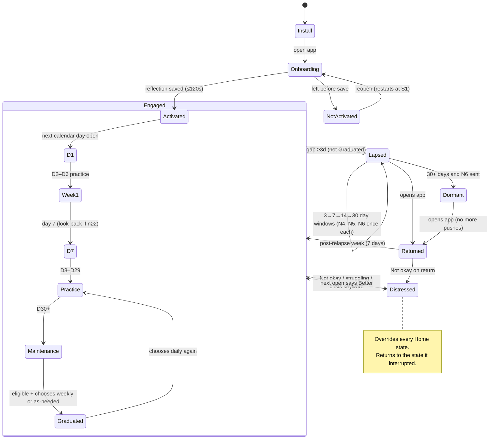
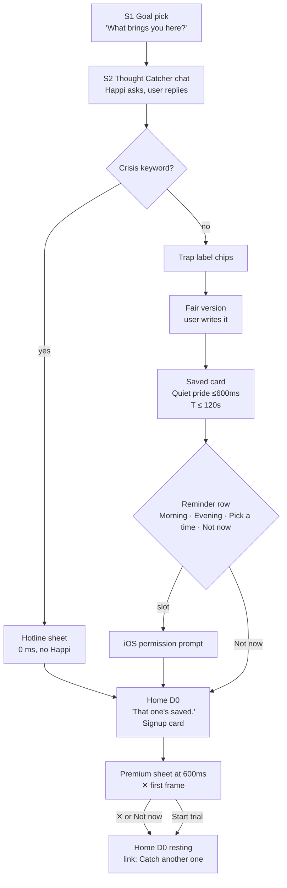
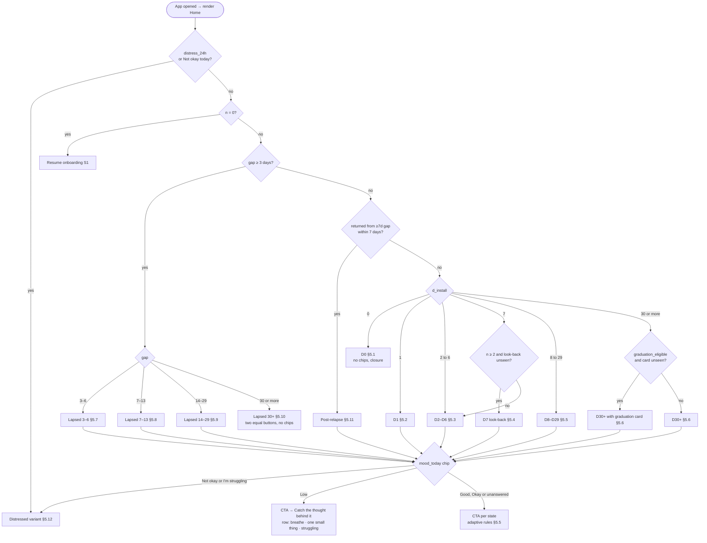
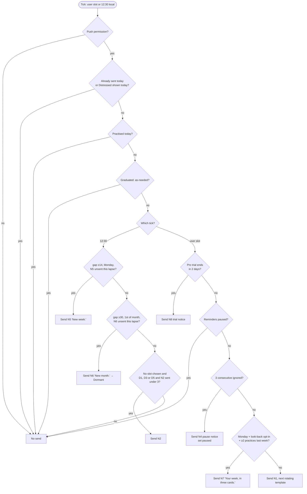
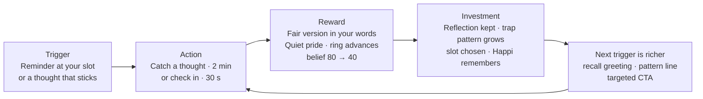

# Happy — Retention Strategy

**One-line position.** Happy keeps people by giving them, every visit, *one thought made fairer, in their own words, kept and remembered* — and by never charging them guilt for the days they don't come. Retention is the side effect of a skill that works; when the skill is learned, we taper, not trap.

**How to read this.** `[n]` = numbered source (§References). `[M]` = a Mobbin screen, linked inline. `[prior: …]` = a decision or finding carried forward from existing project research (not re-retrieved this run). **INFERENCE** = our reasoning, not a sourced fact. Confidence is flagged where a number is below high.

---

## Contents
1. Part 1 — Benchmarks and mechanisms
2. Part 2 — What mental-health apps specifically do
3. Part 3 — Teardown beyond the category
4. Part 4 — Our retention model
5. Part 5 — Home screen behavior by lifecycle stage (centerpiece)
6. Part 6 — Supporting systems
7. Part 7 — Flow diagrams
8. Part 8 — Measurement
9. Part 9 — Ethics guardrails
10. Implementation roadmap
11. Self-critique
12. References

---

## Part 1 — Benchmarks and mechanisms

### 1.1 The factual baseline

| Metric | Number | Source (year) | Confidence |
|---|---|---|---|
| Mental-health apps, median **D15** retention (93 apps, real-world panel) | **3.9%** (IQR 10.3%) | Baumel et al., JMIR (2019) [1] | high |
| Mental-health apps, median **D30** retention | **3.3%** (IQR 6.2%) | Baumel et al. (2019) [1] | high |
| D30 by subtype: peer support / trackers / meditation / breathing | 8.9% / 6.1% / 4.7% / 0.0% | Baumel et al. (2019) [1] | high |
| Mental-health apps, still active at **D15 / D30** (54 apps, Apptopia data) | **~4% / ~3%**; top 10 apps hold 90% of MAU | Kaveladze et al., JMIR Hum Factors (2022) [RG1] | high — independent of Baumel, agrees |
| Health & Fitness, D30 (all apps) | ~3.7% (iOS 3.9%, Android 3.4%) | 2025 benchmark aggregation (likely AppsFlyer 2025) [3] | low — aggregator, unverified |
| Health apps D1 | "20–30%" | Sahha vendor blog (2026) [4] | low — vendor, conflicts with [3] |
| Health & Fitness D1 / D7 / D30, other aggregators | D1 20–34, D7 10–19, D30 3–8 (UXCam 25/10/5; Plotline D1 ~20; AppsFlyer- and Adjust-attributed splits) | [RG3], [RG4], [RG5] | **low — aggregator only; none confirmed on a vendor page** (AppsFlyer, Adjust, Business of Apps returned 404/429/403; the AppsFlyer 2025 report publishes no H&F D1/D7/D30 [RG30]) |
| Cross-industry product **top quartile D7** | **≥ 7%**; 69% of top-D7 products were also top at 3 months | Amplitude Product Benchmark Report (2025) [2] | medium — product-level, not install cohorts |
| Real-world digital CBT completion (7 public programs) | **0.5%–28.6%** | Fleming et al., JMIR (2018) [19] | high |
| MoodGYM open access: completed ≥2 of 5 modules | **10%** (27% completed one) | Neil et al., JMIR (2009) [20] | medium |
| Finch (non-clinical self-care pet), D1 / D7 | **54% / 37%** | Deconstructor of Fun estimate (undated) [44] | low — analyst estimate |
| Youper, retained at week 4 | 43% | Mehta et al., JMIR (2021) [49] | medium — snippet |
| Woebot RCT, retained at 2 weeks | 83% | Fitzpatrick et al., JMIR MH (2017) [30] | high — trial, not real world |

**Gap, stated plainly.** No primary source gave install-cohort **D1/D7** numbers for mental-wellness apps, nor any Education-app numbers. The only primary category-specific numbers are two independent panels on D15/D30: Baumel (2019) and Kaveladze (2022), which agree on ~3% at D30 [RG1][RG2]. Every H&F D1/D7 figure above is aggregator-only. The gap is structural: no vendor publishes mental-health retention and Sensor Tower's 2025 H&F report has none [RG31]; more desk research will not close it, Happy's own cohort data will. Targets in Part 8 are built on this and labelled as inference.

### 1.2 What separates top quartile from median

- **Early value decides late retention.** Amplitude: 69% of top-quartile D7 products were also top-quartile at 3 months; their prescription is "speed users to core value in week 1" [2].
- **A reason to come back that refers to *you*.** Within mental health, the subtypes that retained best at D30 were peer support (8.9%) and trackers (6.1%) — things that accumulate personal or social context — versus one-shot tools like breathing (0.0%) [1]. **INFERENCE:** Home must foreground a returning artifact (your reflections, your patterns), not a tool menu.
- **Protect the already-engaged user.** Duolingo's largest DAU driver over four years was Current User Retention Rate (CURR +21%, "daily churn of our best users" down >40%), not new-user acquisition [12].
- **Forgiveness devices.** Streak Freeze cut churn 21% among users about to break a streak (Duolingo, secondary) [10]; Calm lets users repair a broken streak by back-filling [42]; stoic. lets users restore missed days [46].

### 1.3 Activation / aha-moment literature — what is real

- Facebook's "7 friends in 10 days", Slack's "2,000 messages", Twitter's follow threshold: **no primary analysis found**; retellings only [folklore, A-digest Q3]. We treat them as a *method* (find the behaviour that predicts retention, then shorten the path to it), not as evidence.
- The defensible method: regress D7/D30 retention on session-one behaviours and pick the one with the strongest, earliest signal (Amplitude's D7 framing [2]). For mental health specifically, **only "activities completed per log-in" predicted clinically significant change** in an online depression RCT (n=280); raw usage time explained little [33]. That makes *completing one CBT activity*, not time-in-app, the right activation candidate.

### 1.4 Habit formation

| Finding | Source | Design consequence for Happy |
|---|---|---|
| Median ~66 days to automaticity, range **18–254**; **one missed day did not materially disrupt** habit growth | Lally et al. (2010) [6] | Never punish a missed day; the plan is a 60–90-day horizon, not 21 days |
| If-then plans ("When X, I will Y") improve goal attainment, **d = 0.65** (94 tests) | Gollwitzer & Sheeran (2006) [7] | The reminder ask is phrased as a plan the user chooses, tied to a cue in their day |
| Habits are learned **context-cue → response** links; perceiving the cue triggers the response | Wood & Neal (2007) [8] | Anchor the practice to a stable daily slot the user picks (morning / evening) |
| Activity spikes after **temporal landmarks** (new week, new month) | Dai, Milkman & Riis (2014) [13] | Weekly ring refills Monday; lapsed re-entry lands on Mondays / 1st of month |
| Hook model, Tiny Habits | no peer-reviewed validation found this run | Not used as evidence |

### 1.5 Streaks — when they work, when they backfire

- **Work:** an intact streak log raises subsequent engagement (7 studies) — independent of actual past behaviour; it depends only on *how the log represents it* [9]. Duolingo: separating the daily goal from the streak (streak = 1 lesson) lifted D14 retention +3.3% and new learners on a streak +19% [11]; Duolingo has run 600+ streak experiments [57].
- **Backfire:** showing a **broken** streak lowers later engagement; the effect is **amplified when people blame themselves** and **attenuated when the streak can be repaired** [9]. User voice in this project already documented a "guilt spiral" at re-entry after a broken streak [prior: research-user-voice D1–D2].
- **Category signal:** no streak was found this run in the CBT/chatbot apps examined (Wysa, Woebot, Youper, Sanvello…) — absence of evidence, and Reflectly uses "Daily Challenges". **INFERENCE:** they retain through remembered continuity rather than counters [C2-digest]. Meditation/mood apps kept streaks but **softened** them: Headspace hide toggle [41], Calm weekly-days goal + repair [42], stoic. restore [46], How We Feel small secondary pill [M: HWF home](https://mobbin.com/screens/020dc6d5-ee3a-4871-a0ea-260cdaa88009). None publicly removed them.

### 1.6 Notifications — what lifts return, what drives opt-out

| Finding | Source | Confidence |
|---|---|---|
| Tailored push → **+3.9%** relative likelihood of engaging within 24h; best slot **12:30** (+8.8%), weekend 12:30 **+11.8%**; no increase in attrition | Bidargaddi et al., micro-randomized trial, n=1,255 (2018) [14] | high (workplace well-being sample) |
| Prompt effect is **front-loaded**: +107% at start, decaying over 42 days | Klasnja et al., HeartSteps MRT (2019) [15] | high (n=37) |
| Technology prompts vs none: engagement **RR 1.27** (borderline); prompts promoting new content and sent soon after start work better | Alkhaldi et al. meta-analysis (2016) [37] | high |
| Reminders associated with lower attrition in MH-app RCTs | Linardon & Fuller-Tyszkiewicz (2020) [21] | high |
| Push opt-in: Health & Fitness **33.5% iOS / 43.2% Android** | Airship benchmarks (2026) [16] | medium |
| Self-reported: 43% disable at 2–5 pushes/week; 13% at 1/week | Localytics/BoA surveys (2018–21) [17] | low — stated intent, not behaviour |
| Repetitive reminders for already-done tasks annoy and disengage | HCI studies [B-digest Q6] | low–medium |
| Duolingo grew via timing/template/copy wins **without sending more**; stops reminders after long non-response ("These reminders don't seem to be working. We'll stop sending them for now.") | Mazal (2023) [12]; Taplytics [51] | primary / secondary |

**Consequence:** one reminder a day, at a time the user picked, skipped if they already practised, worth most in week 1, and it stops itself.

### 1.7 Gentle vs aggressive

- Gamification meta-analysis: motivational and behavioural effects are **small and unstable** under rigorous designs; **narrative/game fiction and social interaction** are the moderators that held [18]. A 2025 review of 92 MH-app RCTs found no efficacy link to gamification [prior: soul/01].
- Expected, engagement-contingent rewards lower intrinsic motivation; positive verbal feedback raises it [prior: Deci, Koestner & Ryan 1999 in soul/01].
- **Where aggressive wins:** language learning and fitness, where the behaviour is non-aversive and identity-safe — Duolingo's loss-framed streaks and leaderboards measurably lifted retention [12]. **Where gentle wins:** when the user's state *is* the obstacle — low mood reduces initiation, self-blame amplifies the broken-streak penalty [9, 25]. **INFERENCE:** a CBT user on a bad day is exactly the "self-blame" condition in Silverman & Barasch; aggressive mechanics hit hardest the users we most need to keep.

---

## Part 2 — What mental-health apps specifically do

### 2.1 The adherence problem

- **Dropout is the norm.** Real-world D30 median 3.3% [1]; public digital self-help completion 0.5–28.6% [19]; MoodGYM: only 10% completed ≥2 of 5 modules [20]. Even in RCTs, smartphone MH attrition averages 24.1% short-term and 35.5% at follow-up [21]; depression-app RCT dropout pooled 26.2%, **47.8% after publication-bias adjustment** [22]. Eysenbach called this the "law of attrition" [23].
- **Why it decays faster here.**
  - Depression brings avoidance, anhedonia, concentration loss and negative cognitions that directly impair initiation; adherence is higher among users with lower severity and those perceiving improvement [25 — preprint].
  - Barriers from a 208-article review: severity of symptoms, technical issues, lack of personalization; facilitators: social connectedness, **insight into one's own health**, feeling in control, privacy [24].
  - Some users leave because they got what they needed. Research names this **"e-attainment"**: discontinuing "after personal goals have been met", which trials miscount as dropout [58]. A 2024 scoping review codes "no need anymore" as one abandonment reason [59]. Peer-reviewed but small; prevalence unknown.
  - Effort asymmetry (self-reflection vs scrolling) — **no direct study found**; INFERENCE consistent with [24, 25].
- **The intention–behaviour gap.** Just-in-time adaptive interventions (decision points, tailoring variables, decision rules) are the leading framework for delivering support when the user is able to use it [26]. Implementation intentions inside eHealth programs: evidence mixed / grey [B-digest Q3]; the strong evidence is general [7].
- **Supported vs unsupported.**
  - Human feedback: depression-app dropout **11.74% vs 33.96%** without [22].
  - Guidance raises completion (g = 0.29; full completion ~12% higher) [27].
  - Guided beats unguided iCBT at post-treatment only; **no difference at 6–12 months** [28].
  - Mechanism: *supportive accountability* — accountability to someone seen as trustworthy, benevolent and expert [29].
  - Human-feeling bots: Woebot users reported feeling "super good" when it "remembered" to check in; 83% retained at 2 weeks [30]; Wysa working-alliance scores comparable to face-to-face studies after 3 days [31 — company-affiliated].
- **The ethical line.**
  - Aim for **"effective engagement"** — enough to reach the outcome — not maximal engagement [32].
  - Usage metrics explained little of the outcome; activities completed per log-in did [33].
  - APA's App Evaluation Model and NICE's Evidence Standards Framework make engagement *one* criterion alongside privacy, clinical foundation and interoperability [34, 35].
  - Dark patterns in mindfulness apps affect trust; exit dark patterns raise the emotional cost of leaving [36 — grey summaries].
  - **No peer-reviewed trial found showing streaks harm MH users** — the case against them rests on [9] (general consumer evidence) plus category practice and project user voice.

### 2.2 What the apps actually do

Coverage note: Mobbin carried Headspace, Calm, How We Feel, stoic., Wysa and some Finch screens; Daylio, Bearable, Rootd, Woebot, Youper, Balance, Sanvello, Happify, Reflectly, Intellect had no screens and are text-sourced. "—" = not found this run (not evidence of absence).

| App | First session & payoff | Daily check-in | Data reflected back | Distress / crisis | Streaks | Companion | Notable |
|---|---|---|---|---|---|---|---|
| **Headspace** | "How to Headspace" 2-min video first on Today; program card [M](https://mobbin.com/screens/1820617e-1ba9-42c1-b5e4-0c70bd614823) | Stress score framed kindly: "Think of this score as a way to get to know yourself a little better" [M](https://mobbin.com/screens/355cde92-0dab-4d97-9b6a-242160d7b95e) | Activity history | — | Run streak, **hide toggle** [41]; Headspace article: "if you find it off-putting and scary, don't pay it any attention" | Ebb AI companion, memory added Dec 2025 [C1] | Time-of-day Today timeline [M](https://mobbin.com/screens/1cba404f-413c-4a8b-be36-d791e9ca4fed) |
| **Calm** | — | Check-ins tab | Streak dashboard, history | — | **Weekly goal** "3 days of Calm this week" on Home [M](https://mobbin.com/screens/82e555db-347c-4690-95fe-fb1d395b9c7e); manual repair [42] | — | Promo card right under the goal ring |
| **Finch** | — | Mood several times a day | — | "First Aid Kit" sheet + "Helpline" pill [M](https://mobbin.com/screens/a057550d-5b73-4af4-aa54-c28ff457e817) | Missed day: no pet penalty; "you won't be scolded or shamed" [43] | Pet lives **while you're away** (adventures, sleep) via widget [44] | Return = curiosity, not debt |
| **How We Feel** | "First check-in complete — As you check in more, you'll build a deeper understanding of yourself" [M](https://mobbin.com/screens/3c525324-30d7-4160-aa02-325b11019581) | 4-quadrant mood → named feeling → context chips [M](https://mobbin.com/screens/ffd410a5-ea2c-498a-8536-0dc5fda49ef8) | Weekly story recap ending "Keep checking in to see new insights each week" [M](https://mobbin.com/screens/9b70b030-04c4-422f-aeef-04556bb27818) | Country hotline list [M](https://mobbin.com/screens/8594e649-38c0-4705-b9c7-9355952001ff) | Small "9 DAY STREAK" pill, secondary [M](https://mobbin.com/screens/020dc6d5-ee3a-4871-a0ea-260cdaa88009) | — | Entire app free [45] |
| **Daylio** | 5-point mood + activities | "Simplistic interface" so users record "even when they are at their worst" [C1] | Year in Pixels | — | Goal streaks; reminders ON by default; vendor claims reminder users "87% more successful" [56 — vendor] | — | — |
| **Bearable** | — | Morning + evening recommended | Habit↔symptom correlations (premium) | — | — | — | Data depth is the paywall |
| **stoic.** | — | Mood check-in on each open; lighter once-a-day version [46] | Journey timeline [M](https://mobbin.com/screens/ef8f5c26-2e4b-4baa-876e-20d1ab4c3f55) | — | Flame counter; **restore missed days** [46] | — | **Done state**: "All set for the morning." [M](https://mobbin.com/screens/f01552db-f4b2-40a7-8577-5adc84812501) |
| **Rootd** | — | Journal mood/trigger | — | Large red "Rootr" panic button launches panic exercises; Emergency Contact [47] (INFERENCE: acute help is the primary Home affordance) | — | Friendly monster | "Feels like someone is with me" |
| **Wysa** | Chat: "What are you looking for?" → "Let's begin" [M](https://mobbin.com/screens/6eb03ca6-a5da-44e8-a2d0-fe3a33db7dca) | "Glad you're back, JS! 👋 How are you today?" + slider [M](https://mobbin.com/screens/31047b03-c2a4-43b8-9acd-75847f7575aa); "okay" normaliser [M](https://mobbin.com/screens/f75c2739-0a09-447a-8c6f-881b0509ec9b) | — | Persistent red **SOS** pill → helplines → "Can't make a call?" → safety plan, grounding [M](https://mobbin.com/screens/de96d391-118b-4684-add3-62a5634d2d7e) | None seen | Penguin; Home asks "Are you feeling better now?" [M](https://mobbin.com/screens/1feb4801-a9b3-4a95-b5d7-bc095ac9b8f6) | Morning check-in use ↔ longer retention (median 51 days) [48] |
| **Woebot** | "What's going on in your world right now?" → mood [30] | Word/emoji | Weekly sentence: "It looks like Tuesday was your best day" [30] | Auto helplines on keywords [30] | None | **Followed up on goals**; users loved being "remembered" [30] | Consumer app shut 30 Jun 2025, attributed to FDA cost, not engagement [50] |
| **Youper** | — | — | — | — | — | AI assistant | 43% at week 4 [49] |
| **Balance** | — | Daily questions that **change today's meditation** [C2] | Personalisation | — | — | — | First year free (geo-limited, unverified) |
| **Sanvello** | — | Daily mood → suggested tools | — | "Not for urgent care, call 911" | — | — | Free via insurers |
| **Happify** | Tracks (mini-courses) | — | — | — | — | — | Still live (Twill/DarioHealth); reviewer says no reminders |
| **Reflectly** | Guided first mood check-in | Slider + "Daily Challenges" | — | — | Challenge gamification | — | $79.99 lifetime anchor in onboarding; countdown offer [C2] |
| **Intellect** | Learning paths + "Rescue sessions" | — | — | — | — | — | Daily engagement predicted next-day resilience (n=150) [C2] |

**Not found for any app this run:** exact push copy, after-absence win-back copy, lapsed-user Home screens, first-session paywall timing (except Reflectly), course completion data. Generic "welcome back" Mobbin searches returned login screens only [E-digest §5].

### 2.3 Synthesis for Part 2

**Ethical and effective in mental health**
1. **Remembered continuity** — follow up on what the user said last time (Woebot goals [30], Wysa "Are you feeling better now?" [M]). Mechanism: supportive accountability [29] without a human.
2. **Mood reflected back as narrative and insight** — self-monitoring raised emotional self-awareness, which indirectly reduced depressive symptoms in adolescents [38]; in-app mood monitoring lowered dropout [22]; insight is a named facilitator [24].
3. **Low-effort entry for low-energy days** — Daylio's simple design for "even when they are at their worst" [C1]; Wysa's "okay" normaliser [M].
4. **Weekly or forgiving consistency** — Calm's weekly days goal [42], repair/restore [42, 46], Lally's missed-day finding [6].
5. **One-tap help that never competes with the main CTA** — SOS/Helpline header pill → hotlines first → self-help for those who can't call [M Wysa, Finch]. Only 35% of MH apps show crisis resources in-app at all [39].
6. **Closure** — a "done for today" state (stoic. [M]) instead of an infinite feed. Effective engagement, not maximal [32].

**Effective elsewhere, harmful here**
| Mechanic | Works where | Why harmful in MH | Source |
|---|---|---|---|
| Daily streak with visible break | Duolingo [12] | Break + self-blame lowers engagement; depression amplifies self-blame | [9], [25] |
| Loss-framed streak-saver push ("Your streak is about to end!") | Duolingo [12] | Pressure on users whose obstacle is low mood; anxiety trigger | INFERENCE from [9], [24] |
| Leaderboards / social comparison | Duolingo +17% time [12] | Comparison is a classic depressive cognition; privacy facilitator lost [24] | [24] |
| Commitment pledges ("I'm committed", "I promise myself") | Duolingo, BitePal, Ahead [M] | Creates a promise the user may break on a bad day → self-blame [9] | [9] |
| Countdown offers / lifetime anchors in onboarding | Reflectly [C2] | Fake urgency in a vulnerable state; dark pattern [36] | [36] |
| Pet that suffers when you're away | Tamagotchi pattern | Guilt; project user voice: "sad pet backfires" | [prior: research-user-voice] |
| Maximise time-in-app | Media apps | Usage ≠ outcome [33]; effective engagement [32] | [32], [33] |

**Three things a CBT app can do that meditation or mood apps cannot**
1. **Remember the content of a thought and its fair version, and follow up on it.** A meditation app can say "you meditated"; Happy can say "Last week you caught *'She thinks my work is sloppy'* — you wrote *'I don't actually know that yet.'*" That is Woebot's remembered follow-up [30] applied to the user's own words.
2. **Show the user their thinking-trap pattern.** Trap labels (Mind reading, Catastrophising…) accumulate into a personal pattern ("Mind reading came up 3 times this week") — insight about *cognition*, not just mood, which is the facilitator in [24] and the mechanism in [38].
3. **Measure the skill working inside a session.** A thought record has a built-in outcome: how much the user believes the thought before vs after. No meditation app has a per-session efficacy signal; it lets Happy optimise for improvement, not minutes [33].

---

## Part 3 — Teardown beyond the category

| App | Onboarding & time-to-value | D0 design | Home day-0 / 2 / 7 / lapsed | Streak & commitment | Notifications | Memory | Win-back | Paywall |
|---|---|---|---|---|---|---|---|---|
| **Duolingo** | "Learn for free. Forever." value first [M](https://mobbin.com/screens/fb4eda98-538d-4bc0-9ef6-bf06ed401c12) | — | Path Home; early = few nodes, mature = 4 header counters, unit 99 [M](https://mobbin.com/flows/971a833b-d067-4302-86b1-34df80ae62ac); segments new / current / reactivated (7–29d) / resurrected (30+d) [12] | Day-6 "Tomorrow makes 7 days" + "I'M COMMITTED" [M](https://mobbin.com/screens/f6675d16-c6b5-4847-aa9f-fb66a2d61e88); freeze −21% at-risk churn [10]; goal/streak split +3.3% D14 [11]; Streak Wager D7 +14% [11] | Bandit algorithm over templates (KDD 2020) [52]; wins without more volume [12]; stops after non-response [51] | — | Reactivation buckets 7–29d / 30+d [12]; copy not found | — |
| **BitePal** | 18–19 screens; coach-tone picker: "You showed up again today. That's the whole thing." Cheerleader / Gentle & kind / Straight talker / Mindful guide [D] | "A Streak is born!" + "I'm commited" [M](https://mobbin.com/screens/465c5840-e986-43f6-8826-c15a74866956) | Raccoon over garden, flame, stat cards [M](https://mobbin.com/screens/46a02ecf-d18a-4847-bb3c-6ba18e1b52bc) | Duolingo-style daily streak | Priming shows a sample push in the mascot's voice + "Set up reminders" [M](https://mobbin.com/screens/083cc63f-4506-4dd8-9fc4-b20c2dba4f77) | — | — | — |
| **Ahead** | 36 screens; quiz → journey match % → **draw a checkmark "I promise myself"** → signup → paywall [D] | "First step done… 1 day streak", Streaky the caterpillar hatches [M](https://mobbin.com/screens/fb781054-c6ab-4f88-ace0-939af8dd14ca) | — | Evolving mascot tied to streak | — | — | — | End of onboarding |
| **Fabulous** | Check boxes committing to 3 morning habits — "Yeah. I can do that." [53] | Personal letter right after signup [53] | — | Journeys as story chapters [53] | Immersive: song + illustration + countdown [53] | Letters | — | — |
| **Noom** | 96–113 web screens, 10–15 min, then paywall [54] | Self-set lesson time 1–4 / 5–8 / 9–12 min → "I'VE GOT THIS" [M] | Today: log meals, "Finish day" CTA, insights [M](https://mobbin.com/screens/fe70fe50-afbe-452b-92a5-31b6ba6151ad) | Daily challenges, seed currency | — | Meal logs | — | After long funnel |
| **Elevate** | Long value-rich onboarding → soft paywall [55] | — | — | Workout calendar streak; one review-derived report of a user losing a 97-day streak on one miss and asking for break days [55] (low) | — | — | — | Soft, end of onboarding |

**Mechanic verdicts**

| Mechanic | Source | Verdict for Happy | Why |
|---|---|---|---|
| Separate "showed up" from "did enough" | Duolingo [11], BitePal copy [D] | **Transfer** | Our minimum is one practice; the weekly ring is the goal, never the gate |
| Optimise current-user churn | Duolingo CURR [12] | **Transfer** | Week-1 users (days 2–6) get the most design care |
| Streak freeze / repair | Duolingo [10], Calm [42] | **Soften** → no streak to freeze; weekly ring has no fail state | Repair attenuates harm [9]; removing the break removes it entirely |
| Coach-tone picker | BitePal [D] | **Transfer, deferred** (Phase 3 experiment) | User chooses how Happi speaks before a bad day; autonomy (SDT) [prior: soul/01] |
| Personal letter / remembered follow-up | Fabulous [53], Woebot [30] | **Transfer** | Becomes the D1 recall greeting |
| Self-set daily effort | Noom [M] | **Transfer** as reminder-slot choice | If-then plan [7] |
| Story-format weekly recap | WHOOP, HWF [M] | **Transfer** | D7 and weekly look-back |
| Notification restraint + self-stop | Duolingo [12, 51] | **Transfer, soften copy** | Drop the passive-aggressive edge |
| Pledges ("I'm committed", draw a checkmark) | Duolingo, BitePal, Ahead, Fabulous | **Reject** | Promise-then-break → self-blame [9] |
| Leaderboards, friend streaks, Streak Society | Duolingo [12, M] | **Reject** | Social comparison; privacy [24] |
| Streak Wager | Duolingo [11] | **Reject** | Gambling frame on a health behaviour |
| Long investment funnel before paywall (96–113 screens) | Noom [54] | **Reject** | Time-to-value target is under 2 min (Part 4) |
| Mascot that evolves with your streak | Ahead, BitePal | **Soften** → Happi's world grows with *total* practices, never shrinks | Growth without a loss state |
| Countdown discount / lifetime anchor | Reflectly [C2] | **Reject** | Fake urgency [36] |

---

## Part 4 — Our retention model

### 4.1 Activation event

**Hypothesis.** *Saving one completed Thought Catcher reflection (thought + trap label + fair version) in session one* is Happy's activation event, and users who also **choose a reminder slot** in that session retain at least 1.5× at D7.

**Why this event.**
- Completed activities per log-in is the only usage variable tied to clinical change [33]; a saved reflection is a completed activity, not a visit.
- It produces a *personal artifact* — the property that separated the best-retaining MH subtypes [1].
- The reminder slot is an implementation intention [7] anchored to a daily cue [8].

**Validation (Phase 1 analytics, ≥2,000 installs).** Cohort session-one users by {saved ∕ not saved} × {slot chosen ∕ not}. Logistic regression of D1, D7, D30 return on each session-one behaviour (saved, slot set, signed in, paywall viewed, onboarding duration). Activation = the behaviour with the largest early-and-stable effect. Switch if "slot chosen" alone predicts better than "saved". **INFERENCE:** 1.5× is a planning threshold, not a sourced number.

### 4.2 Time-to-value target

**Target: the first fair thought on screen ≤ 90 seconds from first open; saved card ≤ 120 seconds.**
- Amplitude: speed to core value in week 1 predicts 3-month retention [2]. HWF and Insight Timer deliver a named-feeling artifact at the end of the first check-in [M] (INFERENCE: under a minute; not measured).
- Already cut in the current 2-screen spec [prior: EXPERIENCE.md]: account wall, quiz/survey, fake-personalisation loader, pledge, paywall before value, streak setup.
- **Still to cut:** any screen between goal pick and the first Happi chat bubble; the paywall must never render before the saved card (it opens over Home at 600 ms — keep).

### 4.3 The core loop

| Stage | Happy's version | Evidence |
|---|---|---|
| **Trigger** | External: the one reminder at the user's slot, *"What's been on your mind today?"* Internal: a sticky thought or a low moment — Home's check-in chips catch it | [7], [8], [14] |
| **Action** | 2-minute Thought Catcher, or a 30-second mood check on a low-energy day | Low-effort entry [C1 Daylio], [33] |
| **Reward** | The fair version in your own words, saved as a card; Happi Quiet pride ≤600 ms; weekly ring advances; on recurring traps, the pattern insight | Positive verbal feedback raises intrinsic motivation [prior: Deci et al. 1999]; insight facilitator [24], [38] |
| **Investment** | Library of reflections grows; trap pattern sharpens; reminder slot set; next visit opens with a recall of the last one | Personal-context subtypes retain best [1]; remembered follow-up [30] |

### 4.4 Stance on streaks: **reject the daily streak; keep the weekly ring and lifetime count**

**Decision.** Keep `ProgressPair` from EXPERIENCE.md as the *only* progress surface:
- "Practices completed: N" — lifetime, only increases.
- "N of 3 this week" ring — refills Monday, no fail state.
- The word "streak" never appears.

This **supersedes** soul/06's "{{count}} days practised this month" line. Reason: one progress model, and a weekly cadence matches the fresh-start landmark [13].

**Why.**
- A broken daily streak lowers engagement, worse under self-blame [9]. Depression raises self-blame and lowers initiation [25].
- Missed days don't harm habit formation [6], so daily pressure buys nothing biologically.
- The category's own practice includes a weekly days-goal (Calm [42]); no streak was found in the CBT bots examined [C2].
- One published Duolingo streak win came from *decoupling* the goal from the daily gate: +3.3% D14 [11] (secondary).

**Mechanic.**
- Weekly goal is 3 practices (Mon–Sun, user's locale week start).
- Reaching 3 fills the ring and shows "3 of 3 — that's your week." with no push to exceed it.
- The ring never shows red, empty-with-alarm, or "0".
- At 0 the ring is hidden; the lifetime count stays.

**User voice (Round 2, [UV2] R2.2).** Users describe the cycle: "build a streak, have one bad day, see the reset, feel immediate shame, never open the app again" (r/ADHD and r/finch, 2026). Long Finch streaks do tether people ("too afraid to let it go… 400+ day streak"), but the same users call the app "a daily source of stress" and the hold "underhanded". One asks for exactly a frequency goal: "if I fail one day, it doesn't kill the streak".

**Progress must never be lost.** Losing accumulated progress reads as grief ("Finch broke my heart I cried for days" after a 2-year loss, [UV2] R2.4). The lifetime count and all saved reflections survive reinstall and device change once the user signs in. The sign-in sheet says so ("Keep your reflections safe").

**Forgiveness.** Nothing to forgive. The ring resets every Monday by design (fresh start [13]). A user who missed a week sees a fresh ring, not a hole. **Decision:** ship ring-only; experiment E6 tests adding a day-dots row.

### 4.5 The emotional contract

> **Every visit, you leave with one thought made fairer, in your own words — and Happi remembers it, so you never start from zero.**

**What the user can't get elsewhere:**
- Mood apps record how you feel.
- Meditation apps calm you for ten minutes.
- Happy changes what the thought *says* and keeps the better version where you can find it.

The guarantees: no guilt for absence, nothing you write is shown anywhere but in the app, help is always one tap away.

### 4.6 Graduation

**Position.** Lower use after improvement is a success, not churn.
- Rationale: effective engagement [32]. Guided and unguided iCBT outcomes converge at 6–12 months [28]. **INFERENCE** from that: indefinite daily use is not required for benefit.
- E-attainment is a published construct [58], and "no need anymore" is a coded abandonment reason [59]; prevalence is unknown. The policy is therefore *offer, never force*.

**Mechanic: Maintenance mode**, offered once, from D30+. All of these must hold (thresholds are **INFERENCE**; **clinician sign-off is required before build**, see Self-critique):
- at least **8 weeks since activation** (NICE guided self-help is up to 6–8 sessions over 9–12 weeks [RG19]; NHS step 2 is up to 6 sessions ending in a relapse-prevention plan [RG20]);
- at least **8 completed practices** (the top of that session range);
- **PHQ-4 trend down:** the latest total is lower than the first, with no subscale at ≥3 on the latest check, and no "Not okay" mood chip in the last 14 days.

No guideline or app publishes a daily-to-weekly step-down rule [RG47], so these thresholds cannot be sourced. Measurement every 14 days gives 4–5 PHQ-4 points by week 8 (INFERENCE: the fit is a design choice a clinician should confirm).

**Relapse is common** (65.8% within a year after low-intensity care; single source, low–medium [RG20]), so the way back to daily practice must be one tap. "Back to daily" lives permanently in Account and on the maintenance Home, never behind a recap.

**Card:** "You've built a real skill. How often do you want Happy now?"
- Options, equal weight: **Keep my daily reminder** / **Switch to a weekly check-in** / **I'll come when I need it**.
- Weekly check-in: one reminder per week at their slot, on Mondays.
- "I'll come when I need it": all reminders off; Home stays fully usable; the Get help pill stays. Re-entry later is a normal return with no recap guilt.

**Metric:** graduated users are a separate segment, excluded from churn. Success = they report "Okay or better" when they return (Part 8).

---

## Part 5 — Home screen behavior by lifecycle stage

### 5.0 The building blocks (all variants are compositions of these)

| Block | Definition | Rules |
|---|---|---|
| **Header** | Greeting (time of day) · Get help pill · Help · Account | Get help pill always visible, every state [39], [M Wysa] |
| **Hero** | Happi (rig expression) + at most 1 bubble | Presence caps [prior: soul/03]: ≤1 bubble/screen, ≤3/session, Welcome back ≤1/24h, Celebrating ≤1/7d. A bubble appears **only** for: D1 recall, return greeting, pattern unlock, ring filled, exercise unlock, look-back ready, graduation card. Otherwise Happi idles silently |
| **Check-in chips** | Question rotates daily: "How's today?" · "How are you feeling right now?" · "What's the weather inside today?" · "How's your head today?" — answers stay Good · Okay · Low · Not okay | Never the same question two days running: repetition reads as boring ([UV2] R2.3). Word chips only, no drag-a-face input — the one "condescending" complaint found targeted that mechanic ([UV2] R2.4). Shown once per day from D1; answered chips collapse to one line ("Today: Okay"). **Low** opens a follow-up row: "Want to start small?" → *Catch the thought behind it* (becomes the CTA) · *Breathe for a minute* · *One small thing* (once Behavioral Activation is unlocked) · *I'm struggling* (→ Distressed). **Not okay** → Distressed |
| **Primary CTA** | Filled button | Exactly one filled CTA per state. Two exceptions: **D0** has none (closure state) and **Lapsed 30+** has two equal outline buttons (carried forward from soul/06) |
| **Last reflection card** | Most recent saved thought + fair version | Never shows reflections saved in a session with Low/Not okay chips or crisis keywords [prior: soul/04 F17] |
| **ProgressPair** | "N completed" + weekly ring "N of 3 this week" | Shown from n ≥ 1; ring hidden when w = 0 |
| **Pattern line** | "Mind reading came up 3 times this week." | Unlocks when one trap has ≥2 entries |
| **Look-back card** | Story-format recap entry | D7 once (n ≥ 2); then Mondays when last week had ≥2 practices |
| **Explore** | Other CBT exercises | Progressive unlock (§5.13) |
| **Signup / premium** | SignupNudgeCard, PremiumSheet | Per EXPERIENCE §9; never in Distressed, Low-mood sessions, or Lapsed 30+ |

**Inputs for the decision tree (§7.3):**
- `d_install`: days since install (local calendar)
- `gap`: days since last practice
- `n`: lifetime practices
- `w`: practices this week
- `mood_today`
- `distress_24h`: Not okay / I'm struggling / crisis keyword in the last 24h
- `reminder_state`
- `graduation_eligible`
- `returned_at`: the date of a return after a gap of 7 days or more

**Crisis keyword list:**
- Owned by the clinical content lead.
- Versioned config, reviewed with a clinician before each release.
- Matching happens on device.

### 5.1 D0 — first Home (right after onboarding)

- **Mental state:** a small win and mild curiosity; possibly raw after naming a hard thought. Needs closure and safety, not another ask.
- **Primary CTA:** none filled — the saved card is the hero.
  - Text link: **"Catch another one"**.
  - *Why:* a "done" state closes the loop (stoic. [M](https://mobbin.com/screens/f01552db-f4b2-40a7-8577-5adc84812501)).
  - The goal is effective engagement, not more engagement [32]. The D0 job is to install the cue (the reminder slot asked on the saved card [7]), not to extract a second session.
- **Shown, in order:**
  1. Greeting
  2. Happi
  3. Saved reflection card ("Your first reflection")
  4. ProgressPair ("1 completed · 1 of 3 this week")
  5. SignupNudgeCard (guest)
  6. PremiumSheet, once at 600 ms (existing spec)
- **Hidden:** check-in chips (they just did the work), Pattern line, Look-back, Explore.
- **Hero & tone:** Happi Quiet pride ≤600 ms, then Neutral idle. No bubble — the card speaks. Tone: warm, brief, finished.
- **Progress:** ProgressPair at 1 / ring 1 of 3.
- **Unlock order from here:** check-in chips (D1) → Thought Reframing (D3) → Behavioral Activation (D5 or first Low).
- **Copy:**
  - H1 **"That one's saved."**
  - Sub **"Come back when another thought sticks around."**
  - Link **"Catch another one"**
- **Motion:**
  - Card rises 8pt over 300 ms, `cubic-bezier(0.23,1,0.32,1)`.
  - Quiet pride uses rossark `flow`, then `wave` idle. A rare moment, so it gets the delight ("frequency decides how much", rossark MOTION.md).
  - Reduce Motion: static.
- **Research:** [2], [7], [32], stoic. [M].

### 5.2 D1 — first return

- **Mental state:** testing whether it's worth it. Needs proof it remembers them and a fast way in.
- **Primary CTA:** **"Catch today's thought"** (~2 min).
  - *Why:* completing an activity is what predicts outcome [33].
  - Prompt value is front-loaded (HeartSteps, 42 days [15]). **INFERENCE:** the first days are the highest-value window in our setting too.
- **Shown, in order:**
  1. Greeting
  2. Happi + recall bubble
  3. Check-in chips
  4. CTA (helper "About 2 minutes")
  5. Last reflection card
  6. ProgressPair
  7. SignupNudgeCard (guest)
- **Hidden:** Explore (a single guided start, as in Headspace and pillowtalk new-user Homes [E §2]), Pattern line, Look-back.
- **Hero & tone:** Happi Welcome back (≤1,800 ms). Bubble recalls yesterday: *"Yesterday you turned 'She thinks my work is sloppy' into 'I don't actually know that yet.'"* — unless that reflection is excluded by the card rule, then *"Good to see you."* Tone: glad, specific, no pressure.
  - Why: remembered follow-up (Woebot [30]), "Glad you're back" (Wysa [M](https://mobbin.com/screens/31047b03-c2a4-43b8-9acd-75847f7575aa)), personal letter (Fabulous [53]).
- **Progress:** ProgressPair, ring 1 of 3 (2 of 3 after today's practice).
- **Unlock order:** Thought Reframing at D3.
- **Copy:**
  - H1 **"Good to see you."**
  - Chips **"How's today?"**
  - CTA **"Catch today's thought"** / helper **"About 2 minutes"**
- **Research:** [15], [30], [33], [53], [M Wysa].

### 5.3 D2–D6 — building the week

- **Mental state:** the habit forms or fades here. Project user voice found 30–50% of abandonment happens after the first 1–2 sessions [prior: research-user-voice]. Needs an easy, varied, non-judging way back each day.
- **Primary CTA:** **"Catch a thought"**.
  - Low chip → CTA becomes **"Catch the thought behind it"** with the Low follow-up row (§5.0).
  - Good chip → CTA unchanged; helper **"Good days are worth noticing too."**
  - *Why:* tailoring on the user's state [26]; low mood raises the cost of starting [25].
- **Shown, in order:**
  1. Greeting
  2. Happi
  3. Chips
  4. CTA
  5. Last reflection
  6. ProgressPair
  7. Pattern line (once unlocked)
  8. Explore row (from D3)
  9. SignupNudgeCard (guest, per §9 triggers)
- **Hidden:** Look-back, reflection search.
- **Hero & tone:** Happi Neutral idle. Bubble only for the §5.0 triggers.
  - On the ring filling (w = 3): Quiet pride + bubble **"That's your week."** Nothing asks for a 4th.
- **Progress:** ProgressPair. At w = 3 the ring line reads **"3 of 3 — that's your week."**
- **Unlock order** (each announced once by a one-line chip, never a modal):
  1. D3 — Thought Reframing ("New: Thought Reframing")
  2. D5 or the first Low chip, whichever comes first — Behavioral Activation ("New: One small thing")
  3. First trap with ≥2 entries — Pattern line
- **Copy:**
  - Greeting **"Good morning." / "Good afternoon." / "Good evening."**
  - CTA **"Catch a thought"**
  - Pattern unlock bubble **"Mind reading came up twice. Want to see how you answered it?"** → opens reflections filtered to that trap.
- **Research:** [11] (minimum separate from goal), [12] (protect current users), [24], [25], [26], [38].

### 5.4 D7 — first week

- **Mental state:** "Is this part of my life?" Needs evidence of progress that is about *them*.
- **Primary CTA:** **"See your first week"** → a 3-card story:
  1. **"You caught N thoughts."**
  2. **"The trap that showed up most: Mind reading."**
  3. One fair thought they wrote, quoted (card rule applies).
  - End card: **"Next week starts Monday. Come back whenever a thought sticks."** with buttons **"Done"** / **"Catch a thought"**.
  - *Why:* How We Feel and WHOOP story recaps [M](https://mobbin.com/screens/9b70b030-04c4-422f-aeef-04556bb27818); Woebot's narrative weekly summary [30]; self-monitoring builds self-awareness [38].
- **Fallback:** n < 2 → render the D2–D6 Home. A recap of nothing is a shame surface.
- **Shown:**
  1. Greeting
  2. Happi + bubble
  3. Look-back card (as the CTA)
  4. Chips
  5. "Catch a thought" as a text link
  6. Last reflection
  7. ProgressPair
  8. Pattern line
  9. Explore
- **Hidden:** SignupNudgeCard for this session (one ask per moment [prior: EXPERIENCE §12]).
- **Hero & tone:** Happi Quiet pride; bubble **"One week. Want to see it?"** Tone: proud for them, not of them.
- **Progress:** ProgressPair. The 7th *entry-day* milestone modal is separate and fires whenever it happens [prior: soul/06].
- **Unlock order:** look-back becomes weekly (Mondays) → ABC Analysis at D10.
- **Copy:** H1 **"One week with Happy."** / CTA **"See your first week"**.
- **Motion:**
  - Story cards cross-fade over 300 ms with ease-out.
  - Progress segments fill linearly over each card's on-screen time.
  - Reduce Motion: static cards, tap to advance.
- **Research:** [30], [38], [M HWF], [M WHOOP](https://mobbin.com/screens/9214ddad-b502-43c5-aa25-70bd056e2c76).

### 5.5 D8–D29 — the practice

- **Mental state:** routine is forming (Lally's median 66 days, range 18–254 [6]). Risk: sameness. Needs depth and evidence that the skill is working.
- **Primary CTA:** adaptive, first match wins:
  1. Low chip on 2 of the last 3 days → **"One small thing"** (Behavioral Activation).
  2. Same trap ≥3 times in 14 days → **"Practice answering Mind reading"** (Thought Reframing seeded with that trap).
  3. Otherwise → **"Catch a thought"**.
  - *Why:* tailoring [26]; completed activities predict outcome [33].
- **Shown, in order:**
  1. Greeting
  2. Happi
  3. Chips
  4. CTA
  5. Pattern line
  6. Last reflection
  7. ProgressPair
  8. Look-back card (Mondays)
  9. Explore
- **Hidden:** nothing structural. SignupNudgeCard only per §9 triggers.
- **Hero & tone:** Neutral idle; bubbles only for the §5.0 triggers. Tone: steady, companionable, brief.
- **Progress:** ProgressPair. Reflection count is also visible in the library.
- **Unlock order:** each gated on n ≥ 4; if n < 4, it waits.
  - D10 — ABC Analysis
  - D14 — Journal
  - D21 — Fear Ladder
  - n ≥ 10 — reflection search by trap
- **Copy:**
  - Mondays: H1 **"New week."**; look-back card **"Last week, in 3 cards"**.
  - Other days: greeting by time of day; CTA per rule.
- **Research:** [6], [13], [26], [33], progressive disclosure [E §10].

### 5.6 D30+ — maintenance

- **Mental state:** competent; some users are improving and need Happy less. Needs Happy to respect that, and to be useful on bad days.
- **Primary CTA:** same adaptive rule as §5.5.
- **Shown, in order:**
  1. Greeting
  2. Happi
  3. Chips
  4. CTA
  5. Pattern line
  6. Last reflection
  7. ProgressPair
  8. Monthly look-back (on the 1st) or weekly look-back (Mondays)
  9. Graduation card (once, when eligible)
  10. Explore
  11. Reflection search
- **Hidden:** exercise unlock chips (everything is unlocked).
- **Hero & tone:** Neutral idle. Graduation card bubble **"You've built a real skill."** Tone: respectful, adult.
- **Progress:** ProgressPair. The monthly look-back adds **"How your check-ins moved"** (share of Okay+ days, first week vs this month).
- **Unlock order:** monthly look-back on the 1st → graduation card when eligible (§4.6).
- **Copy:**
  - 1st of month H1 **"New month."**
  - Monthly card **"Your month, in 3 cards"**
  - Graduation card per §4.6
- **Research:** [13], [28], [32].

### 5.7 Lapsed — 3–6 days without practice

- **Mental state:** busy, or a little guilty. Needs zero friction and zero reckoning.
- **Primary CTA:** **"Catch a thought"**. *Why:* the gap is short, so the habit is intact [6].
- **Shown, in order:**
  1. Greeting
  2. Happi + bubble
  3. Chips
  4. CTA
  5. Last reflection
  6. ProgressPair (this week only)
  7. Explore
- **Hidden:** Look-back (unless it's Monday with ≥2 practices last week — usually not), SignupNudgeCard this session.
- **Hero & tone:** Happi Welcome back; bubble **"Good to see you."** Never name the gap. Banned: "missed", day counts [prior: soul/06], [9].
- **Progress:** ProgressPair. A fresh week is never shown as broken.
- **Unlocks:** paused; resume normally after the next practice.
- **Copy:** H1 **"Good to see you."** / CTA **"Catch a thought"**.
- **Research:** [6], [9].

### 5.8 Lapsed — 7–13 days

- **Mental state:** the habit is fading; the barrier to re-entry is higher. Low mood may be the reason [25].
- **Primary CTA:** **"Start with a 30-second check-in"** (expands the chips). Secondary text link: **"Or catch a thought"**.
  - *Why:* lower effort first. Low mood reduces initiation [25].
  - Daylio's design for recording "even when they are at their worst" [C1].
  - Wysa opens returns with the mood question [M](https://mobbin.com/screens/31047b03-c2a4-43b8-9acd-75847f7575aa).
- **Shown, in order:**
  1. Greeting
  2. Happi + bubble
  3. CTA
  4. Recall line
  5. ProgressPair
  6. "Turn reminders back on" link (if N4 paused them)
- **Hidden:** Explore, Pattern line, Look-back, SignupNudgeCard.
- **Hero & tone:** Happi Welcome back; bubble **"Good to see you."** Tone: easy, low-stakes.
- **Recall line:** **"Last time, you wrote: 'I don't actually know that yet.'"** — follows the card rule, only if recall is on [prior: soul/04]. **Fallback** (recall off, or no saved reflection): **"Your reflections are right where you left them."**
- **Bubble variants** (E12): "Good to see you." · "Easy does it." · "Glad you're here."
- **Progress:** ProgressPair (this week only).
- **Unlocks:** Explore and Pattern return after the first practice.
- **Copy:**
  - H1 **"Good to see you."**
  - CTA **"Start with a 30-second check-in"**
  - Link **"Or catch a thought"**
- **Research:** [24], [25], [30], [M Wysa], [C1].

### 5.9 Lapsed — 14–29 days

- **Mental state:** has likely stopped thinking of themselves as a user. Needs a fresh-start frame.
- **Primary CTA:** **"Start with a 30-second check-in"**; link **"Or catch a thought"**.
- **Shown, in order:**
  1. Greeting (Monday: **"New week."**; 1st of month: **"New month."** [13])
  2. Happi + bubble
  3. CTA
  4. Recall line
  5. ProgressPair
  6. Reminders link
- **Hidden:** Explore, Pattern line, Look-back, SignupNudgeCard, PremiumSheet.
- **Hero & tone:** Happi Resting → Welcome back; bubble **"Good to see you."** Tone: as if no time passed.
- **Progress:** ProgressPair (this week only).
- **Unlocks:** full Home after the first practice; the post-relapse week (§5.11) starts.
- **Copy:**
  - H1 **"New week."** on Mondays / **"New month."** on the 1st, otherwise **"Good to see you."**
  - CTA **"Start with a 30-second check-in"**
  - Recall line and its fallback as §5.8.
- **Research:** [13], [24], [25].

### 5.10 Lapsed — 30+ days (existing spec, carried forward [prior: soul/06])

- **Mental state:** a near-new user who may not remember the method. Needs to choose their own way back.
- **CTAs:** two **equal** outline buttons — **"Pick up where you left off"** / **"Start with a short check-in"**. Link **"Change reminders"**.
- **Shown:**
  1. Greeting
  2. Happi
  3. The two buttons
  4. Scope card with the **"Show Happi"** toggle
  5. Reminders link
- **Hidden:** ProgressPair, Pattern, Look-back, Explore, signup, paywall.
- **Hero & tone:** Happi Resting → Welcome back (≤1,800 ms); bubble **"Good to see you."**
- **Scope-card line:** **"Your reflections are saved. Start wherever feels right."**
- **Progress:** hidden until the first practice. Then ProgressPair returns with the lifetime count intact.
- **Research:** [9], [12] (resurrected users are their own segment), [13].

### 5.11 Post-relapse return (the 7 days after a return from a ≥7-day gap)

- **Mental state:** a fragile restart. Needs the D2–D6 simplicity with memory.
- **Primary CTA:** as §5.3 (adaptive on chips).
- **Shown:** as §5.3, with the last reflection pinned.
- **Hidden:** Look-back and the graduation card until 2 practices since `returned_at`; SignupNudgeCard.
- **Hero & tone:** Neutral idle. On the first practice after the return, Quiet pride + bubble **"That's one more kept."** (once). No "back on track" or count language.
- **Progress:** ProgressPair.
- **Unlocks:** none new; prior unlocks persist.
- **Research:** [9], [12], [29] (accountability without judgment).

### 5.12 Distressed variant (overrides every state)

- **Trigger:** `distress_24h` — "Not okay" chip, "I'm struggling" in the Low follow-up, or a crisis keyword in any session in the last 24h.
- **Mental state:** acute distress. Needs safety, grounding, and a human route — not a lesson.
- **Primary CTAs:** three full-width options of equal weight (the safety exception to the one-CTA rule):
  1. **"Breathe with me — 1 minute"**
  2. **"Write down the loudest thought"** (Thought Catcher, short mode)
  3. **"Talk to someone now"** → regional hotlines first, then **"Can't call right now?"** → **"Make a safety plan"** / **"Grounding for 1 minute"**
- **Shown:** H1, the three options, Get help pill.
- **Hidden:** paywall, signup, progress, pattern, look-back, Explore, milestone modals, all bubbles.
- **Hero & tone:** Happi Gentle concern, small, no bubble, 300 ms fade only. On the crisis sheet itself: no Happi, 0 ms, no sound or haptics [prior: soul/04 F16]. Tone: plain, calm, short sentences.
- **Progress:** hidden.
- **Next open within 24h:** chips replaced by **"How are you now?"** → "Better" / "About the same" / "Still not okay" (the last re-enters this variant).
- **Copy:** H1 **"That sounds hard. Let's go gently."**
- **Research:**
  - Wysa's in-chat de-escalation and SOS ladder [M](https://mobbin.com/screens/de96d391-118b-4684-add3-62a5634d2d7e) and "Are you feeling better now?" [M](https://mobbin.com/screens/1feb4801-a9b3-4a95-b5d7-bc095ac9b8f6)
  - Woebot auto-helplines [30]
  - only 35% of MH apps carry in-app crisis resources [39]
  - safety-plan app feasibility (tertiary pilot) [40]
  - Rootd's acute-help-first Home (INFERENCE from [47])

### 5.13 Progressive disclosure plan

| Element | Appears when | Why |
|---|---|---|
| Saved card, Get help pill, Account, ProgressPair | D0 (n ≥ 1) | Value and safety from minute one [2], [39]; never show a zero [9] |
| Check-in chips | D1 | Mood monitoring linked to lower dropout [22] |
| Thought Reframing | D3 | Second skill once the first exists |
| Behavioral Activation | D5 or first Low chip, whichever first | Low mood needs action, not analysis [25] |
| Pattern line | First trap with ≥2 entries | Insight once it's real [38] |
| Look-back card | D7 if n ≥ 2; then Mondays with ≥2 practices last week | Weekly recap [M HWF] |
| ABC Analysis / Journal / Fear Ladder | D10 / D14 / D21, each needs n ≥ 4 | Avoid early choice overload [E §2] |
| Reflection search by trap | n ≥ 10 | Library worth searching |
| Monthly look-back, Graduation card | D30+ | [13], [32] |

**Brand-new Home:**
- Greeting
- Happi
- One saved card
- ProgressPair at 1
- One text link
- Get help

**Mature Home:**
- Greeting
- Chips
- One adaptive CTA
- Pattern line
- Last reflection
- ProgressPair
- Look-back
- Explore
- Search

All of these sit on one constant Today spine [E §10].

---

## Part 6 — Supporting systems

### 6.1 Notification plan

**Global rules:**
- At most 1 push per day (so ≤7 per week; the skip rule makes 3–6 typical).
- The slot picker only offers 08:00–21:30 local, so no push lands at night.
- Signed "Happy", never voiced by Happi [prior: soul/03].
- No thought, mood or reflection content in any push, widget or lock screen [prior: soul/04 F17].
- Skip the day's reminder if the user already practised.
- No push on the day a distressed variant was shown.

| # | Notification | Trigger | Timing | Cap | Copy (rotates, no emoji) | Research |
|---|---|---|---|---|---|---|
| N0 | **Permission priming** (in-app, not push) | On the D0 saved card, after value | Inline row: "Want a nudge for your next one?" Morning · Evening · Pick a time · Not now; shows a sample: *"Happy — What's been on your mind today?"* | Once, re-offered once after the 2nd save; never after OS denial | as left | Contextual ask after value [prior: EXPERIENCE §9]; sample push + equal decline [M BitePal, Brilliant] |
| N1 | **Daily reminder** | User-chosen slot, D1+ | Slot time ± 5 min | 1/day | "What's been on your mind today?" · "One thought, two minutes, whenever you're ready." · "A quick check-in is here when you want it." · "Anything sticking with you today?" · "Two minutes for you." | [7], [8], [14], [37]; template rotation [52] |
| N2 | **Suggested slot** (no slot chosen, permission granted) | D1, D3, D5 | **12:30 local** | 3 total | "One thought, two minutes, whenever you're ready." | Best MRT slot [14]; front-loaded value [15] |
| N3 | **Skip** | Practised today | — | — | No send | Repetition annoys [B-digest Q6] |
| N4 | **Pause notice** | 3 consecutive reminders ignored (no open within 6h) | Next slot | Once per pause | "We'll pause reminders for now. You can turn them back on anytime in Account." → next open asks "Keep reminders?" | Duolingo self-stop [51], softened; habituation [15]; Duolingo stops after ~8 ignored [RG14], Happy after 3 |
| N5 | **Fresh-start nudge** | gap ≥ 14 days, any user with permission (paused or not, slot or not) | Next **Monday 12:30** | Once per lapse | Rotates (E12): "New week. Happy's here whenever you are." · "New week. One small thought, if you'd like." · "A fresh week. Nothing to catch up on." | [13], [14]; copy untested (INFERENCE) |
| N6 | **New month** | gap ≥ 30 days, any user with permission | 1st of month 12:30 | Once ever per lapse, then silence | Rotates (E12): "New month. One small thought, whenever you're ready." · "New month. Your reflections are still here." · "New month. Happy's here, same as ever." | [13]; copy untested (INFERENCE) |
| N7 | **Look-back ready** (opt-in in Account) | Monday, ≥2 practices last week | Replaces that day's reminder | 1/week | "Your week, in three cards." | [M HWF], [38] |
| N8 | **Trial ending** (Pro trial only) — **mandatory, sent even if reminders are paused or permission denied (in-app banner)** | 2 days before charge | User slot (push) + in-app banner on every open those 2 days | Once push; banner until dismissed | Push: "Your free trial ends in 2 days. Nothing changes for your saved reflections." Banner: "Trial ends {date}. You'll be charged {price} unless you cancel. Manage" | Trial auto-charge anger ≈6.7% of negative Finch reviews; "told they would send a notification… Never got one" ([UV2] R2.6) |
| — | **Banned** | streak-saver, "we miss you", "Happi is waiting", FOMO, discount pushes | | | | [9], [prior: soul/03 bans] |

**Observed precedent for push copy** (hands-on or documented, 2026-11):
- Headspace sends a content-first series labelled "Mindful Moment:" [RG12]. Flo asks a soft question: "A little time for yourself today?" [RG13]. Neither carries guilt or a gap count, which is the pattern N1, N5 and N6 follow.
- Duolingo stops sending after about 8 ignored reminders and says so on return: "These reminders don't seem to be working" [RG14]. N4 stops after 3, a stricter version of the same rule.
- No day-7, day-14 or day-30 win-back copy was found for any wellness app [retention-gaps CR1]. The N5/N6 lines and the in-app lapsed copy are therefore designed from the rules below and tested by E12.

**Opt-out risk assessment:**
- Baseline H&F opt-in is ~33.5% iOS [16].
- Self-reported disabling starts at 2–5 pushes per week [17, low confidence]. A daily slot is up to 7/week, so this is the main opt-out risk. Mitigations: the user chose the slot, the skip rule removes days already practised, and N4 stops after 3 ignores.
- The highest risk is N1 firing after the user has stopped coming. N4 removes it after 3 ignores, and N5/N6 are the only re-entry pushes, each sent once.
- **Expected:** prompts give a small (+3.9% [14]) but real lift, concentrated in week 1 [15]. Do not expect notifications to carry D30.

### 6.2 Win-back sequences

| Window | Push | In-app on return (Home variant) |
|---|---|---|
| 1–2 days | N1 continues | Normal Home; "Good to see you." if ≥24h [prior] |
| 3–6 days | N1 continues until N4 | §5.7 — "Good to see you." + "Catch a thought" |
| 7–13 days | N4 fires on the 3rd consecutive ignored reminder (day 3 for a daily slot; day 5 for N2) → silence until N5 | §5.8 — "Start with a 30-second check-in" + recall of last fair thought |
| 14–29 days | N5 once (next Monday) | §5.9 — "New week." + check-in primary |
| 30+ days | N6 once (1st of month), then silence forever | §5.10 — Resting → Welcome back, two equal buttons |
| Return | — | §5.11 post-relapse week |

**Copy rule (every window):** never name the gap. Words banned in all win-back copy: "missed", "streak", "waiting", "lost", "it's been X days", "we miss you", "haven't", "been a while", "come back", "still there?". No "we" (Happi speaks, not a company), no emoji, no urgency or loss framing, no clinical words (FDA wording rule, §6.6). A push is at most 60 characters and makes one ask.
- Why: broken-log representation lowers engagement [9]; the user-voice guilt spiral [prior].

**Win-back copy by window** (full tables and variants: `docs/research/winback-copy.md`; all INFERENCE, untested):

| Window | Channel | Copy |
|---|---|---|
| 7–13 days | In-app only (N4 has paused pushes) | Bubble "Good to see you." (variants: "Easy does it." · "Glad you're here."). Recall line if recall is on, else "Your reflections are right where you left them." |
| 14–29 days | N5 push, then in-app | Push as in the N5 row. Landing H1 "New week." (or "Good to see you.") |
| 30+ days | N6 push, then in-app | Push as in the N6 row. Landing bubble "Good to see you."; scope-card line "Your reflections are saved. Start wherever feels right." |

### 6.3 Memory and continuity

| We store (on device by default) | We surface | Where | Guard |
|---|---|---|---|
| Each saved reflection: thought, trap label, fair version, date | Last reflection card; D1 recall bubble; lapsed recall line | Home | Opt-in recall; low/crisis-tagged items never recalled [prior: soul/04] |
| Trap label counts | Pattern line; look-back card 2 | Home, Look-back | Shown only at ≥2 occurrences |
| Mood chip per day | "How your check-ins moved" in monthly look-back | Look-back | Never in push or widget |
| Most-used fair thought | Monthly look-back card 3 | Look-back | User can hide any item ("Forget this") |
| Reminder slot, pause state | "Keep reminders?" prompt | Home | — |
| Belief rating before/after (new, §8.5) | "You believed it 80 → 40" on the saved card | Saved card | Optional field |

**Why.**
- Remembered follow-up is the CBT bots' retention lever [30].
- Personalisation removes the top barrier [24]; personal artifacts drive the best subtype retention [1].
- Covert personalisation backfires, so every surfaced memory carries "Why am I seeing this?" [prior: Aguirre 2015 in soul/04].
- Callback reads as care ("It made me feel like he remembered and cared about what I'd shared"); repetition reads as boring ("keeps asking the same mood question every day"); over-applied memory feels intrusive ("I wasn't trying to have you opine about my divorce at every chance") — [UV2] R2.3. So: recall only the last *saved* reflection, never an unrelated heavy topic, and rotate greeting and check-in wording.

### 6.4 Milestones mapped to checkpoints

| Checkpoint | Moment | Treatment | Cap |
|---|---|---|---|
| D0 | First saved reflection | Quiet pride, card rise | once |
| Week 1 | Ring 3 of 3 first time | "3 of 3 — that's your week." line, Quiet pride | once per week, no modal |
| D7 | First week look-back | Story, 3 cards | once |
| 7th entry day | Existing modal "Seven days of practice. That's real." | Celebrating (low) ≤900 ms, CTA "Continue" | once [prior] |
| 15th entry day | "Fifteen days of practice. That counts." | same | once [prior] |
| First pattern | "Mind reading came up twice." | Pattern line + Happi bubble | once per trap |
| D30 | Monthly look-back | Story | monthly |
| Graduation | Maintenance card | Equal options | once |

**Happi's role is evidence-backed:** character attachment brings people back in Finch and Wysa (HIGH, [UV2] R2.4). No user voice asked to hide the mascot; the "Show Happi" toggle stays because it is cheap.

**Never:** confetti, badges, share prompts, "next milestone in N days" countdowns [prior: soul/02; 9]. Cal AI's "Not enjoying badge celebrations?" opt-out [M] shows that even badge-heavy apps hear this complaint.

### 6.5 Paywall timing

**Decision:** keep the existing rule. The premium sheet appears once over Home on D0 at 600 ms with ✕ from the first frame, and is never shown again unprompted. The Pro entry lives in Account and on locked Explore items.
- **Never:** in the Distressed variant, in a session with a Low/Not okay chip, on a lapsed return (§5.10), or before the first saved card.

**Tradeoff:**
- RevenueCat reports 82.1% of H&F trial starts happen on D0 [prior: RevenueCat 2026 in EXPERIENCE/teardown], so showing nothing on D0 forfeits most trial revenue.
- Showing it *before* value contradicts time-to-value [2].
- The 600 ms post-value placement captures D0 intent after the activation event.
- **INFERENCE:** the retention cost is low because it's dismissible once and never interrupts practice.
- Saved reflections are never a paid benefit, and every exercise reachable from the Distressed variant (breathing, short Thought Catcher, safety plan) is free. Users read "paywalling help" as a broken promise ([UV2] R2.6).
- The premium sheet states the charge date and price on its first screen. "Offered… Finch Plus without knowing what Finch plus means" ([UV2] R2.6) confirms it must follow value.
- Funnel anchors (H&F): install→trial 9.5% and trial→paid 42.2% (Adapty 2026) [RG6]; trial→paid median 37.7% (RevenueCat 2026) and 39.9% (2025) [RG7][RG8] [5]. Two vendors agree on 38–42%. A D0 trial started after value is worth keeping.
- Price anchor: competitors' annual plans cluster at **$69.99–$79.99** (US App Store, seen 2026-11) [RG9]. Woebot's consumer app shut down on 2025-06-30 [RG10] and Sanvello became members-only AbleTo [RG11]. A free thought-record core with a Pro tier priced below the cluster sits in open space (INFERENCE). The exact price is a PRD decision. Re-check prices from Feb 2027.

### 6.6 Crisis and safety

- **Get help pill:** in the header of every Home state (Wysa SOS pill, Finch Helpline pill pattern [M]), outlined, not filled, so it never competes with the primary CTA.
- **Tap, step 1:** region hotlines first (call/text buttons) — How We Feel country picker pattern [M].
- **Then:** "Can't call right now?" → "Make a safety plan" (Stanley-Brown structure; app feasibility shown in a 36-patient tertiary pilot alongside treatment [40] — not yet in self-guided consumers) and "Grounding for 1 minute".
- **Disclaimer line:** "Happy isn't an emergency service."
- **Detection:** crisis keywords in Thought Catcher text → interrupt with the hotline sheet (Woebot pattern [30]); sets `distress_24h`.
- **Rules:** no Happi, sound, haptics, paywall or motion on the crisis sheet; 0 ms [prior: soul/04 F16]. Reachable in ≤2 taps from anywhere.
- **Platform rules:** neither Apple nor Google has a crisis or self-harm section. Apple 1.4.1 (medical apps get more scrutiny; remind users to check with a doctor) and 5.1.3 (no health data for advertising) [RG48]; Google Play requires the Health apps declaration and bans misleading health claims [RG49]. Resource vetting follows Parrish et al.'s recommendation for vetted, internationally accessible lists [39].

**Copy wording rule (FDA General Wellness, reissued 2026-01-06):** "relaxation or stress management" and "self-esteem" are wellness claims; "a product that helps treat an anxiety disorder" is not [RG22]. Coping-skills apps for diagnosed conditions fall under enforcement discretion, not outside device rules [RG50]. So every push, win-back, graduation and store string says "manage stress", "feel calmer", "see a thought more fairly", and never "treats", "heals" or a diagnosis. UK MHRA: general wellbeing is not usually a medical purpose [RG51] (medium).

**Safe-messaging rules** (Action Alliance, seven messaging don'ts [RG23]; those that bind Happy's copy): never show methods or locations; never glorify; never portray suicide as common or inevitable; never oversimplify causes; never say "committed" or "successful" suicide, say "died by suicide" [RG52]; always pair mentions with help resources and hopeful, recovery-oriented framing [RG53][RG54].

**Helplines by region** (show by device region; vetted list per Parrish [39]):

| Region | Lines | Confidence |
|---|---|---|
| US | 988 (call or text); Crisis Text Line, text HOME to 741741 [RG24][RG25][RG26] | high |
| UK | Samaritans 116 123; NHS 111 mental-health option; 999 if life is at risk; Shout, text 85258 [RG27][RG28][RG26] | high |
| India | Tele-MANAS 14416 / 1-800-891-4416 [RG55] | medium — secondary sources only; confirm on the primary page before launch |

**Never list KIRAN (1800-599-0019):** it was merged into Tele-MANAS and phased out [RG29].

---

## Part 7 — Flow diagrams

### 7.1 Full lifecycle state machine

### 7.2 D0 first-session flow, screen by screen

### 7.3 Home decision tree

### 7.4 Notification decision tree

Two scheduler ticks: the user's slot (N1, N4, N7, N8) and **12:30 local** (N2, N5, N6). Global rule: at most one push per day.

### 7.5 The core habit loop

---

## Part 8 — Measurement

### 8.1 Metrics per checkpoint

| Checkpoint | Metric | Definition |
|---|---|---|
| D0 | **Activation rate** | Installs that save ≥1 reflection in session one ÷ installs |
| D0 | Time-to-first-fair-thought | Seconds from first open to fair version on screen (median, p75) |
| D0 | Slot rate | Activated users who choose a reminder slot ÷ activated |
| D1 | **D1 return** | Users with any session on calendar day 1 ÷ install cohort |
| D7 | **D7 return** (Amplitude style) | Session on day 7 ± 0 ÷ cohort; also **week-1 practice rate** = users with ≥2 practices in days 0–6 |
| D30 | **D30 return** | Session on day 28–30 ÷ cohort (bucketed to reduce day-noise) |
| Ongoing | **CURR-H** (current-user retention) | Users active today who were active ≥1 day in prior 6 days, next-day return — Duolingo's definition [12] |
| Ongoing | Reactivation / resurrection rate | Return after 7–29d / 30+d ÷ users in that bucket [12] |
| Ongoing | Weekly ring completion | Users hitting 3 of 3 ÷ weekly actives |

### 8.2 Events to instrument

| Event | Properties |
|---|---|
| `onboarding_started` | `source` |
| `goal_selected` | `goal` |
| `practice_started` | `exercise`, `entry` (home_cta / reminder / pattern / lookback / distressed), `home_variant`, `d_install`, `gap_days` |
| `practice_saved` | `exercise`, `trap_label`, `belief_before`, `belief_after`, `duration_s`, `is_first` |
| `practice_abandoned` | `exercise`, `step`, `duration_s` |
| `mood_checked` | `value` (good/okay/low/not_okay), `d_install` |
| `home_viewed` | `variant`, `d_install`, `gap_days`, `n`, `w`, `mood_today` |
| `reminder_set` / `reminder_changed` | `slot`, `context` (saved_card / second_save / account / keep_prompt) |
| `notification_sent` / `notification_opened` | `type` (N1–N8), `template_id`, `hour_local` |
| `reminder_paused` / `reminder_resumed` | `reason` (ignored_3 / user) |
| `lookback_opened` / `lookback_completed` | `kind` (week1 / weekly / monthly), `cards_seen` |
| `pattern_line_shown` / `pattern_line_tapped` | `trap_label`, `count` |
| `distressed_variant_shown` | `trigger` (chip / keyword / struggling) |
| `help_opened` | `source` (pill / keyword / distressed) |
| `hotline_tapped` / `safety_plan_started` | `region` |
| `graduation_offered` / `graduation_chosen` | `choice` (daily / weekly / as_needed) |
| `paywall_viewed` / `paywall_dismissed` / `trial_started` | existing per EXPERIENCE §7 |
| `outcome_check_completed` | `phq4_total`, `phq4_anxiety`, `phq4_depression` (opt-in, at most every 14 days, §8.5) |
| `risk_item_answered` | `positive` (bool); a positive answer also fires `distressed_variant_shown` (trigger: risk_item) |

### 8.3 Targets

| Metric | Target | Reasoning |
|---|---|---|
| Activation | ≥ 70% of installs | **INFERENCE:** 2-screen onboarding with no wall; no external benchmark found |
| D1 | **≥ 30%** | Health D1 "20–30%" (aggregator-only, unverified [4][RG3]–[RG5]); Finch est. 54% [44] is the ceiling of a gamified pet. 30% = top of the generic range. Research cohorts are ceilings, not benchmarks (Wysa clinic cohort 70% at D30 [RG32]) |
| D7 | **≥ 15%** | Below Finch's estimated 37% [44] (a gamified pet, low confidence). Amplitude's ≥7% top quartile [2] is product-level, not install cohorts, so it is context only |
| D30 | **≥ 8%** | ~2.5× MH median 3.3% [1], corroborated by ~3% in a second panel [RG1]; approaches the best MH subtype (peer support 8.9%) [1]. Baumel measures day 30 exactly; our §8.1 bucket is day 28–30 |
| Week-1 practice rate (≥2 practices) | ≥ 25% of installs | **INFERENCE** — the leading indicator below |

All targets are **inference** anchored to the cited ranges. **Hard step: re-baseline D1, D7 and D30 on Happy's own first 4 weekly cohorts before any target is treated as a commitment.** The D30 median is solid (two primary panels); the D1/D7 targets rest on unverified aggregator figures.

### 8.4 Leading indicators

| Predicts | Leading indicator (hypothesis to validate by regression, §4.1) |
|---|---|
| D1 | Saved reflection in session one; slot chosen; time-to-fair-thought < 120 s |
| D7 | ≥2 practices in days 0–3; D1 recall bubble shown; any mood chip answered by D2 [22] |
| D30 | Weekly ring filled in week 1 or 2; pattern line tapped; look-back completed [38] |
| Reactivation | N5/N6 open rate; recall line present at return |

### 8.5 Outcome metrics (are users getting better?)

1. **Standardised check: PHQ-4 every 14 days.** Four items (PHQ-2 + GAD-2) rated 0–3, two-week recall, total 0–12; each subscale is positive at ≥3 [RG15]–[RG17].
   - Validated in 2,149 primary-care patients [RG15] and general-population norms from N=5,030 [RG16]; picks up change during iCBT [RG39].
   - Opt-in, never gating, and **never more often than every 14 days** (the recall window is two weeks).
   - In-app administration scores about 3 points higher than paper [RG37], so compare within a user only.
   - Licence is described as "no permission required" on secondary pages: verify on phqscreeners.com before launch (medium).
   - Primary outcome of record: within-user change in subscale and total score.
2. **Separate risk item, asked with the PHQ-4.** PHQ-4 has no suicide item, so it cannot detect suicidal ideation on its own [RG17].
   - Add one risk question. Any non-zero answer routes to the Distressed variant (§5.12) and the Get help sheet (§6.6).
   - The crisis-on-any-non-zero pattern comes from trial protocols, not a guideline [RG36] (medium).
   - Item wording and the response protocol need clinician review before build.
3. **Mood trajectory.** The share of check-ins that are Low/Not okay, compared between a user's first and fourth week (within-user).
4. **Belief change: a process metric, not an outcome.** Keep the optional Thought Catcher slider: "How much do you believe it?" before (on the thought) and after (on the fair version), 0–100.
   - Standard thought-record practice [RG40]; research uses it as a process measure [RG41].
   - **No psychometric validation as an outcome measure was found** [RG18]. Use it as a per-practice progress signal and never as a clinical outcome claim.
5. **Graduated-return wellbeing.** For graduated users who return, the first mood chip should be Good/Okay ≥ 70% (INFERENCE target).

**North star:** *practices with a belief drop ≥ 20 points per weekly active user.* It rewards completed, working practice [33], not minutes [32]. It is a **process proxy** (the slider is unvalidated as an outcome); the outcome of record is PHQ-4 change.

### 8.6 Experiment backlog (prioritised)

| # | Hypothesis | Change | Primary metric | Expected lift (inference) | Effort |
|---|---|---|---|---|---|
| E1 | Remembered recall on D1 raises return | D1 bubble with yesterday's fair thought vs plain "Good to see you." | D7 return | +2–4 pts | S |
| E2 | Lower-effort entry raises lapsed re-engagement | Lapsed 7+ primary CTA = 30-s check-in vs Thought Catcher | Practice within 48h of return | +10% relative | S |
| E3 | D0 closure beats D0 "do another" | D0 done-state vs D0 primary "Catch another" | D1 return, D7 | neutral-to-positive D7 | S |
| E4 | Reminder auto-pause reduces opt-outs | N4 after 3 ignored vs continuous | OS permission revocations; reactivation at 30d | −30% revocations | S |
| E5 | Fresh-start landmarks pull lapsed users back | N5 Monday 12:30 vs same copy random weekday | 7-day reactivation | +1–2 pts (INFERENCE; [13] gives direction, not size) | S |
| E6 | Weekly ring alone vs ring + day-dots | Add a Mon–Sun dot row (no breaks shown) | D30, weekly ring completion | unknown — the open test | M |
| E7 | Pattern line drives depth | Pattern line on vs off | D30, practices per weekly user | +5% relative | M |
| E8 | Story look-back at D7 lifts week-2 | D7 3-card story vs none | Week-2 practice rate | +3 pts | M |
| E9 | Coach-tone picker in onboarding | BitePal-style tone choice for Happi | D7; NPS | unknown | M |
| E10 | Belief slider increases perceived value | Before/after slider on vs off | D7; practice completion (watch for drop) | +2 pts D7 if completion holds | M |
| E11 | Suggested 12:30 slot for no-slot users | N2 on vs off | D7 | +1–2 pts (INFERENCE; [14] is +3.9% relative 24h engagement) | S |
| E12 | Win-back push wording (N5, N6) | Rotate the 3 variants per user at random | Push open rate; practice within 48h of open; permission revocations | Keep the winner; drop any variant that raises revocations | S |

---

## Part 9 — Ethics guardrails

| We will not | Mechanic it replaces | What we do instead | Basis |
|---|---|---|---|
| Show a broken streak, a "0", or a lost count | Daily streak with reset | Lifetime count + weekly ring that refills Monday | [9], [6] |
| Use loss-aversion pressure ("Don't lose your progress!") | Streak-saver push | Quiet daily reminder that stops itself after 3 ignores | [9], [51] |
| Create fake urgency (countdown offers, "only today") | Reflectly countdown, discount intercepts | One dismissible premium sheet, no intercept | [36], [prior] |
| Send manipulative cadence (escalating pushes when absent) | "We miss you" win-back drip | At most N5 + N6, once each, then silence | [17], [15] |
| Use dark-pattern cancellation or exit friction | Exit dark patterns | Cancel in ≤2 taps from Account; "Delete account" in plain sight | [36] |
| Make the mascot suffer or wait for you | Sad pet / "Happi is waiting" | Happi rests while you're away and is glad when you're back | [prior: user voice, soul/03] |
| Ask users to pledge or promise | "I'm committed", draw-a-checkmark | User picks a time (if-then plan), revocable | [7], [9] |
| Optimise time-in-app | Feeds, autoplay | Done state after a practice; effective engagement | [32], [33] |
| Compare users with each other | Leaderboards, friend streaks | Private patterns only | [24] |
| Put content of thoughts in pushes, widgets, lock screen | Personalised push copy | Generic, content-free copy signed "Happy" | [prior: soul/04 F17] |
| Paywall help or show offers in distress | Upsell on any session | No paywall in Distressed or low-mood sessions; reflections never paid | [prior] |
| Discourage seeking real help or position Happy as enough | "Your AI therapist" framing | Get help pill everywhere; "Happy isn't an emergency service."; graduation offered | [39], [28] |
| Count graduation as churn | Win-back on everyone | Graduated users excluded from win-back and churn metrics | [32] |

---

## Implementation roadmap

**Phase 1 — Foundations (build first).** Expected impact: D1 and D7, protecting the activation investment already in onboarding.
1. Home state engine: inputs (§5.0), decision tree (§7.3), variants D0, D1, D2–D6, lapsed 3–6 / 7+.
2. D0 done-state + D1 recall bubble (E1, E3).
3. Mood check-in chips + Distressed variant + Get help pill + crisis sheet (§5.12, §6.6) — safety ships before scale.
4. Notification rules N1, N3, N4 (skip and auto-pause).
5. Instrumentation (§8.2) and activation regression (§4.1).
- **Expected:** D1 toward the 30% target; fewer permission revocations. INFERENCE.

**Phase 2 — The week and the return.** Expected impact: D7 and reactivation.
1. Weekly ring final behaviour + "3 of 3 — that's your week."
2. Pattern line + progressive unlocks (§5.13).
3. D7 and weekly look-back stories (N7).
4. Lapsed 14–29 / 30+ variants, post-relapse week, N5 / N6 fresh-start pushes.
5. Experiments E2, E4, E5, E7, E8, E11.
- **Expected:** D7 toward 15%; measurable reactivation from N5. INFERENCE.

**Phase 3 — Depth and graduation.** Expected impact: D30 and outcome.
1. Belief slider + outcome dashboard (§8.5).
2. Monthly look-back, reflection search by trap.
3. Graduation / maintenance mode (§4.6).
4. Optional PHQ-4 at D30.
5. Experiments E6, E9, E10.
- **Expected:** D30 toward 8%; first outcome evidence (belief drop, mood trajectory). INFERENCE.

---

## Self-critique — the three weakest sections and what a second pass must fix

**Status after the retention-gaps run (2026-11-09).** Closed: PHQ-4 validity and scoring, the FDA and platform rules, helplines, competitor pricing, the mental-health D30 median (two primary panels), observed push copy for Headspace, Flo and Duolingo, and the healthy-disengagement construct. **Still open:** Health & Fitness D1/D7 from vendor primaries (gated PDFs, or Happy's own cohorts); real day-7/14/30 win-back copy (needs a hands-on 14-day capture with deliberate lapses; E12 tests our own copy meanwhile); the PHQ licence wording; clinician review of the graduation thresholds and the risk-item protocol; primary confirmation of the Tele-MANAS number. The original notes below are kept as written.

1. **Part 8.3 Targets and the D1/D7 benchmarks (Part 1.1).**
   - No primary install-cohort D1/D7 numbers for mental-wellness or education apps were retrieved. The H&F D30 3.7% and D1 "20–30%" are low-confidence aggregations. Finch's 54%/37% is an analyst estimate. Every target is inference built on Baumel 2019, which is seven years old.
   - **Fix:** open the AppsFlyer 2025 retention report, Adjust's vertical benchmarks and Sensor Tower's 2025 H&F report directly. Get a mental-health-specific D1/D7 from a 2023+ primary source. Then re-baseline the targets on Happy's own first 4 cohorts.
2. **Part 2.2 app teardown coverage.**
   - 10 of 16 named apps had no Mobbin screens. No exact push copy, no after-absence win-back copy and no lapsed-Home screens were found for any app, so Part 6's copy is designed from principles, not observed precedent. Several Duolingo numbers (freeze −21%, D14 +3.3%, Wager +14%) are secondary because Duolingo's blogs returned 503.
   - **Fix:** do a hands-on capture of Finch, Daylio, Wysa and How We Feel over 14 days with deliberate 3- and 7-day lapses to record real push and win-back copy. Fetch Duolingo's primary blog posts when reachable.
3. **Part 8.5 outcome metrics and Part 4.6 graduation.**
   - The belief-rating slider and PHQ-4 are proposed without retrieved sources for their validity in a self-guided app. The graduation thresholds (12 practices, 3/week for 3 weeks, mood "Okay"+) are pure inference. "Healthy disengagement" now has one peer-reviewed construct (e-attainment [58]) but no prevalence figure.
   - **Fix:** retrieve the primary validation of PHQ-4 (Kroenke et al. 2009) and the thought-record belief-rating literature. Find the primary qualitative study on appropriate disengagement. Have a clinician review the graduation thresholds before Phase 3.

Also noted:
- Crisis surfacing lacks Apple/Google platform guidance (not found).
- The motion specs reuse project tokens rather than new rossark choreography per state, which is adequate for a spec but not for build.

---

## References

Primary unless marked. Accessed 2026-11 unless noted. Digest file in brackets.

1. Baumel A, Muench F, Edan S, Kane JM. Objective User Engagement With Mental Health Apps. *J Med Internet Res* 2019;21(9):e14567. https://www.jmir.org/2019/9/e14567/ [A, B]
2. Amplitude. Product Benchmark Report 2025 / "The 7% retention rule". https://amplitude.com/blog/7-percent-retention-rule (medium) [A]
3. Health & Fitness D30 ~3.7% — aggregated via uxcam.com, businessofapps.com, plotline.so (2025-11); origin likely AppsFlyer 2025 App Retention Benchmarks (low) [A]
4. Sahha. Health app churn & retention (vendor blog, 2026-01). https://resources.sahha.ai/news/health-app-churn-retention (low) [A]
5. RevenueCat. State of Subscription Apps 2025. https://www.revenuecat.com/blog/company/the-state-of-subscription-apps-2025-launch (medium) [A]
6. Lally P, van Jaarsveld CHM, Potts HWW, Wardle J. How are habits formed. *Eur J Soc Psychol* 2010 — via Univ. of Surrey / BPS summaries [A]
7. Gollwitzer PM, Sheeran P. Implementation intentions and goal achievement: a meta-analysis. *Adv Exp Soc Psychol* 2006;38:69–119 [A]
8. Wood W, Neal DT. A new look at habits and the habit–goal interface. *Psychol Rev* 2007 [A]
9. Silverman J, Barasch A. On or Off Track: How (Broken) Streaks Affect Consumer Decisions. *J Consumer Research* 2023;49(6):1095–1117. doi:10.1093/jcr/ucac029 [A]
10. Duolingo Streak Freeze −21% churn among at-risk users — via Lakhiani, "Breaking Down Duolingo's Growth Model" (Substack) and Duolingo blog snippets (secondary; primary 503) [A, D]
11. Duolingo "Improving the streak" (goal/streak separation +3.3% D14; Streak Wager D7 +14%) — via search snippets of blog.duolingo.com / making.duolingo.com (secondary; primary 503) [D]
12. Mazal J. How Duolingo reignited user growth. *Lenny's Newsletter*, 2023-02-28. https://lennysnewsletter.com/p/how-duolingo-reignited-user-growth [D]
13. Dai H, Milkman KL, Riis J. The Fresh Start Effect. *Management Science* 2014 [A]
14. Bidargaddi N et al. To Prompt or Not to Prompt? A Microrandomized Trial. *JMIR mHealth uHealth* 2018;6(11):e10123. https://mhealth.jmir.org/2018/11/e10123 [A, B]
15. Klasnja P et al. Efficacy of contextually tailored suggestions for physical activity (HeartSteps micro-randomized trial). *Ann Behav Med* 2019. PMC6401341 [A]
16. Airship. Mobile App Push Notification Benchmarks for 2026 (medium) [A]
17. Localytics / Business of Apps push frequency surveys, 2018–2021 (low, self-report) [A]
18. Sailer M, Homner L. The Gamification of Learning: a Meta-analysis. *Educ Psychol Rev* 2020;32:77–112 [A]
19. Fleming T et al. Beyond the Trial. *JMIR* 2018;20(6):e199 [B]
20. Neil AL et al. Predictors of adherence by adolescents to a cognitive behavior therapy website. *JMIR* 2009;11(1):e6 (medium) [B]
21. Linardon J, Fuller-Tyszkiewicz M. Attrition and adherence in smartphone-delivered interventions for mental health problems. *J Consult Clin Psychol* 2020 [B]
22. Torous J, Lipschitz J, Ng M, Firth J. Dropout rates in clinical trials of smartphone apps for depressive symptoms. *J Affect Disord* 2020. https://pubmed.ncbi.nlm.nih.gov/31969272/ [B]
23. Eysenbach G. The Law of Attrition. *JMIR* 2005;7(1):e11 [B]
24. Borghouts J et al. Barriers to and Facilitators of User Engagement With Digital Mental Health Interventions. *JMIR* 2021;23(3):e24387 [B]
25. Brighten study longitudinal engagement analysis. arXiv 2412.00942 (preprint) [B]
26. Nahum-Shani I et al. Just-in-Time Adaptive Interventions. *Ann Behav Med* 2018;52(6):446–462 [B]
27. Musiat P et al. Impact of guidance on intervention adherence. *Psychol Med* 2022;52(2):229–240 [B]
28. Karyotaki E et al. Internet-based CBT for depression: IPD network meta-analysis. *JAMA Psychiatry* 2021 [B]
29. Mohr DC, Cuijpers P, Lehman K. Supportive Accountability. *JMIR* 2011;13(1):e30 [B]
30. Fitzpatrick KK, Darcy A, Vierhile M. Delivering CBT Using a Fully Automated Conversational Agent (Woebot). *JMIR Ment Health* 2017;4(2):e19 [B, C2]
31. Beatty C et al. Evaluating the Therapeutic Alliance With Wysa. *Front Digit Health* 2022 (company-affiliated) [B]
32. Yardley L et al. Understanding and Promoting Effective Engagement With Digital Behavior Change Interventions. *Am J Prev Med* 2016;51(5):833–842 [B]
33. Donkin L et al. Rethinking the Dose-Response Relationship Between Usage and Outcome in an Online Intervention for Depression. *JMIR* 2013;15(10):e231 [B]
34. Lagan S, Torous J et al. APA App Evaluation Model. *npj Digit Med* 2020; psychiatry.org [B]
35. NICE. Evidence Standards Framework for Digital Health Technologies (ECD7), updated 2022 [B]
36. deceptive.design — summaries of dark-pattern studies in mindfulness and gamified apps (grey) [B]
37. Alkhaldi G et al. Effectiveness of Prompts to Promote Engagement With Digital Interventions. *JMIR* 2016;18(1):e6 [B]
38. Kauer SD et al. Self-monitoring Using Mobile Phones in the Early Stages of Adolescent Depression. *JMIR* 2012;14(3):e67 [B]
39. Parrish EM et al. Are Mental Health Apps Adequately Equipped to Handle Users in Crisis? *Crisis* 2021 [B]
40. Melvin GA et al. Evaluating the Feasibility and Effectiveness of BeyondNow (safety planning app). 2019, PMC6618059 [B]
41. Headspace Help Center. How does the run streak feature work? (undated) [C1]
42. Calm Support. How to Restore a Broken Streak (Manual History) [C1]
43. Engadget. "This self-care virtual pet is helping me get my act together", 2025-03-11 [C1]
44. Deconstructor of Fun. Finch deconstruction (D1/D7 estimates) (low) [C1]
45. How We Feel — App Store listing; Yale School of Medicine news [C1]
46. stoic. — App Store listing (restore streak, daily check-in) [C1]
47. Rootd — App Store listing; Pulse VIVE 2026 interview summary [C1]
48. Wysa for chronic pain. *JMIR Formative Research* 2022 (median retention 51 days; morning check-in) (snippet) [C2]
49. Mehta A et al. Youper real-world study. *JMIR* 2021;23(6):e26771 (snippet) [C2]
50. STAT News. Woebot shuts consumer app, 2025-07-02 (snippet) [C2]
51. Taplytics blog / UniversityXP 2025-07-25 — Duolingo "These reminders don't seem to be working" (secondary) [D]
52. Yancey KP, Settles B. A Sleeping, Recovering Bandit Algorithm for Optimizing Recurring Notifications. KDD 2020 [D]
53. Google Design. Fabulous: Motivating App Engagement (undated) [D]
54. RevenueCat. Web-to-app onboarding funnel (Noom 96–113 screens) (secondary) [D]
55. marlvel.ai intel report / screensdesign — Elevate (review-derived, 2026-05) (low) [D]
56. Daylio FAQ — goals, streaks, reminders ("87% more successful", vendor claim) [C1]
57. Shuttleworth J (Duolingo Group PM, Retention). "Behind the product: Duolingo streaks", *Lenny's Podcast*, 2024-12-15 — 600+ streak experiments (secondary) [A, D]
58. e-attainment cluster analysis of myCompass users. *JMIR* 2019-11. PMC6908978 [UV2]
59. Reasons for abandoning lifestyle and mental-health apps: scoping review. *JMIR* 2024-12. PMC11694054 [UV2]
RG1–RG55. Retention-gaps research run (market, competitive, domain), 2026-11-09: `_bmad-output/initiative-happy-product-direction/research-retention-gaps/research-retention-gaps.md`, source appendix rows [1]–[55] cited here as [RG n] to avoid clashing with the numbering above. Win-back copy: `docs/research/winback-copy.md` (INFERENCE, untested).
UV2. Happy user-voice research, Round 2 (2026-11-09): `_bmad-output/initiative-happy-product-direction/research-user-voice/research-user-voice.md` §Deepening — Round 2, digests D/E/F/G-r2

**Mobbin screens** are cited inline by URL; the full catalogue with descriptions is in `docs/research/_work/retention/E-mobbin-screens.md`.

**Carried forward from project research** (cited as `[prior: …]`): `docs/research/soul/01–06`, `research-user-voice`, `research-onboarding-competitive-teardown`, `ux-onboarding-and-day-0/EXPERIENCE.md`. These include Deci, Koestner & Ryan 1999; Breines & Chen 2012; Aguirre et al. 2015; Darcy et al. 2021; and the RevenueCat 2026 D0 trial share. They were not re-retrieved this run.
